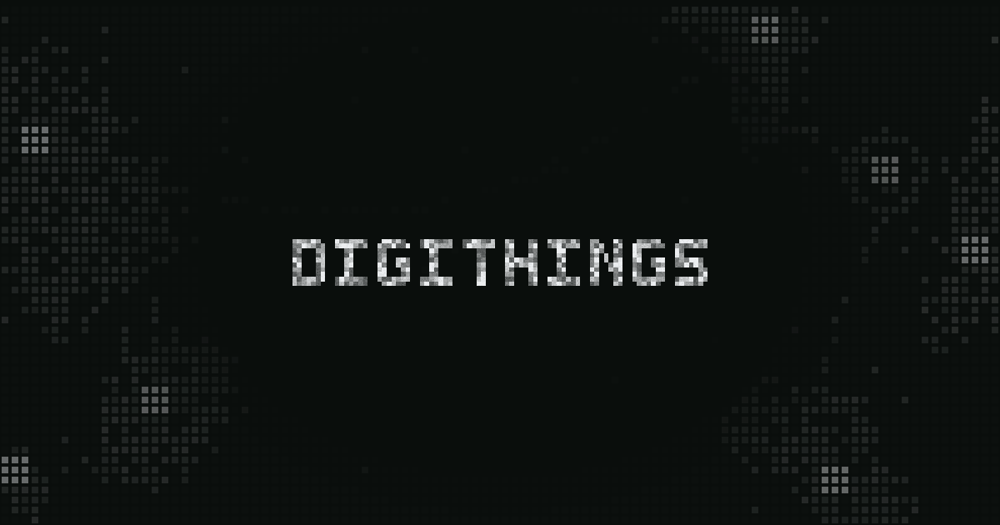
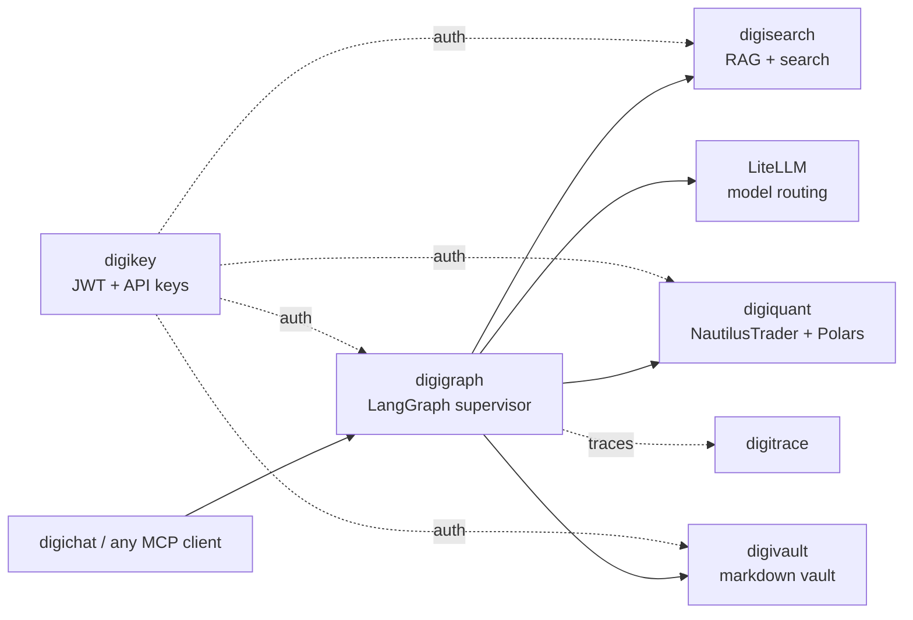

<p align="center">
  <a href="https://digithings.ai">
    
  </a>
</p>

<p align="center">
  <b>Self-hosted, MCP-first agent stack.</b> Chat in, agents out: orchestration, RAG, quant research and auth you run on your own machine.
</p>

<p align="center">
  <a href="./LICENSE"></a>
  <a href="https://www.python.org/downloads/"></a>
  <a href="https://modelcontextprotocol.io"></a>
  <a href="./CONTRIBUTING.md"></a>
</p>

<p align="center">
  <a href="#quick-start">Quick start</a> ·
  <a href="#modules">Modules</a> ·
  <a href="docs/SELF_HOST.md">Self-hosting</a> ·
  <a href="ARCHITECTURE.md">Architecture</a> ·
  <a href="CONTRIBUTING.md">Contributing</a>
</p>

---

## What is digithings?

digithings is a modular platform for building **conversational agents that research, search, analyze and act**. You send a chat message. A LangGraph supervisor picks the tools, queries your RAG index, runs a backtest or drives your own workflow, and answers with structured output.

Every module is a small service with its own MCP server, so you can run the whole stack or just the piece you need, from Claude Desktop, Cursor or your own client.

## Why digithings

- **MCP-first.** Every capability is a discoverable MCP tool. digigraph orchestrates them; any MCP client can call them directly.
- **Yours to run.** Docker Compose on one machine, no vendor lock-in. Services bind to `127.0.0.1` by default.
- **Any model.** Routing goes through LiteLLM, so OpenRouter, OpenAI, Anthropic, Ollama and free-tier providers all work. See [docs/LLM_PROVIDERS.md](docs/LLM_PROVIDERS.md).
- **Typed end to end.** Pydantic v2 models on every boundary, no dicts over the wire.
- **Real quant engine.** NautilusTrader (Rust core) and Polars for backtests and optimization, with a human gate before anything touches a broker.
- **Auth built in.** digikey issues JWTs and scoped API keys for every service and MCP edge.

## Quick start

Requires Docker with Compose v2, `make`, and one LLM API key ([OpenRouter](https://openrouter.ai) is the default; see [docs/providers/](docs/providers/README.md) for the others).

```bash
git clone https://github.com/digithings-ai/digithings.git
cd digithings
cp .env.example .env        # set OPENROUTER_API_KEY
make up                     # core stack: digigraph, digisearch, digiquant, digikey, digitrace, LiteLLM
make up-digichat            # optional: chat UI at http://127.0.0.1:3005
```

Send your first request to the orchestrator:

```bash
curl -s -X POST http://127.0.0.1:8000/workflow \
  -H "Content-Type: application/json" \
  -d '{"prompt":"Build me a mean-reversion stat-arb on tech","session_id":"hello"}' \
  | python3 -m json.tool
```

Every FastAPI service serves Swagger at `http://127.0.0.1:<port>/docs`.

<details>
<summary><b>Other ways to run it</b></summary>

| Goal | Command |
|---|---|
| Use prebuilt images from GHCR (no local build) | `make pull-ghcr && make up-ghcr` |
| Chat UI with hot reload against a running stack | `make up` then `make digichat-dev` (port 3000) |
| Python services without Docker | `make stack-local`, stop with `make stack-local-stop` |
| Stop everything | `make down` |

Full guide: [docs/SELF_HOST.md](docs/SELF_HOST.md).

</details>

## How it fits together



Details, interfaces and data flow: [ARCHITECTURE.md](ARCHITECTURE.md).

## Modules

### Services

| Module | What it does | Port | Docs |
|---|---|---|---|
| **digigraph** | LangGraph orchestration, OpenAI-compatible chat API | 8000 | [architecture](digigraph/ARCHITECTURE.md) |
| **digiquant** | Backtest and optimize on NautilusTrader, Polars only | 8001 | [architecture](digiquant/ARCHITECTURE.md) |
| **digisearch** | RAG, ingestion and document search (Chroma or Azure AI Search) | 8002 | [architecture](digisearch/ARCHITECTURE.md) |
| **digitrace** | OTLP tracing helpers and a status API | 8003 | [architecture](digitrace/ARCHITECTURE.md) |
| **digivault** | Obsidian-style markdown vaults: frontmatter, wikilinks, backlinks | 8004 | [architecture](digivault/ARCHITECTURE.md) |
| **digikey** | JWT exchange and scoped API keys | 8005 | [readme](digikey/README.md) |
| **digichat** | Next.js chat UI and BFF | 3005 | [readme](apps/digichat/README.md) |
| **LiteLLM** | Model routing and caching | 4000 | [config/MODELS.md](config/MODELS.md) |

### Libraries and tools

| Module | What it does | Docs |
|---|---|---|
| **digillm** | Provider-agnostic LLM client and routing | [architecture](digillm/ARCHITECTURE.md) |
| **digifetch** | Shared web fetch and headless scraping engine | [architecture](digifetch/ARCHITECTURE.md) |
| **digibase** | Shared HTTP and audit library | [readme](digibase/README.md) |
| **digibot** | Heartbeat, audit and an MCP skill for digigraph | [readme](digibot/README.md) |
| **digiskills** | Compile a repo into an Agent Skill package | [architecture](digiskills/ARCHITECTURE.md) |
| **digivoice** | Local dictation and speech tools | [readme](digivoice/README.md) |
| **digidev** | Drop-in agentic coding workflow kit | [readme](digidev/README.md) |

JavaScript packages live in [`packages/`](packages/) (`@digithings/ui`, `@digithings/design`, `@digithings/digichat-ui`, `@digithings/hero-banner` and more) and terminal clients in [`clients/`](clients/).

All services bind to `127.0.0.1`. For remote access use Tailscale or Cloudflare Tunnel, never a public port. See [SECURITY.md](SECURITY.md).

## Development

```bash
make test-unit   # unit tests
make test-e2e    # end-to-end, needs `make up`
make test        # both
```

Python 3.12+, ruff and strict typing. Each module's `ARCHITECTURE.md` is the contract for that module; read it before changing one. AI coding agents start at [AGENTS.md](AGENTS.md).

## Contributing

Bug reports, docs fixes and PRs are welcome. For questions and bug reports see [SUPPORT.md](SUPPORT.md). Read [CONTRIBUTING.md](CONTRIBUTING.md) before opening a PR; PR titles follow Conventional Commits with a module scope, for example `fix(digisearch): ...`.

Please report security issues privately, as described in [SECURITY.md](SECURITY.md), not in a public issue. Everyone taking part is expected to follow the [Code of Conduct](CODE_OF_CONDUCT.md).

## License

[MIT](LICENSE). The digithings name and logo are trademarks; see [TRADEMARKS.md](TRADEMARKS.md). Third-party licenses are listed in [docs/LICENSING.md](docs/LICENSING.md). Release notes are in [CHANGELOG.md](CHANGELOG.md).
