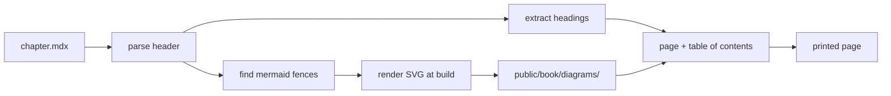

Every chapter is one `.mdx` file under `content/book`. It opens with a header
that says three things — the title, the order, and a one-paragraph summary —
and the rest is ordinary prose with ordinary markdown.

## The pipeline

There are four steps and one of them is the only place a diagram is ever
rendered.

## The one-address rule

A diagram's name is a hash of its source. That hash decides two paths, and both
are produced by the same function:

- the **URL** the page renders — `/book/diagrams/<id>.svg`
- the **file** the build writes — `public/book/diagrams/<id>.svg`

Because there is a single address, the page you read on screen and the page
that comes out of the printer load the same object. There is no second render
and no opportunity for the two to drift.

Editing a diagram changes its source, which changes the hash, which changes the
address. A stale diagram cannot survive under an old name.

### Why not render in the browser

A browser-side renderer would be less code and would give a sharper image at
every zoom level. It would also give two different things: the screen would show
a live render and the print would show whatever the print pipeline could
recreate. For a book, the printed copy is the one that is still readable in ten
years, and it should not depend on a client bundle staying alive.

### Why a plain image

The rewritten chapter contains an ``, not a component. An image needs no
client code, prints identically under any paginating engine, and is readable by
a screen reader through its alt text. The caption is the alt text, so the two
say the same thing.

## Headings and anchors

Each heading gets one id: a slug of its own words. There is no author-chosen
form, because MDX reads `{` as the start of an expression and a heading
carrying `{#custom}` fails to compile — which was measured, not assumed.

Repeated headings get a `-2` suffix in document order, so two sections called
`Notes` produce two working entries rather than one link that jumps to the
wrong place.

The table of contents holds only levels two to four. A level-one heading is the
chapter title, which the page already shows, and anything deeper is a clause
that would turn the rail into a wall of links.