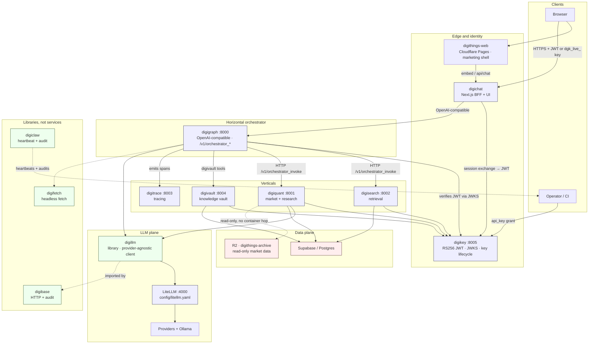
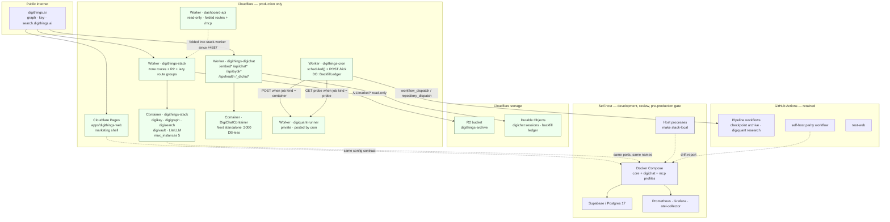
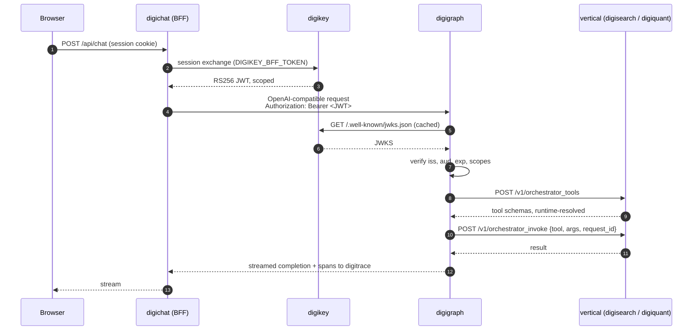

This chapter describes the digithings stack **as it ships in this release**. Every
statement here was read off the tree at commit `c326332bd` on `develop`, not
inferred from a design document. Where the code and the documentation disagree,
the disagreement is recorded in [§2.10](#210-where-the-code-and-the-docs-disagree)
and carries its own ticket; nothing in this chapter is "fixed" here.

**How to read this chapter.** digithings has two deployment variants that read
*the same* configuration contract: a **self-hosted** stack (Docker Compose and
local processes) and a **hosted** stack on Cloudflare. Cloudflare is production
only — there is deliberately no hosted development stack, because it would
duplicate infrastructure cost. Development, review and verification happen
self-hosted, and self-hosting is the **pre-production gate**: interfaces, MCP
servers and APIs are verified fully connected locally before anything is
deployed. Chapter 2 therefore starts with the module map, because the module map
is identical in both variants; only the process supervisor changes.

Diagrams are Mermaid source. On the website they render to zoomable SVG; in the
PDF export they are printed as-is. All code, identifiers and diagram labels are
typeset in **Geist Mono**.

---

## 2.1 The architecture in one paragraph

digithings is an **open-core modular agentic stack** for conversational agents
that research, search, analyse and act, with a flagship vertical in quantitative
finance. A horizontal orchestrator (**digigraph**) accepts OpenAI-compatible
requests, authenticates them against **digikey**, resolves which vertical tools
it needs at runtime, and calls into vertical services (**digisearch** for
retrieval, **digiquant** for market data and execution research) over plain HTTP
and MCP. Cross-cutting libraries — **digillm** for LLM access, **digitrace** for
tracing, **digibase** for HTTP and audit, **digifetch** for headless web
fetching, **digiclaw** for heartbeat and audit — are libraries, not services.
**digivault** is a markdown knowledge vault. The user-facing surface is
**digichat**, a Next.js BFF that performs the session exchange and never speaks
to a vertical directly. In production the Python tier is packaged into Cloudflare
Containers behind Cloudflare Workers; the scheduled work that used to live in
GitHub Actions cron now lives in a Cloudflare Worker.

The design philosophy, quoted from the root `ARCHITECTURE.md`:

> **MCP-first.** **Federated hub.** **Loopback-only by default.**

Those three sentences decide almost every question in this chapter.

---

## 2.2 Module map and module interaction

### 2.2.1 The three kinds of module

Most misunderstandings of this architecture come from reading all the module
names as if they were the same kind of thing. They are not.

| Kind | What it is | Modules |
| --- | --- | --- |
| **Services** | Long-running network processes with an HTTP or MCP surface | digigraph, digisearch, digiquant, digikey, digivault, digitrace, digichat |
| **Libraries** | Importable packages. No port, no container, no health endpoint | digillm, digibase, digifetch, digiclaw |
| **Frontends and platform** | User-facing apps and deployment scaffolding | `apps/dashboard`, `apps/digichat`, `apps/digichat-cloudflare`, `apps/digithings-cron`, `apps/digithings-stack-cloudflare`, `apps/dashboard-api` |

`digibase` is the clearest illustration: its own vision document states it is
"a shared Python library … imported as a library — not deployed as a service."
A search for `digibase` on a port number will always return zero.

### 2.2.2 Service topology

| Module | Port (HTTP) | Port (MCP) | Role |
| --- | --- | --- | --- |
| digigraph | 8000 | 8766 | Horizontal orchestrator. OpenAI-compatible `/v1/chat/completions`. The hub. |
| digiquant | 8001 | 8767 | Vertical: quantitative research, backtests, NautilusTrader. |
| digisearch | 8002 | 8765 | Vertical: retrieval / RAG. Requires a real vector backend to start. |
| digitrace | 8003 | — | Trace store plus `/v1/status`. Unauthenticated on purpose. |
| digivault | 8004 | 8769 | Markdown knowledge vault (Obsidian-style frontmatter and wikilinks). |
| digikey | 8005 | — | Authentication. RS256 JWTs, JWKS, key issue/revoke. |
| LiteLLM | 4000 | — | Routing proxy for LLM providers. Not a digithings module. |
| digichat | 3005 local / 3000 in the Container | — | Next.js BFF and UI. |
| digichat-db | 5433 | — | Postgres 16. Local profile only; see [§2.6](#26-data-plane). |
| Ollama | 11435 → 11434 | — | Optional local model runtime. |

Every service binds `127.0.0.1` by default. Remote access requires Tailscale or
a Cloudflare Tunnel. "Loopback-only by default" is a security property, not a
deployment inconvenience: it is why exposing `graph.digithings.ai` in [§2.5](#25-the-cloudflare-stack)
was an owner decision with a recorded gate rather than a default.

### 2.2.3 Module interaction diagram



Read it for four things:

1. **digichat never calls a vertical.** It calls digigraph. Every vertical
   capability is reachable only through the hub from the UI.
2. **digikey is on every service-to-service edge**, not just the client edge.
   A service that trusts the hub without verifying the JWT is a defect, not a
   shortcut.
3. **digillm is a library, so it has no edge into the topology from outside.** It
   is drawn dotted because it never listens.
4. **R2 is read-only and is read by the Worker**, not by a container process.
   See [§2.6](#26-data-plane).

### 2.2.4 What is not shipped

`digilink` and `digistore` are named in `docs/VISION.md` and have **no directory
in the tree**. The vision documents are honest about this — `digillm` and
`digifetch` "have shipped as standalone open-core libraries, while `digilink` …
and `digistore` … remain designed-but-unshipped" — and `docs/vision/README.md`
carries a matching "not yet shipped" note. They are specced, not built, and this
chapter does not pretend otherwise. The no-lock-in promise ("every capability
exposed as REST endpoint, MCP tool, CLI command, and Docker container via
digilink") is therefore currently delivered in three of four forms.

---

## 2.3 Deployment variants

### 2.3.1 The configuration contract

Both variants read the **same env var names, the same service URL/port schema
and the same secrets manifest**. A variant supplies *values*, never a *name*.
This is the single rule that makes "self-host is a reference for Cloudflare" a
testable claim rather than an aspiration, and CI parity checks fail on drift.

### 2.3.2 Self-host: the pre-production gate

Self-host runs under Docker Compose or as local host processes. Compose
profiles that exist today:

| Profile | Starts |
| --- | --- |
| *(core, unprofiled)* | `digikey-blocklist-redis`, `digikey`, `ollama`, `digitrace`, `digigraph`, `digiquant`, `digisearch`, `searxng`, `valkey`, `litellm` |
| `digichat` | `digichat-db` (Postgres 16), `digichat` |
| `digivault` | `digivault` |
| `digisearch-mcp`, `digivault-mcp`, `zammad-mcp` | the in-container MCP servers on :8765 / :8769 / :8770 |
| `omniroute` | `omniroute`, `omniroute-auth-guard` (:20128) |
| `litellm-cache` | Redis for LiteLLM caching |
| `heartbeat` | the digiclaw heartbeat (`make up-heartbeat`) |
| `observability` | Prometheus, Grafana |
| `otel` | otel-collector |

There are four local run paths, and they are not interchangeable:

| Path | Command | What it is |
| --- | --- | --- |
| **A** | `make up` | Compose core. digikey in a container on :8005. The default. |
| **A′** | `make digichat-profile-a-bundle-up` | One supervisord container instead of N services — **local parity with the Cloudflare Container**. |
| **B** | `make stack-local` | Host Python processes via `scripts/run_stack_local.sh`, same ports 4000 and 8000–8005. Fastest edit-run loop. |
| **C** | `docker compose --profile digichat up -d` | digichat in Docker with `DIGIKEY_URL=http://digikey:8005`. |

For day-to-day digichat work, `make digichat-dev` on the host keeps hot reload.

### 2.3.3 Deploy topology diagram



Two things in that diagram are worth reading twice.

**The crons moved, and what stayed behind.** Production clocks now live in the
`digithings-cron` Worker. `scheduled()` returns in seconds — it fires
`workflow_dispatch` or `repository_dispatch` at the private digiquant-runner when
the job kind is `container`, or fetches a public probe URL when it is `probe`,
and `waitUntil` covers the POST. A cron that the Worker does not recognise raises
an `unrecognised_cron` alarm rather than passing silently, and the required set is
checked against the **deployed** trigger list, not against `wrangler.toml`. Four
GitHub Actions workflows still carry a `schedule:` — the digiquant pipeline, the
checkpoint-archive pipeline, the self-host parity check and `test-web` — because
those are *pipelines and verifications*, not production clocks. "All crons moved
to Cloudflare" is the wrong sentence; "production clocks moved, pipelines stayed"
is the right one.

**Nothing deploys the two Cloudflare stacks from CI.** `wrangler deploy` appears
in exactly two workflows: the digiquant-runner deploy, and
`build-cloudflare-workers.yml`, which runs `wrangler deploy --dry-run` (and
`--containers-rollout=none`). `digithings-stack` and `digichat-cloudflare`
therefore ship out-of-band. See finding **F3**.

---

## 2.4 Request flow

### 2.4.1 A chat request, end to end



Three properties in that exchange are load-bearing.

**The hub does not hard-code vertical tool schemas.** It asks at runtime
(`POST /v1/orchestrator_tools`) and invokes by name
(`POST /v1/orchestrator_invoke` with `\{tool, args, request_id\}`). Adding a tool
to a vertical does not require a digigraph release. `DIGI_HUB_MODE=federated`
(the default) selects the alias delegate names; `legacy` selects the older set.

**Auth is one mechanism, used twice.** A client holds a `dgk_live_` key and
exchanges it at `POST /v1/oauth/token` with `grant_type: api_key`; digikey
bcrypt-verifies it, signs an RS256 JWT and returns `\{access_token,
litellm_proxy_api_key, expires_in\}`. Services then validate that JWT through
`DigiAuthMiddleware`, which fetches `/.well-known/jwks.json` and checks issuer,
audience `digi-ecosystem`, expiry and scopes. When
`DIGIKEY_LITELLM_PROXY_KEY` equals LiteLLM's admission secret, the same response
can carry `litellm_proxy_api_key`, and digichat forwards it as
`X-LiteLLM-Proxy-Key`. The LLM credential is therefore minted by the identity
service, not stored in a service.

**Cohesion is not optional.** A protected service expects
`DIGIKEY_JWKS_URL` (or `DIGIKEY_PUBLIC_KEY_PEM`) plus a scoped
`Authorization: Bearer <JWT>`. digichat uses `DIGIKEY_URL` +
`DIGIKEY_BFF_TOKEN` for the session exchange. The phrase in the reference is the
right one: "not silent anonymous access to the hub". The minimal scope sets for
common local-dev roles are tabulated in the self-host reference — the
hub-plus-quant-plus-search set is `digigraph:workflow`, `digigraph:chat`,
`digiquant:backtest`, `digiquant:optimize`, `digisearch:query`, plus
`digisearch:ingest` when seeding a corpus.

### 2.4.2 Auth-exempt paths

A short, closed list is exempt from digikey: `/health`, `/healthz`, `/metrics`,
`/docs`, `/redoc`, `/openapi.json`; `OPTIONS` preflights; `/_stack/meta`;
`/v1/market/tickers` and `/v1/market/closes`; and `/_stack/key/*`. Everything
else needs a token. Note that `/_stack/mcp/*` is **not** on that list — see
[§2.7](#27-the-mcp-surface).

---

## 2.5 The Cloudflare stack

Production is Cloudflare: Workers for the edge, **Containers** for the Python
tier, R2 for object storage, Durable Objects for state.

### 2.5.1 Workers and their containers

| Worker | Backs with | Notes |
| --- | --- | --- |
| `digithings-stack` | one multi-process **Container** (digikey, digigraph, digisearch, digivault, LiteLLM) | The hub Worker. Owns the zone routes for graph/key/search, the R2 market-data read path, the secret-gated MCP edge and — since #4687/#4689 — the folded `dashboard-api` and digichat routes. |
| `digithings-digichat` | a dedicated **Container** running Next standalone on :3000 | Seven zone routes on `digithings.ai`. Deliberately **DB-less**. |
| `dashboard-api` | — | Central read-only dashboard API. Folded into the stack Worker since #4687; the standalone worker stays deployed until cutover. |
| `digithings-cron` | Durable Object `BackfillLedger` + a counter DO | `scheduled()` and `POST /kick`. |
| `digiquant-runner` | private | Posted to by the cron Worker, never public. |

Public hostnames: `digithings.ai` (the Cloudflare Pages marketing shell built
from `apps/digithings-web/`), and `graph.digithings.ai` → digigraph:8000,
`key.digithings.ai` → digikey:8005, `search.digithings.ai` → digisearch:8002.
`mcp.digithings.ai` is **reserved and not routed**; the route is enabled only
behind its JWT gate, and an unauthenticated `/_stack/mcp/*` forwarder must not go
live.

### 2.5.2 The hub Worker's route discipline

Three properties of `apps/digithings-stack-cloudflare/src/index.ts` are worth
naming because they are what make a partial outage survivable.

1. **Every route group is a lazy `import()`.** A port that fails to answer
   degrades that route group; it does not kill the Worker. `/_stack/meta` is
   deliberately the loader that stays up when every other group is degraded.
2. **Isolation groups split the folded surfaces.** `dashboard-api` routes and
   digichat routes run behind their own isolation groups, proxied to the
   digichat Container with the standalone worker's own `shouldProxyToDigiChat`
   path predicate. Auth for those digichat paths stays **in the container**;
   there is no edge gating on them.
3. **Loopback is preserved where it matters.** Inside the Container the
   zammad/digisearch/digivault MCP servers bind `0.0.0.0` only because the edge
   routes need them, and **LiteLLM stays loopback-only**. digisearch also binds
   `0.0.0.0:8002` so the Worker can reach it at the container network address,
   while in-container callers keep using `http://127.0.0.1:8002`.

### 2.5.3 digichat in production is DB-less

`DIGICHAT_DATABASE_URL` is **deliberately not forwarded** to the digichat
Container. The consequence is concrete: digichat falls back to localStorage and
`/api/health` reports `database: skipped`. An Env/envVars parity test pins that
absence, so enabling Postgres is a four-part change — the secret, the `Env`
member, the `envVars` entry, and removing it from the test's
`DOCUMENTED_NOT_FORWARDED` list. Anyone planning a persistence feature against
digichat in production is planning against localStorage until they make all four.

The same wrangler file pins two more production facts: the anonymous legacy embed
is off by default (`DIGIKEY_LEGACY_EMBED_ENABLED` is opt-in), and
`DIGICHAT_ENABLED_SERVICES = "digigraph"` — because digisearch and digivault are
loopback inside `digithings-stack`, digichat must not probe them, as the defaults
are unreachable from the digichat Container.

---

## 2.6 Data plane

### 2.6.1 What stores what

| Store | Holds | Reached by |
| --- | --- | --- |
| **Supabase / Postgres** | research graphs, portfolio theses, vault rows | digibase, digiquant, digivault (exactly these three declare the dependency) |
| **Postgres 16** (`digichat-db`, :5433) | digichat sessions and messages, self-host only | digichat; **not forwarded in the Cloudflare Container** |
| **R2** (`digithings-archive`) | historical market data | the stack Worker's `MARKET_DATA` binding, `/v1/market/*` |
| **digivault** | markdown knowledge: YAML frontmatter, `[[wikilinks]]`, backlinks, tags | digivault, via the hub's vault tools |
| **digitrace** | spans and traces | every module that instruments |
| **Langfuse** (`apps/digitrace-langfuse`) | LLM observability | in the repository, **not deployed** |

### 2.6.2 The R2 read path is a Worker feature, not a container feature

`MARKET_DATA` is a binding on the `digithings-stack` Worker, and
`DIGIQUANT_MARKET_DATA_BACKEND = "r2"` selects the backend inside the stack. The
`/v1/market/tickers` and `/v1/market/closes` routes are served **from the
binding, with no container hop**, and they are the reason those two paths are
auth-exempt: they read an archive, they mutate nothing. Anything that needs
write access to market data is not on this path.

### 2.6.3 digivault is the memory layer, not a database

digivault is an Obsidian-style markdown vault for the monorepo's own
documentation: files with YAML frontmatter, `[[wikilinks]]`, backlinks, tags and
a folder taxonomy, served over HTTP on :8004 with an MCP face on :8769. Its
first consumer is the project's own docs migrated into a managed vault. It is
also where the digillm audit notes live. This is a deliberate choice — knowledge
that lives in a git-tracked, human-readable format is inspectable without a
database dump.

---

## 2.7 The MCP surface

MCP is exposed **twice**, and choosing between them is a design decision with a
documented answer.

| Path | Use it when | Shape |
| --- | --- | --- |
| **Hub MCP** (digigraph :8766) | you want one allowlist and one unified trace | the hub mediates every call, so the per-tool allowlist and the trace are in one place |
| **Direct vertical MCP** (digisearch :8765, digiquant :8767, digivault :8769, zammad :8770) | you deliberately want to bypass the hub | the vertical answers for itself |

And the answer that surprises people: **for normal chat, digigraph uses HTTP, not
MCP**, to reach verticals. It resolves schemas through
`/v1/orchestrator_tools` and invokes through `/v1/orchestrator_invoke`. MCP is
the right tool when you want the hub's allowlist and trace, or when you want to
bypass the hub — not because the hub happens to speak it.

### 2.7.1 The secret-gated edge

Three MCP servers are published at the edge under `/_stack/mcp/<server>/…`:
`zammad` (:8770), `digisearch` (:8765), `digivault` (:8769). The gate requires
the `x-digi-mcp-key` header to match a secret, and it **fails closed with 401**.
Per-server keys in `MCP_EDGE_KEYS` (JSON) win over the shared `MCP_EDGE_KEY`.

Note what this gate is *not*. It is **not** digikey auth — it is a shared-secret
check at the Worker. `/_stack/mcp/*` is therefore not on the auth-exempt list,
and it is a second, distinct credential from the JWT a client uses for the hub.
Managing two credentials for the same stack is a known sharp edge; treat the
secret-gated edge as an operator surface, not a developer convenience.

---

## 2.8 The LLM plane: digillm to LiteLLM

The chain is **three layers, one responsibility each**.

```
digigraph / digiquant / digisearch
        │  import (library, no port)
        ▼
     digillm          provider-agnostic OpenAI-compatible client:
                      routing, retry, cache, tools, structured output
        │  OPENAI_API_BASE (LiteLLM is the house upstream swap layer)
        ▼
     LiteLLM :4000    routing proxy, aliases + fallback chains,
                      budgets per alias
        │
        ▼
     providers        Google AI Studio · Groq · Cerebras · OpenRouter ·
                      Cloudflare Workers AI · Mistral · SambaNova ·
                      Nvidia NIM · Ollama / local
```

**digillm is the single home for LLM client code.** It is a standalone,
provider-agnostic library extracted from the mature `digigraph.llm`
implementation. It has no vendor preference, no FastAPI coupling and no hard
dependency on digitrace. Its non-negotiables are Python 3.12, Pydantic v2, ruff
line-length 100, and hard dependencies of only `openai>=1.0` and `pydantic>=2`.

**LiteLLM owns routing.** All LLM traffic goes through `config/litellm.yaml`,
where each `model_name` alias (`test`, `medium`, `best`, `coding`, `vision`,
`embeddings`) maps to one or more `litellm_params.model` entries with fallbacks
on the same alias, so a rate-limited free provider degrades into the next one
instead of failing the request. `DIGI_LLM_MODE` selects the tier; budgets enforce
monthly caps per alias and `best` requires explicit opt-in; routed calls are
logged through `digibase.audit.redact_mapping` so secrets never persist in the
audit trail.

**One migration is in flight.** The vision documents describe digillm as the
destination digigraph and digisearch *will* migrate to. The tree is further
along than that: digigraph imports digillm in **17 modules** and declares
`digillm>=0.1.0` in its `pyproject.toml`; digisearch imports it in 7 and
digiquant in 12. The in-tree `digigraph/src/digigraph/llm_\{client,auth,errors\}.py`
modules still exist, so digillm currently sits *beside* the old modules rather
than replacing them. See finding **F5** — the code is further along than the doc,
and somebody has to say which is authoritative before the book quotes either.

**Subscriptions are not API access.** Claude Pro/Max, ChatGPT Plus and Cursor
Pro do not give API access; GitHub Models was retired on 2026-07-30. This is
worth stating in a book aimed at readers who are about to buy a subscription to
try digithings.

---

## 2.9 Auth plane: digikey

One sentence: **digikey authenticates every service-to-service and
user-to-service call in the stack.**

- **Key issue and revoke.** `POST /v1/admin/keys` with `DIGIKEY_ADMIN_TOKEN`, or
  `python -m digikey.cli issue-key`. Local development can use
  `DIGIKEY_ALLOW_EPHEMERAL_KEY=1`.
- **Exchange.** `POST /v1/oauth/token` with `grant_type: api_key` returns an
  RS256 JWT plus, conditionally, `litellm_proxy_api_key`.
- **Verify.** Services fetch `/.well-known/jwks.json` and check issuer
  `http://digikey:8005`, audience `digi-ecosystem`, expiry and scopes.
- **Scopes are per-component.** `digigraph:workflow`, `digigraph:chat`,
  `digiquant:backtest`, `digiquant:optimize`, `digisearch:query`,
  `digisearch:ingest` — a granted `component:*` covers its children, never the
  reverse.
- **Never open.** digisearch, in particular, **refuses to start without a real
  vector backend**. A compliance-critical route mounted on the retrieval app
  would silently make the retrieval deploy story depend on a RAG dependency, so
  the RAG requirement stays where it belongs.

---

## 2.10 Where the code and the docs disagree

Five divergences were found while writing this chapter. Each is filed as its own
ticket under the DigiBook epic with the prefix `DigiBook finding:` and links back
to the section that surfaced it. **None is fixed in the chapter PR** — the
chapter's job is to report the state of the system accurately, including the
places where documentation has drifted from the tree.

| # | Ticket | Divergence | Where the doc says | What the tree does | Section |
| --- | --- | --- | --- | --- | --- |
| **F2** | DIG-2842 | Digichat's Cloudflare Containers scaffold described as removed | `docs/DEPLOYMENT.md:152-153`: the scaffold "was removed on 2026-08-06 — it had no deploy path in the repo (Containers need Workers Paid, digithings is on Free; routes stayed commented out and no workflow built the image)" | Both `apps/digichat-cloudflare/` and `Dockerfile.digichat-cloudflare` exist; the wrangler header says "Cloudflare Containers (Workers Paid)"; the Worker owns 7 live routes on `digithings.ai` | [§2.5](#25-the-cloudflare-stack) |
| **F3** | DIG-2843 | No CI lane deploys the two Cloudflare stacks | Readers reasonably infer CI ships production | `wrangler deploy` appears only in `deploy-digiquant-runner.yml` (real) and `build-cloudflare-workers.yml` (`--dry-run`). `digithings-stack` and `digichat-cloudflare` ship out-of-band | [§2.3](#23-deployment-variants) |
| **F4** | DIG-2844 | Provider catalog "updated automatically, the provider-review workflow runs every Monday" | `docs/LLM_PROVIDERS.md:231` and `:13` | `pipeline-provider-review.yml` says "Production clock: Cloudflare Worker digithings-cron. Schedule removed #3579." and is `workflow_dispatch`-only. The cadence is the Worker's, and the doc does not say so | [§2.8](#28-the-llm-plane-digillm-to-litellm) |
| **F5** | DIG-2845 | digillm described as a future migration for digigraph | `docs/vision/digigraph.md:58` "…to which digigraph migrates"; `docs/vision/README.md:45` "migrating to" | digigraph imports digillm in 17 modules and declares `digillm>=0.1.0`; the in-tree `llm_client.py` / `llm_auth.py` / `llm_errors.py` still coexist | [§2.8](#28-the-llm-plane-digillm-to-litellm) |
| **F7** | DIG-2846 | digichat "not deployed publicly yet" | `docs/vision/README.md:54`, `docs/vision/digichat.md:74`: "the digithings.ai instance described above still runs a separate bespoke widget (direct OpenRouter calls, its own Supabase vault search) rather than this app" | The live `digithings-digichat` Worker owns `/embed*`, `/api/chat*`, `/api/embed*`, `/api/byok*`, `/api/plan-proof*`, `/api/health`, `/_dtchat*` | [§2.5](#25-the-cloudflare-stack) |

Two candidate findings were investigated and **withdrawn** before filing,
because the documentation turned out to be honest and the shared checkout
stale:

- `docs/SELF_HOST.md` is a named source in the chapter brief and does not exist
  in the stale checkout — but it **does** exist at the develop tip (added by
  #5357), 31 KB, and it is the authoritative self-host reference.
- `digilink` and `digistore` have no directory, but `docs/VISION.md` says so in
  as many words ("designed-but-unshipped"), so it is a documented state rather
  than a divergence.

The lesson generalises past this chapter: **a documentation finding measured in
a stale checkout is a finding about the checkout.** Both false positives above
came from the shared `~/Code/digithings` working tree being behind `develop`.

---

## 2.11 Decision notes

Each design question below got a decision and a reason. The reason matters more
than the decision: a reader who disagrees with the reason can predict when the
decision should change.

### D1 — Cloudflare is production only; self-host is the pre-production gate

**Decision.** Two first-class variants. Hosted = Cloudflare (production).
Self-host = Docker Compose and local processes (the reference variant).

**Reason.** "There is no hosted development stack, because it would duplicate
infrastructure cost. Development, review and verification happen self-hosted."
The cost of a second full stack is real, and a self-host that cannot run the
real interface cannot be a gate. This is why the digichat production deployment
is DB-less and why the self-host path exists at all.

### D2 — One configuration contract, two variants

**Decision.** Both variants read the same env var names, port schema and secrets
manifest. A variant supplies values, never a name.

**Reason.** If a variant could introduce a name, "self-host is a reference for
Cloudflare" becomes unverifiable prose. CI parity checks fail on drift — and
`docs/SELF_HOST.md` records honestly that drift exists today (variable names
differ between wrangler `[vars]`, Compose and `.env.example`).

### D3 — The hub resolves vertical tools at runtime

**Decision.** digigraph fetches schemas from `/v1/orchestrator_tools` and
invokes by name, instead of hard-coding vertical tool definitions.

**Reason.** Hard-coding couples the orchestrator's release cadence to every
vertical's feature cadence. A vertical shipping a new tool should not require a
hub deploy. `DIGI_HUB_MODE` keeps the legacy alias path available for the
transition.

### D4 — digillm is a library, LiteLLM is the swap layer

**Decision.** Application modules import digillm; digillm speaks to any
OpenAI-compatible endpoint; LiteLLM sits underneath as the house upstream swap
layer, selected by `OPENAI_API_BASE`.

**Reason.** Provider selection is an operational concern (quotas, cost caps,
fallback order); provider *access* is a code concern. Splitting them means
changing providers is a config edit, while changing how we call a provider is a
library edit. It also keeps digillm free of FastAPI coupling, which is what
makes it reusable by tools and scripts that are not services.

### D5 — digikey on every service-to-service edge

**Decision.** Services verify the JWT via JWKS rather than trusting a
forwarded identity from the hub.

**Reason.** Trusting the hop means one compromised internal path becomes
unauthenticated access to every vertical. The cost is a JWKS fetch and a cache;
the benefit is that the network path is not the security boundary.

### D6 — The MCP edge is a separate, secret-gated credential

**Decision.** `/_stack/mcp/<server>/…` is guarded by `x-digi-mcp-key`, fails
closed, and is not on the auth-exempt list. `mcp.digithings.ai` stays reserved
and unrouted.

**Reason.** MCP servers expose vertical capability directly, bypassing the hub's
per-tool allowlist. A JWT gate on the hub would be bypassed by construction, so
the edge needs its own credential. Reserving the hostname rather than routing it
keeps the option open without shipping an unauthenticated forwarder.

### D7 — Market data is served from R2 by the Worker, read-only

**Decision.** `/v1/market/tickers` and `/v1/market/closes` read the
`digithings-archive` binding in the Worker with no container hop, and are
auth-exempt.

**Reason.** It is a hot, read-only, public-shaped path; a container hop would add
latency and a failure mode for no benefit. Read-only is what makes the exemption
defensible: a write-capable path on the same exemption would not be.

### D8 — Digichat in production runs without a database

**Decision.** `DIGICHAT_DATABASE_URL` is not forwarded to the digichat
Container; `/api/health` reports `database: skipped`; an Env/envVars parity test
pins the absence.

**Reason.** A Container-bound Postgres brings a connection pool, a migration
path and a failure mode into the chat request path. The absence is pinned by a
test so that *enabling* it is a deliberate four-part change rather than an
accident.

---

## 2.12 Glossary

| Term | Meaning in digithings |
| --- | --- |
| **Hub** | digigraph. The horizontal orchestrator. |
| **Vertical** | A service that owns domain capability: digisearch (retrieval), digiquant (quant). |
| **Federated** | Verticals keep their own pipelines and tools; the hub orchestrates rather than absorbs. |
| **BFF** | Backend for frontend. digichat. Performs session exchange, then talks to the hub. |
| **Loopback-only** | Services bind `127.0.0.1`. Remote access needs Tailscale or a Tunnel. |
| **Profile A** | The one-Container shape: digikey + digigraph + digisearch + digivault + LiteLLM in a single Cloudflare Container. |
| **Self-host gate** | Verify interfaces, MCP servers and APIs fully connected locally before deploying. |
| **`dgk_live_`** | Prefix of a digikey API key. Exchanged for a JWT; never a session token. |
| **Config contract** | One set of names shared by both variants; variants supply values only. |

---

*Sources read at `digithings @ c326332bd` (develop, 2026-10-10): `ARCHITECTURE.md`,
`docs/VISION.md`, `docs/vision/README.md` and the per-module `docs/vision/*.md`,
`docs/SELF_HOST.md`, `docs/LOCAL_STACK.md`, `docs/DEPLOYMENT.md`,
`docs/LLM_PROVIDERS.md`, `docs/architecture/*`, the module `ARCHITECTURE.md`
files, `apps/digithings-stack-cloudflare/\{wrangler.toml,src/index.ts\}`,
`apps/digichat-cloudflare/wrangler.toml`, `apps/digithings-cron/src/index.ts`,
and the GitHub Actions workflow set.*