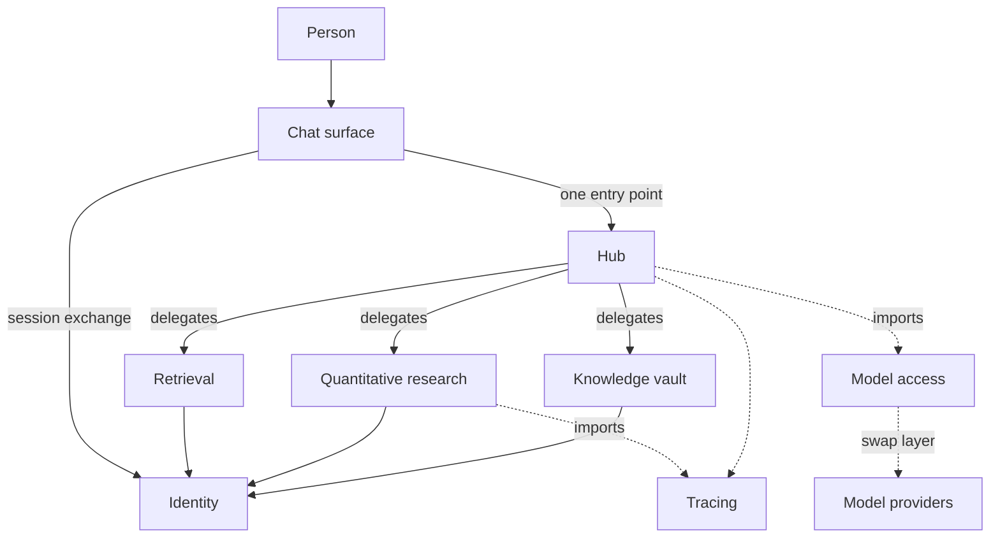

The diagram below is the whole system on one page. Three things in it are worth
naming, because most of the architecture follows from them.

**The surface talks only to the hub.** There is no path from the chat surface to
a vertical. This is deliberate and it costs something: a capability that needs to
be fast can be awkward to reach, because it now travels through a hop it does not
need. The benefit is that the hub knows every request that carries a user's
intent, so authorisation, rate limiting and tracing have one place to live instead
of one per vertical. In a system whose verticals are independently replaceable,
that single choke point is what makes replacement safe.

**Identity sits on every edge.** Not only the front door. When the hub calls a
vertical, the vertical checks the caller itself rather than trusting that the hub
already did it. This is more work per call and it removes an entire class of
problem: if any single internal path is ever compromised, it does not become
unauthenticated access to everything behind it. The network is not the security
boundary; each hop is.

**The model layer is a library.** It appears dotted because it never listens.
It is imported by the services that call models, and it sits on top of a routing
layer that decides which provider actually answers. That routing layer is
configuration, which is why changing provider later is not a code change.

The hub's shape also explains why it does not need to be redeployed when a
vertical gains a capability. The hub asks the vertical what it can do, at
runtime, and then asks it to do it. Adding a capability is a change to one
vertical, not a coordination between two.

The next section takes the same system and asks where it runs.
