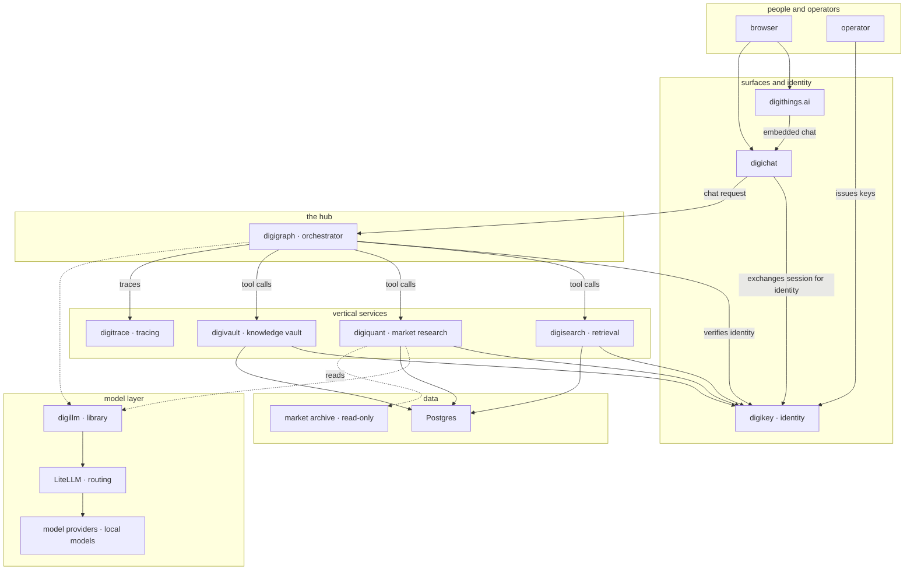

The diagram below is the whole system at the level of who calls whom. Solid
arrows are network calls between running services; dotted arrows are a library
being used inside a service, which crosses no network at all.

Read it for three things. First, **digichat never calls a vertical**. Every
capability the interface offers is reached through the hub, which means there is
one place that decides which tools a user may use, one place that records what
happened, and one interface to keep stable.

Second, **digikey sits on every service-to-service edge**, not only at the front
door. The verticals verify the caller's identity themselves instead of trusting
that a request from inside the network must be legitimate. The network path is
not the security boundary; identity is.

Third, **the model layer is a library**. digillm is drawn with dotted arrows
because it never listens for traffic. Services import it, and it talks to a
routing layer that can reach any provider. That keeps model choice out of the
service code entirely.

<Reference kind="API" href="/docs/api/" title="API reference">
  The interfaces of every service in this diagram, generated from the code.
</Reference>
