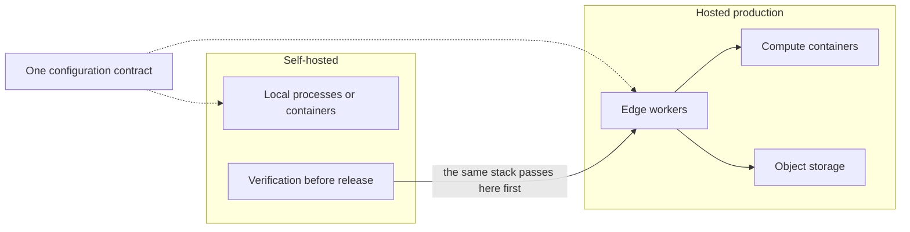

The same modules run in two places. On your machine, as a set of local processes
or containers that you start yourself. Hosted in production, built on Cloudflare
Workers and Containers. The code is the same. The contract that names things is
the same. A deployment supplies values; it never supplies names.

That last sentence is the important one, and it is what makes the second place
trustworthy. If the hosted deployment were allowed to invent its own names, then
running locally would test a different system, and a release would only ever be
tested against itself. Because both read one contract, what you verify locally
is what ships — provided the parity between them is actually checked, which is
what the self-hosting story below is for.

Self-hosting is therefore not a hobby mode. It is the pre-production gate.
Interfaces, capabilities and integrations are verified fully connected locally
before anything is deployed. The reasoning is cost, mostly: a second complete
hosted stack would duplicate infrastructure expense to buy very little, since a
local run already exercises every path that matters. What the hosted deployment
adds is scale, isolation and availability — not different software.

Scheduled work follows the same split. The clocks that run production jobs were
moved off the continuous-integration platform into the hosted runtime, because a
job that must not silently stop should not depend on someone keeping a pipeline
tab open. Continuous integration still owns what it is good at: building,
testing and verifying. The distinction is worth keeping straight, because
"all the scheduling moved" is not the same claim as "production clocks moved,
pipelines stayed".

> **Why digithings**
>
> Run it on your own hardware or run it hosted — the same product either way.
> The hosted path is priced on what you use, and no capability is locked to it.
> Self-hosting is not a trial; it is a supported mode of operation.

The next page follows a single request through the whole system.
