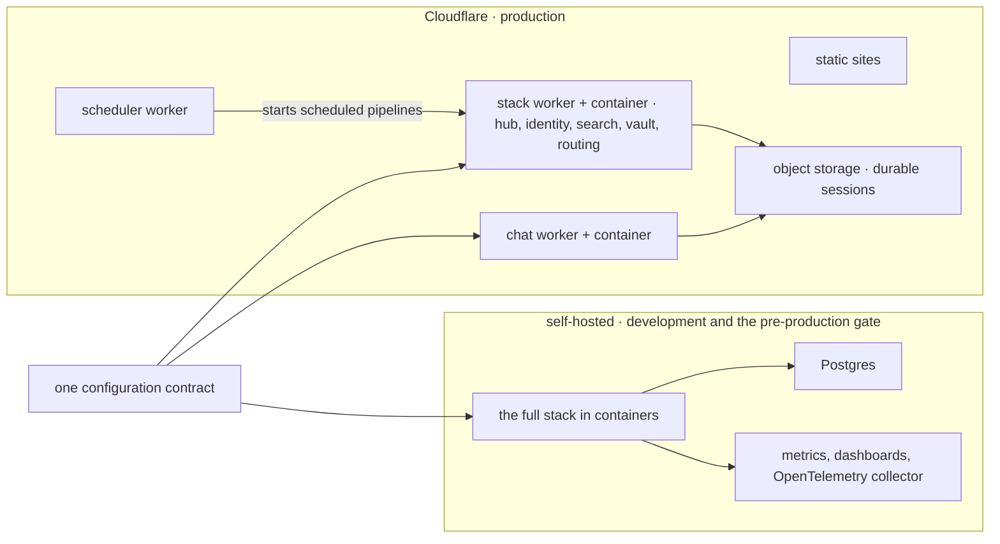

digithings has two first-class ways to run. The **self-hosted** stack runs on
your own machine or server with Docker Compose. The **hosted** stack runs on
Cloudflare, with the services packaged into containers behind Cloudflare
Workers. They are not two products. They are the same modules, reading the same
configuration contract, under two different process supervisors.

The self-hosted stack is not a lesser copy. It is the **pre-production gate**:
every interface, tool server and API is verified fully connected locally before
anything is deployed. There is deliberately no hosted development environment,
because a second hosted stack would double the infrastructure bill without
catching anything the local stack does not. Cloudflare is where production
lives; your machine is where everything is proven first.

The contract is the important part. Both variants read the same setting names
and the same service layout; a variant supplies values, never new names. That
is what makes "it worked locally" a meaningful statement about production, and
it is what lets you move between the two without rewriting anything.

> **Why digithings.** You choose where it runs. Self-host on a laptop or your
> own servers with no external dependency, or run it on Cloudflare, where
> Workers and Containers are billed on usage so cost follows traffic. The
> hosted path has no features the self-hosted path lacks.

<Reference kind="guide" href="repo:docs/SELF_HOST.md" title="Self-hosting guide">
  Requirements, configuration and the steps to run the full stack yourself.
</Reference>

<Reference kind="guide" href="repo:docs/LOCAL_STACK.md" title="Local stack guide">
  The development setup, profiles and seed data.
</Reference>

<Reference kind="reference" href="repo:docs/DEPLOYMENT.md" title="Deployment reference">
  How the hosted stack is built and shipped.
</Reference>
