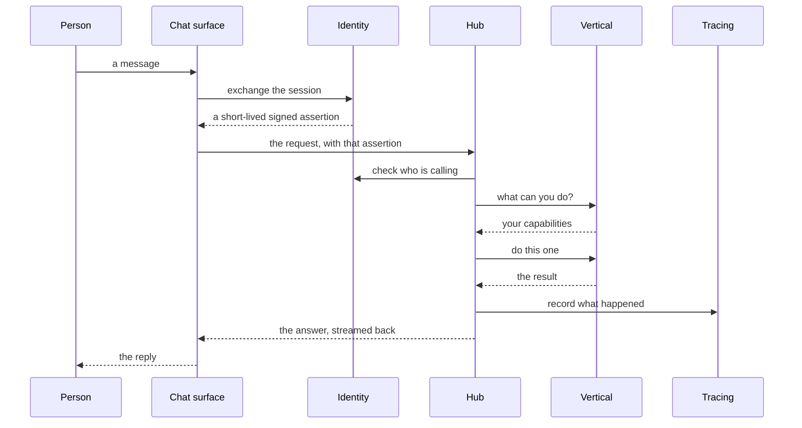

One message in a chat is enough to exercise most of the architecture. What
follows is the whole path, drawn without addresses or interface names, because
none of them matter to the shape of the flow.

Four things are worth pulling out.

The person never talks to a vertical. The chat surface performs an exchange with
the identity service, receives a short-lived assertion, and hands that to the
hub. The surface holds nothing long-lived about the person, so a compromised
chat surface yields a session and not a set of long-lived material.

The hub checks identity even though the surface already did. This looks
redundant and is the single most deliberate redundancy in the system. Identity
is checked at every hop because a check performed once at the front door is a
check that every internal path silently depends on.

Capabilities are discovered, not hard-coded. The hub asks a vertical what it can
do, immediately before using it. A vertical can therefore gain a capability
without the hub being aware of it in advance, and the hub does not need a
release to keep up.

The answer streams back through the same path it arrived on. There is no separate
channel for results, which keeps the ordering guarantees simple: what the person
reads arrives in the order the hub produced it.

Read together with the previous two pages, this is the whole system. What
follows are the parts that deserve a page each — identity, models, data and
protocols.
