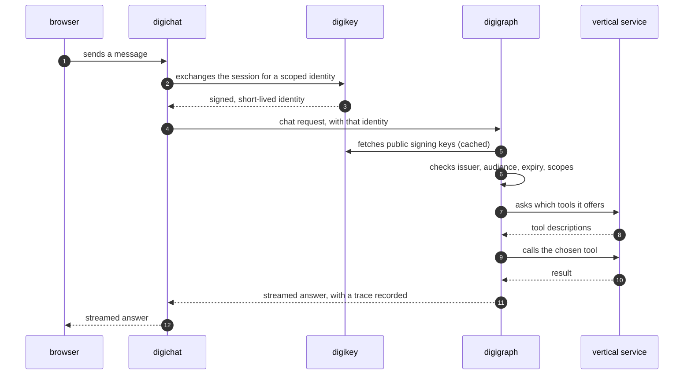

The clearest way to see the architecture is to follow a single message. A
person types a question into digichat; a few hundred milliseconds later an
answer starts streaming back. In between, five parts of the system each do one
job.

The interface never holds long-lived credentials. It trades the person's
session for a short-lived, narrowly scoped identity and passes that along. The
hub verifies that identity cryptographically instead of trusting the caller,
then **asks the vertical what tools it has** rather than carrying a hard-coded
list. That runtime discovery is why a vertical can ship a new tool without a new
release of the hub.

The answer streams back through the same path, and the hub records a trace of
every step along the way, so an operator can later see which tools were called,
in what order and how long each took.

<Reference kind="API" href="/docs/api/" title="API reference">
  The request and response shapes for each step above.
</Reference>
