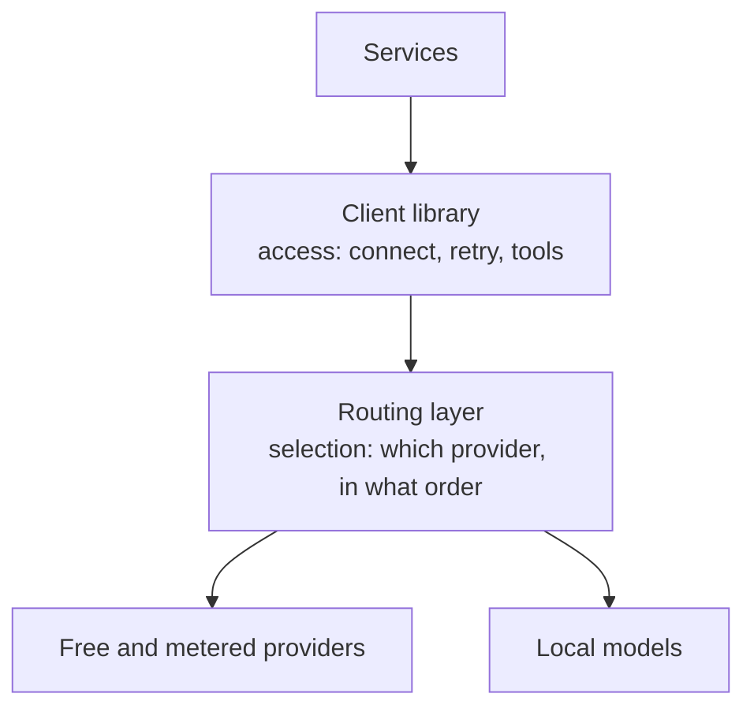

Talking to a language model looks like one job and is actually two. The first is
access: opening a connection, retrying when it fails, streaming, handling tools
and structured output. The second is selection: which provider answers, in what
order, and what happens when the first one is rate-limited.

The system separates them. A single client library owns access. It is
provider-agnostic, so it holds no preference between vendors and no opinion about
which model is better. Above it sits a routing layer that owns selection, and
that layer is configuration.

The split is what makes the top layer replaceable. Because the client library
has no vendor preference, and because it speaks an open interface that the routing
layer exposes, changing provider is an edit to configuration. No service changes,
and nothing is redeployed.

Fallback is the routing layer's job, and it is why the configuration looks the
way it does. Each logical model is defined as an ordered set of providers, so a
rate-limited or unavailable provider degrades into the next one rather than
failing the request. Tiers make the same choice explicit: a fast tier for
routine work and a strong tier that a caller opts into deliberately, with budgets
enforced per alias so that a tier cannot quietly become the expensive default.

Local models are part of the same arrangement, not an exception to it. They are
configured like any other provider. A team that cannot send work to a hosted
provider configures a local one and changes nothing else in the system.

> **Why digithings**
>
> Bring any provider, or run models locally. The routing decision is yours and
> lives in configuration, so switching costs nothing and no vendor holds a
> position you cannot leave.

One consequence is worth naming because it surprises people. Application code
does not choose a model. It asks for a tier, and the routing layer resolves that
to a concrete provider at the moment of the call. This is why the model a service
actually used is a fact recorded in tracing rather than a fact you can read in
the code.
