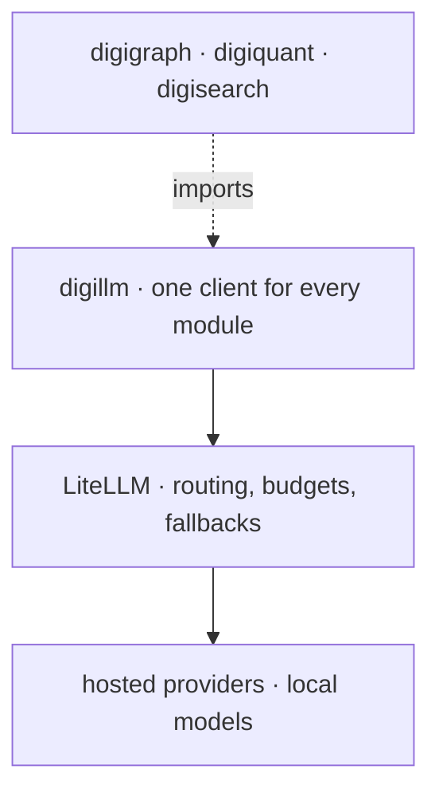

Every module that needs a language model uses **digillm**, a small library with
no preference for any vendor. It handles the parts every caller needs (retries,
caching, tool calls, structured output) and speaks the widely adopted
chat-completions interface. It does not know which provider will answer.

That decision belongs to the layer underneath. digillm sends its requests to
**LiteLLM**, an open-source routing proxy that maps a model name to a provider,
applies budgets and falls back to another provider when one is unavailable.
digithings builds its own LiteLLM image from the published Python package, so
the routing layer is as inspectable as the rest of the stack.

The split is deliberate. How the code *calls* a model is a programming concern,
and lives in a library. *Which* model answers is an operational concern, with
quotas, costs and fallbacks, and lives in configuration. Changing provider is
an edit to the routing configuration; it never touches application code.

> **Why digithings.** No model lock-in. The same stack runs against a large
> hosted model, a fast inference provider, or a model running entirely on your
> own hardware, and you can mix them with fallbacks between them.

<Reference kind="architecture" href="repo:digillm/ARCHITECTURE.md" title="digillm architecture">
  The client library's design and its guarantees.
</Reference>

<Reference kind="guide" href="repo:docs/LLM_PROVIDERS.md" title="Model providers">
  The supported providers and how routing between them is configured.
</Reference>
