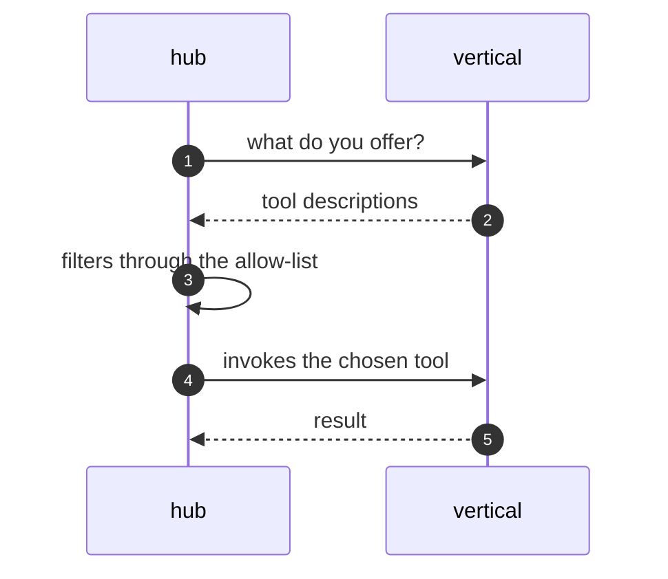

The hub never imports a vertical's code. Each vertical publishes
machine-readable descriptions of its tools on one endpoint, names, inputs and
what each does, and takes calls on another. The hub fetches the descriptions
when it needs them and calls over HTTP, so a vertical can be on another
machine, in another language, on another release schedule.

Three properties make this work. Fetching is lazy, so the hub starts without
waiting for every vertical. Each vertical sits behind a circuit breaker, so
one that is down fails fast instead of holding the request. And the
allow-list sits between discovery and invocation, so an operator decides which
offered tools the model may actually use.

The boundary is worth knowing. The vertical owns the description; the hub owns
a small handler per first-party tool name, because it treats those results
specially (citations, notes, backtests). Tool servers added over MCP have no
such handler and need no hub change at all.

<Reference kind="architecture" href="repo:digigraph/ARCHITECTURE.md" title="digigraph architecture">
  The discovery endpoints and the offer filter.
</Reference>

> **Why digithings.** A tool server joins the system by describing itself
> over MCP. No SDK to adopt and no hub release to wait for: the same property
> that keeps vendors interchangeable keeps teams independent.
