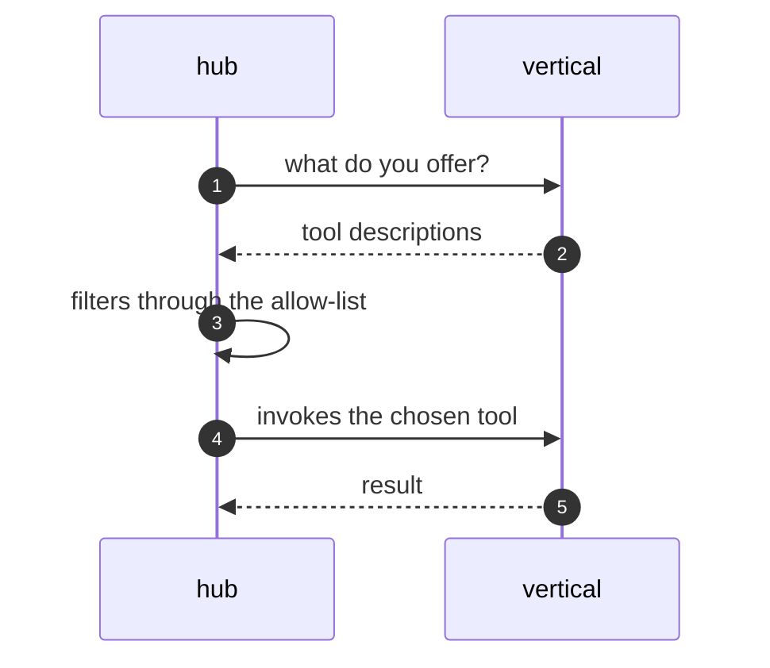

The hub never imports a vertical's capabilities. Instead, each vertical
publishes machine-readable descriptions of its tools — names, inputs,
outputs — and the hub fetches them when it needs them. Integration is a
conversation, not a dependency.

Three properties make this work. Descriptions are versioned, so the hub
can tell when an offer changed. Fetching is lazy, so a vertical that is
down simply offers nothing until it recovers — the hub degrades rather than
fails. And the allow-list sits between discovery and invocation, so an
operator decides which offered tools the model may actually use.

<Reference kind="architecture" href="repo:digigraph/ARCHITECTURE.md" title="digigraph architecture">
  The discovery endpoints and the offer filter.
</Reference>

> **Why digithings.** A new capability joins the system by describing itself
> over an open protocol. No SDK to adopt, no hub release to wait for — the
> same property that keeps vendors interchangeable keeps teams independent.
