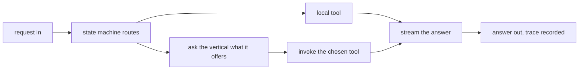

Every system with more than one capability eventually needs someone to answer
a hard question: when a request arrives, who decides what happens next?
digigraph is digithings' answer. It is the orchestration hub every user
request flows through, and its one design commitment is to stay thin. It
routes, it dispatches, it streams — and it leaves the real work to the
verticals that own it.

## What it is for

A chat message, a research job and a dashboard widget all need the same
things: understand the request, pick the right tools, run them in the right
order, and return the result. Without a hub, each of those callers
re-implements that loop, and they drift apart within months. digigraph owns
the loop once, so digichat, the dashboard and outside callers all share one
routing behaviour, one tool contract and one streaming shape.

The audience question this chapter answers is simple: where does the
intelligence of the system live? Answer: in one place, on purpose.

## How it works

digigraph runs a state machine. A request enters, the machine walks it
through stages — research, validation, execution, and optional refinement —
and conditional edges decide which stages run for each request. Around that
machine sits a registry of named tools. Some tools live inside the hub;
vertical services publish their own tool descriptions, which the hub fetches
lazily and invokes over the network. The hub never carries a hard-coded list
of what the verticals can do. It asks, at runtime, and dispatches what it
finds.

That middle step — asking instead of assuming — is the whole design. A
vertical can ship a new tool without a new release of the hub, because the
hub discovers capabilities instead of declaring them.

## Where it meets the rest

The hub sits between the interfaces and the verticals. digichat and the
dashboard send it chat-shaped requests; it answers in a widely compatible
streaming shape, so ordinary chat clients work unchanged. Downstream it talks
to digisearch for retrieval and digiquant for analysis, and to models through
the shared model layer. Identity arrives as a short-lived credential minted
upstream, which the hub verifies cryptographically instead of trusting the
caller. Every step is traced through digitrace, so an operator can replay
which tools ran, in what order, and how long each took.

<Reference kind="architecture" href="repo:digigraph/ARCHITECTURE.md" title="digigraph architecture">
  The hub internals: the state machine, the registry and the discovery protocol.
</Reference>

## Running it in each home

The hub runs the same in all three homes; only its neighbours change. On a
laptop it sits beside the other services on the local network and talks to a
local model runner. On Cloudflare it runs as part of the worker stack and
reaches the verticals through service bindings. Self-hosted, it runs wherever
the operator puts it and points at whichever model endpoints the operator
chose. Nothing in the hub's own design prefers one home — that portability is
why the hub never holds credentials longer than a single request.

## Trade-offs

A thin hub is a bet with two sides. On the good side, the verticals stay
independent: the search team and the quant team ship without coordinating
releases, and a new vertical joins by publishing tool descriptions, not by
patching the hub. On the sharp side, the hub is on every request path, so its
availability matters more than any vertical's, and runtime discovery means a
misbehaving vertical can surprise the hub at call time rather than at build
time. The tracing exists largely to make that surprise cheap to diagnose.

## Roadmap

The hub's roadmap deepens memory and resilience: longer-lived conversation
state, checkpoints that survive restarts, and richer routing as the number of
verticals grows. None of that changes the contract — route, dispatch, stream
— which is exactly what a hub owes the system around it.

> **Why digithings.** Most orchestration frameworks want to own your tools: you
> write to their plugin format and you are locked in. digigraph inverts that —
> tools are described over standard protocols and discovered at runtime, so the
> hub works with services it never heard of. That is the modular, no-lock-in
> position in one component.
