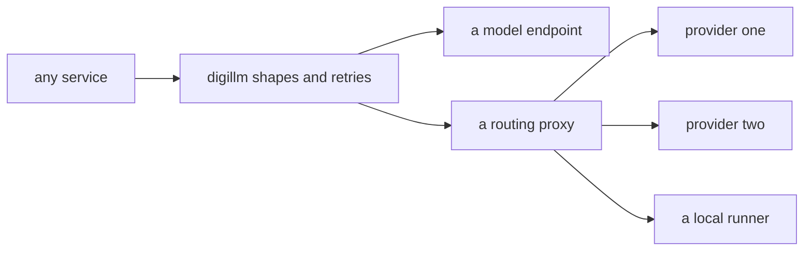

Left alone, every service grows its own model client. Each one picks a
favourite vendor, hard-codes the retry behaviour its author liked, and
handles failures a little differently. Six months later, switching models
means six refactors, and nobody can answer what a model call costs. digillm
exists so that never happens: one library, every service, no vendor
preference.

## What it is for

The audience question is practical: what does it take to change models? With
a shared layer, the answer is a configuration choice, not a rewrite. digillm
speaks to any endpoint that follows the widely adopted chat format, so local
runners, hosted vendors and routing proxies all look identical to the
calling service. A team trying a new model changes where the traffic goes,
not how the code asks.

## How it works

digillm is a library, not a service — it ships inside the services that use
it rather than running on its own. It defines the shared shapes every model
call uses: the request, the tool call, the tool definition, and structured
answers in schema form. On top of those shapes it layers the behaviours every
caller needs but nobody wants to write twice: retries, timeouts, usage
accounting, and optional tracing hooks. A routing proxy can sit underneath
for provider choice, caching and rate limits, and the library never knows or
cares.

The dependency discipline is part of the design: the library holds almost no
dependencies of its own and never imports web frameworks, so it can live
inside a chat interface, an orchestration hub and a research pipeline
without dragging their worlds along.

## Where it meets the rest

digillm is consumed, not called. The orchestration hub uses it for
routing-adjacent model calls, the search vertical for judging and rewriting,
and the research tooling for structured extraction. Tracing flows through
digitrace hooks when tracing is configured, and silently costs nothing when
it is not. Because the shapes are shared, a structured answer produced in one
service can be read in another without translation.

<Reference kind="architecture" href="repo:digillm/ARCHITECTURE.md" title="digillm architecture">
  The module map, the shape definitions and the dependency rules.
</Reference>

## Running it in each home

A library has no deployment of its own, so the three homes change nothing
about digillm itself — they change what sits underneath it. Locally it points
at a model runner on the same machine. On Cloudflare it points at whatever
inference the deployment chose. Self-hosted, the operator picks the endpoint
and the library behaves identically. That indifference is the point: the
decision of where models run stays an operator decision, never a code change.

## Trade-offs

The shared layer charges a small tax: every caller accepts the same shapes
and the same retry semantics, even when a special case tempts. In return, the
system gets one place where model behaviour is understood, measured and
changed. The alternative — each service with its own client — looks faster
until the first vendor migration, at which point it bills everything it
saved, with interest.

## Roadmap

The layer grows by absorbing patterns the services prove out: new structured
answer shapes, richer usage accounting, and deeper tracing integration. The
rule for growth stays the same — shared shapes first, vendor specifics
never.

> **Why digithings.** Swapping a model vendor is usually a migration project.
> Here it is a routing decision, because no service code names a vendor. Open
> interfaces plus one shared layer is what makes pay-as-you-go models
> genuinely interchangeable instead of merely available.
