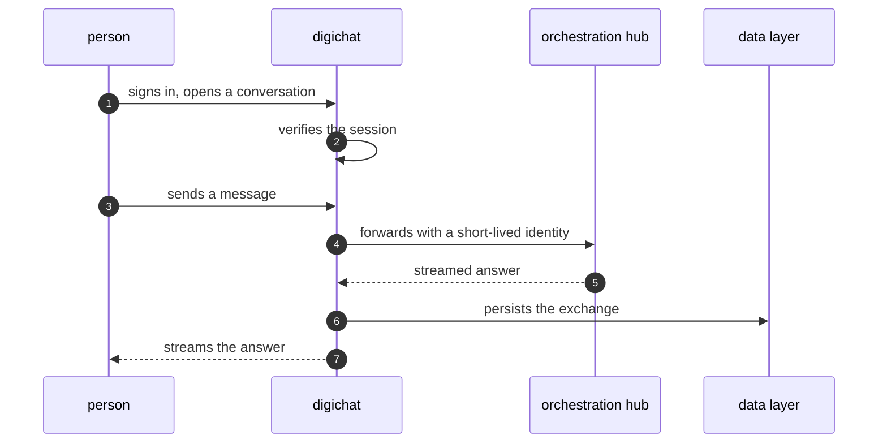

Most people never meet the stack. They meet digichat: the chat surface where
questions go in and answers stream out. Everything behind it — the hub, the
verticals, the models — exists to serve that surface well. This chapter is
about the surface itself and the deliberate thinness behind it.

## What it is for

digichat answers one audience question: what does it feel like to use this
system? A person signs in, opens a conversation, and talks. The interface
streams answers as they arrive, keeps history per conversation, and offers
artifacts — rendered outputs like documents and visuals — beside the chat.
It also embeds elsewhere: a host site can frame the chat experience for its
own visitors, with the same backend serving both.

## How it works

digichat is two things that travel together: a request layer and a surface.
The request layer authenticates the person, resolves which conversation they
are in, and forwards the message to the orchestration hub with a short-lived
identity. The surface renders the streaming answer, the history and the
artifacts. Neither half holds anything an attacker would want: sessions are
verified per request, conversation content lives in the data layer rather
than in the interface, and embed visitors are authorised per host before they
see anything.

The embed path follows the same shape with one extra check: the host naming
the visitor must itself be recognised before any conversation resolves. A
registered host alone authorises nothing; the per-visit credential does.

## Where it meets the rest

digichat is the hub's most demanding caller and the data layer's steadiest
writer. It leans on the identity service for sessions and machine
credentials, on the hub for answers, and on the data layer for conversation
persistence. Artifact rendering reuses the shared design components, so the
chat looks like the rest of the surfaces without sharing their code.

<Reference kind="guide" href="repo:apps/digichat/INSTALL.md" title="digichat install guide">
  Running the interface locally and connecting it to the stack.
</Reference>

## Running it in each home

Locally the interface runs beside the stack it talks to, which makes
development a single checkout. On Cloudflare it runs at the edge, close to
visitors, while the hub and verticals sit behind service bindings. Self-hosted
it runs wherever the operator serves web traffic from. In every home the
interface stays stateless: stop it, move it, scale it — conversations survive
because they never lived in it.

## Trade-offs

A stateless interface is easy to run and slightly harder to build: every
request must re-establish context the interface refuses to keep. The payoff
is operational calm. The interface can be redeployed mid-conversation without
anyone noticing, and scaling it is a capacity decision with no data
migration attached. The embed story carries the one real tension — reaching
visitors on other sites means thinking carefully about which hosts are
recognised and what a framed visitor may do.

## Roadmap

The surface roadmap is about richness, not plumbing: better artifacts,
clearer history, and embed options that stay safe by default. The request
path is deliberately finished — its job is to be boring so the surface can
be interesting.

> **Why digithings.** The interface is open source and stateless, so it runs
> anywhere the operator already serves traffic. No hosted-only surface, no
> per-seat metering in the interface itself — the chat you run is the chat
> you own.
