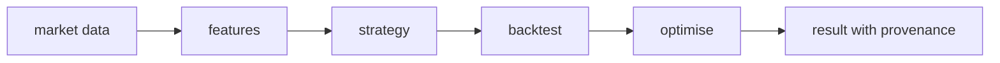

Quantitative research has a failure mode other software does not: results
that look rigorous and are not. A backtest that peeks at the future, a
pipeline that reorders steps casually, a number nobody can reproduce — each
one manufactures confidence. digiquant is the vertical that refuses those
outcomes structurally, by making the honest order of operations the only
order the pipeline can run.

## What it is for

The audience question is trust: why should anyone believe a number this
system produces? digiquant answers with process. Research flows through an
ordered pipeline — data, features, strategy, backtest, optimisation — where
each stage declares what it reads and the pipeline refuses to run stages out
of order. Every run keeps its inputs, so a result can be re-examined later
under the same conditions that produced it.

## How it works

The pipeline is the unit, not the function. A caller asks for a research
task; the vertical plans the stages, runs them through a mature backtesting
engine, and returns the outcome with its provenance attached. Honesty checks
sit inside the pipeline rather than beside it: estimates that are refused
carry no number at all instead of a plausible-looking one, and partial
results are labelled partial rather than rounded up. The orchestrator half of
the vertical exposes the same tools the hub discovers at runtime, so the hub
never needs to know how quant work is ordered — only what to ask for.

Each arrow is a contract: a stage may only read what the previous stage
wrote. That single rule is what makes results reproducible and what makes
look-ahead bias structurally hard instead of merely discouraged.

## Where it meets the rest

digiquant is the hub's quant arm and the data layer's heaviest reader. Market
history flows in from the data layer; research briefs and digests flow out to
whoever asked — the chat surface, scheduled sessions, or the dashboard. Model
calls go through the shared model layer, and every run is traced so a number
on a screen can be walked back to the data and parameters behind it.

<Reference kind="architecture" href="repo:digiquant/ARCHITECTURE.md" title="digiquant architecture">
  The pipeline stages, the honesty rules and the integration points.
</Reference>

## Running it in each home

The research pipeline runs wherever compute is cheapest for the operator.
Locally it runs on the same machine as the data it reads, which keeps large
backtests fast. On Cloudflare the scheduled runner executes on a timetable
and the interactive parts stay behind the hub. Self-hosted, the operator
sizes the machine to the workload. In every home the pipeline's ordering
guarantees travel with it — they are in the code, not in the deployment.

## Trade-offs

Strict ordering costs flexibility: exploratory one-off analysis must still
enter through the pipeline's front door, which feels ceremonial when someone
just wants a quick number. The system accepts that cost because the
alternative — fast numbers of unknown provenance — is exactly what the
vertical exists to prevent. Reproducibility is slow to build and fast to
lose; the pipeline is built to never lose it.

## Roadmap

The vertical deepens along two axes: more of the research workflow inside
the ordered pipeline, and richer provenance on everything it emits. The
direction is always the same — fewer ways to produce a number nobody can
explain.

> **Why digithings.** Institutional-grade research tooling usually arrives as
> a closed platform with the methodology hidden inside. Here the pipeline,
> the ordering rules and the honesty checks are open source and readable, so
> a small firm can hold its research to the same standard without buying the
> platform.
