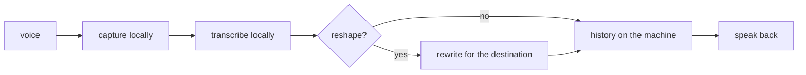

Typing is not always the way people work. Sometimes the thought arrives
spoken, half-formed, while walking or while the hands are busy. digivoice is
the loop that catches it: capture speech, transcribe it locally, optionally
reshape the transcript for its destination, and speak results back. The whole
loop runs on the operator's own machine, with no audio ever leaving it.

## What it is for

The audience question is about place: where should voice be processed? The
common answer — send the audio to a hosted service — trades away the most
sensitive stream a person produces: their voice, with all its background.
digivoice answers that the machine in front of you is already fast enough.
Local transcription and synthesis keep the loop private by construction,
offline-capable, and free of per-minute metering.

## How it works

The loop has four stations. Capture records from the microphone to a local
audio file. Transcription turns that file into text with a local speech
model. An optional rewrite pass reshapes the raw transcript for where it is
going — a message, a note, a command — using a small local model with a
cleanup prompt that keeps the boundary between instruction and content.
Synthesis speaks results back through a local voice. History stays on the
machine as an append-only log the operator can search and revisit.

Settings are scriptable — get and set from the command line — so the loop
can be driven by other tools, not only by fingers. A built-in checkup
command reports what the host can and cannot do, because a local tool owes
its operator an honest account of the host.

## Where it meets the rest

digivoice touches the rest of the system lightly, by design. It shares the
design language with the terminal surfaces, reads local model files in the
same way the rest of the stack reads models, and can hand a finished
transcript to the chat or the research pipeline as ordinary text. It never
calls the hub mid-loop: the voice loop completes on the machine, and only
its text output travels further.

<Reference kind="architecture" href="repo:digivoice/ARCHITECTURE.md" title="digivoice architecture">
  The loop stations, the settings surface and the local-first rules.
</Reference>

## Running it in each home

digivoice has one home: the operator's machine. It is not a service and it
does not deploy to Cloudflare or to shared servers — voice capture needs the
microphone in front of the person speaking. That constraint is also its
strength: there is no voice infrastructure to operate, scale or pay for. The
self-hosting story for voice is simply that it was never hosted at all.

## Trade-offs

Local-first voice trades raw model size for privacy and latency. A hosted
giant hears slightly better; the local loop hears well enough, answers
faster, works on a plane, and never uploads a word. Model files live on disk
and take space, and the operator picks them — curation effort in exchange for
zero metering. For a tool that handles speech, that trade is usually worth
making.

## Roadmap

The loop gets smarter hosts rather than bigger servers: better local models
as they arrive, more destinations for reshaped text, and tighter bridges to
the terminal surfaces. The local-only commitment does not move — it is the
feature, not a limitation awaiting infrastructure.

> **Why digithings.** Voice tooling normally means streaming your speech to
> someone else's servers on someone else's meter. A local loop keeps the most
> personal input stream entirely on hardware you own, with no account, no
> metering and no network needed. Privacy as architecture, not as policy.
