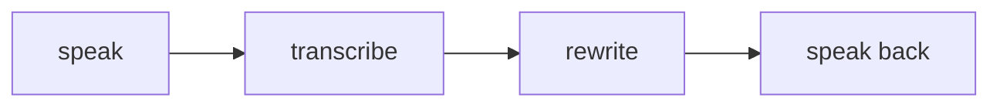

Typing is not always how people think. A thought often arrives spoken and
half-formed, while walking or with the hands busy. digivoice catches it:
capture speech, transcribe it, reshape the transcript for where it is going,
and speak results back.

Voice is not a separate product in that view. It is a surface on the same
stack, in the same way the chat window is, and it should be able to sit
wherever the work already happens: beside a person's own machine, inside the
chat, or as one step in a longer flow.

## The most personal stream

Speech carries more than words: the room, the people in it, the things
someone says only once. The default position is that audio is processed
where the person speaking can see it happen, on their own machine, and that
this is a choice rather than a limitation. Local models are fast enough for
the loop, they work without a connection, and nothing about the audio needs
to leave the room.

Where a hosted model earns its place, the operator chooses it, the way they
choose a model provider anywhere else in the stack. The interface stays the
same and the credentials stay theirs. What makes the position durable is not
that voice is always local; it is that whether it is local remains someone's
decision.

## How it works

The loop has four stations. Capture takes speech in. A speech model turns it
into text. An optional rewrite pass reshapes the transcript for its
destination: a message, a note, a question for the chat, a command. Synthesis
reads results back in a voice the listener chose.

Each station is a replaceable part, which is the point: a small local model
and a hosted one are the same station with different physics, and swapping one
for the other changes configuration, not the shape of the loop.

## Where it fits

digivoice is a utility rather than a vertical. It has no conversation of its
own and holds no state the rest of the stack depends on. What it produces is
plain text, which is why it can sit in front of a chat, a research brief or a
note without any of them knowing it was voice.

The rewrite pass inside it is where the interesting risk lives: a transcript
is data, but a model reads everything as a potential instruction. Keeping the
transcript wrapped and labelled as source text, and asking for a faithful
reshaping rather than for judgement, is what keeps content as content.

<Reference kind="architecture" href="repo:digivoice/ARCHITECTURE.md" title="digivoice architecture">
  The loop stations, the settings surface and the local-first defaults.
</Reference>

> **Why digithings.** A hosted voice pipeline can promise privacy; you are
> trusting the promise. Here the default is set in code you can read, and the
> choice to leave it is yours to make.
