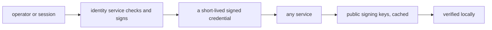

In a system of a dozen services, the dangerous question is who vouches for
whom. If every service trusts every caller, one compromised caller owns
everything. digikey is the narrow answer: exactly one service issues
credentials, every other service verifies them independently, and no service
ever trusts a caller on its word.

## What it is for

The audience question is access: how does one part of the system prove it
may act? Operators hold long-lived credentials issued once and shown rarely.
Services hold short-lived signed credentials minted by exchange and verified
locally. People sign in through the interface and receive sessions the
request layer trades for scoped identities. Three shapes, one issuer, no
exceptions.

## How it works

The design splits issuance from verification. Issuance is centralised: the
identity service checks the presented credential — an operator credential, a
session, a machine credential — and returns a short-lived signed credential
carrying scopes, tenant context and identity. Verification is federated:
each service holds the issuer's public signing keys, cached locally, and
checks every incoming credential itself — issuer, audience, expiry, scopes —
without calling anyone. The issuer can go quiet for minutes and in-flight
requests keep working, because verification never phones home.

Operator credentials are stored as one-way hashes and shown once at
creation; a lost one is replaced, never recovered. Machine credentials let
server-to-server callers authenticate without a person involved. Scopes keep
every credential narrow: a credential that can read research results cannot
spend anything, because it was never granted that scope.

## Where it meets the rest

Everything protected meets digikey — the hub, the verticals, the data paths.
Each service declares which scopes its routes demand; the shared middleware
enforces them uniformly. The chat request layer exchanges sessions for
scoped identities before calling the hub. Outside callers enter through the
same exchange, so there is no side door with different rules.

<Reference kind="architecture" href="repo:digikey/ARCHITECTURE.md" title="digikey architecture">
  Issuance, verification, scopes and the credential lifecycle.
</Reference>

## Running it in each home

Identity travels unchanged across homes, which is precisely the point of
verifying locally. On a laptop the issuer runs beside its consumers. On
Cloudflare it runs as part of the worker stack. Self-hosted, the operator
runs it wherever trust is rooted and every service points at its keys. Key
rotation is an operator action with a documented path, not an emergency.

## Trade-offs

Centralised issuance is a single point of trust: if the issuer's signing
material is mishandled, every credential is suspect. The system contains
that blast radius with short lifetimes, narrow scopes and rotation — damage
expires quickly and cannot spread sideways. The alternative, pairwise trust
between services, feels decentralised until the first incident, when it
turns out to be a dozen trust decisions nobody wrote down.

## Roadmap

Identity work moves toward finer scopes and richer tenant context, so
credentials can say more precisely what they allow. The shape — one issuer,
local verification, short lifetimes — is settled and does not need revisiting.

> **Why digithings.** Zero-trust identity usually arrives inside an enterprise
> suite with per-seat pricing. Here it is a small open service with standard
> signed credentials any operator can run, verify and rotate. Serious access
> control without the enterprise contract.
