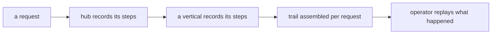

A system that cannot explain itself cannot be operated. When an answer looks
wrong, someone must be able to ask: which tools ran, in what order, what did
each see, and how long did it take? digitrace is how digithings answers.
It records the trail of every request as a first-class output, not as log
scrapings assembled after the fact.

## What it is for

The audience question is accountability: what happened inside that answer?
For operators debugging a bad result, for reviewers auditing a research
number, for anyone who needs to trust the system — the trace shows the
steps. Tracing that is always on is also how the project learns: slow tools,
surprising routes and failing calls all surface in the same trail.

## How it works

digitrace has two faces. As a library, it wraps the tracing calls inside
each service with a thin helper that records when tracing is configured and
vanishes — costing nothing — when it is not. Services adopt it without
depending on any tracing vendor. As a small service, it reports whether
tracing is active and healthy, so orchestrators and dashboards can show
tracing status without ever touching sensitive configuration.

The trail follows the request across service boundaries, so a hub step and
the vertical step it triggered appear in one story. Self-hosted tracing
backends keep the trail on infrastructure the operator controls; the library
never assumes which backend that is.

## Where it meets the rest

Everything that acts traces: the hub records routing and tool calls, the
verticals record their pipeline stages, and the model layer records usage
through its hooks. The chat surface and dashboards read trail status to show
operators what ran. Because the library is vendor-neutral, adopting a new
tracing backend changes configuration, not service code.

<Reference kind="architecture" href="repo:digitrace/ARCHITECTURE.md" title="digitrace architecture">
  The library, the status service and the backend options.
</Reference>

## Running it in each home

Tracing follows the deployment without special effort. Locally the trail
goes to whatever backend the operator configured on the machine. On
Cloudflare the trail flows to the hosted tracing setup beside the workers.
Self-hosted, the operator picks the backend and the retention, and the
services comply without code changes. The only invariant across homes: the
trail is always recorded, never sampled away silently.

## Trade-offs

Always-on tracing costs storage and a little latency on every request. The
system pays it because the alternative — debugging a multi-service answer
from scattered logs — costs far more the first time it matters. Retention
is the operator's dial: keep recent trails in full, age the rest out. What
the system will not do is trace silently into infrastructure the operator
did not choose.

## Roadmap

Tracing deepens toward analysis rather than collection: slower steps
flagged automatically, surprising routes highlighted, trails feeding back
into routing decisions. Collection itself is finished — it just needs to
keep working everywhere the system runs.

> **Why digithings.** Hosted platforms observe your system for you and bill
> you for the privilege of seeing your own behaviour. Here the trail is
> recorded with open protocols onto infrastructure you choose, so watching
> your system work never becomes a second vendor relationship.
