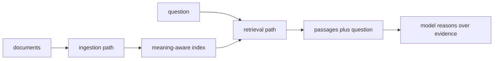

Language models know a lot and remember nothing of yours. Everything an
organisation knows — its documents, its history, its prior research — sits
outside the model. digisearch is the bridge: it ingests the operator's
documents, indexes them for meaning, and retrieves the right passages when
a question needs them. Retrieval is load-bearing enough to deserve its own
vertical, with its own pipeline and its own guarantees.

## What it is for

The audience question is grounding: how do answers stay connected to real
documents? Without retrieval, a model answers from training memory — fluent,
confident, and occasionally invented. With it, the answer carries the
passages it stands on, and a sceptical reader can check them. digisearch
makes that the default shape of every answer that touches private knowledge.

## How it works

The vertical keeps two paths strictly apart. Ingestion takes documents in,
splits them into passages, and stores them with meaning-aware indexes so
later questions can find them by content rather than by keyword. Answering
takes a question, retrieves the passages most likely to matter, and hands
them to the model alongside the question — the model reasons over supplied
evidence instead of recalling. The two paths share storage but never logic:
a document being indexed cannot change how a question is answered, and
answering never writes to the index.

Access control rides along: retrieval respects which scopes the requester
holds, so private documents stay private even though they share an index
with public ones. The vector backend underneath is an operator choice —
embedded for a laptop, managed for a fleet — and the pipeline above it does
not care.

## Where it meets the rest

digisearch is the hub's research arm alongside digiquant: where the quant
vertical answers from market data, search answers from documents. The chat
surface leans on it for grounded answers, and the research pipelines call it
for background. Ingestion can be scheduled or on demand; either way it lands
in the same index the answering path reads.

<Reference kind="architecture" href="repo:digisearch/ARCHITECTURE.md" title="digisearch architecture">
  The two paths, the index choices and the access rules.
</Reference>

## Running it in each home

The pipeline runs in every home; the index backend is what changes. Locally
an embedded index keeps the whole loop on one machine. On Cloudflare the
index lives in managed vector storage beside the workers. Self-hosted, the
operator picks the backend that fits the corpus size. Documents cross no
boundary the operator did not approve in any home — ingestion is always an
explicit act.

## Trade-offs

Separating ingestion from answering doubles the machinery for a reason:
mixing them is how systems end up with answers that quietly rewrite their
own sources. The cost is operational — an index to maintain, ingestion to
schedule, stale passages to expire. Chunking is the permanent judgement
call: passages too large dilute meaning, too small lose context, and no
setting is right for every corpus.

## Roadmap

Search improves along retrieval quality: better ranking, fresher indexes,
and clearer provenance on every passage an answer cites. The two-path shape
holds — it is what keeps the evidence honest.

> **Why digithings.** Grounded answers usually mean sending your documents
> to a hosted search vendor. Here ingestion, indexing and retrieval all run
> on infrastructure you control, over standard protocols, so private
> knowledge stays private while answers stay checkable.
