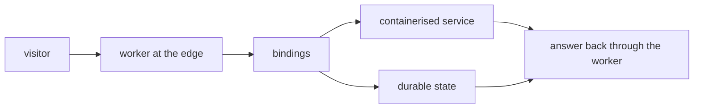

Cloudflare is one of the three homes, and the only one where the system
runs on someone else's computers without becoming someone else's product.
Workers run the request paths at the edge, containers carry the workloads
that need a full machine, and bindings wire them to state. This chapter is
about what that home looks like from the inside — and what it deliberately
does not change.

## What it is for

The audience question is portability: if the system runs on a laptop today,
what does it take to run it at the edge tomorrow? The answer the stack gives
is: a deployment decision, not a rewrite. The same services, the same
contracts, the same identity checks — placed on Cloudflare's network instead
of a local machine. An operator outgrows a laptop without outgrowing the
system.

## How it works

Three Cloudflare shapes cover the stack. Workers serve the request-driven
paths: the chat interface, the request layer, scheduled runners. Containers
host the workloads that need persistent processes — model runners, research
pipelines, tracing backends. Bindings connect the two to durable state and
to each other, so a worker can reach a containerised service as if it were
local. Identity and scopes work exactly as they do locally, because the
services verify credentials themselves rather than trusting the network
around them.

Nothing in this picture is Cloudflare-specific in design — only in address.
The services do not know which home they are in, which is why the same
build can move between homes without code changes.

## Where it meets the rest

The edge home meets the operator through deployment, not through new
concepts. Configuration declares which service lands where; the deploy
pipeline builds and ships; scheduled runners keep their timetables. The
local and self-hosted homes stay available for development and for
operators who want every byte on their own hardware. Moving between homes
is a supported direction in all directions, not a migration with no return.

<Reference kind="reference" href="repo:docs/DEPLOYMENT.md" title="Deployment reference">
  How each service is placed, built and shipped in every home.
</Reference>

## Trade-offs

The edge home trades control for reach. Global presence, no servers to feed,
and billing that follows traffic — against the reality that someone else's
computers hold the running processes. The architecture limits what that
concession costs: stateless request paths, credentials that expire in
minutes, and state in stores the operator chose. An edge deployment that
assumed the network was friendly would be a different, weaker system.

## Roadmap

Edge work follows the platform: newer runtime shapes adopted as they
mature, placement declared rather than hand-built, and the local home kept
as the development default so the edge never becomes the only place the
system can be understood. The invariant is symmetry — no feature that only
exists at the edge.

> **Why digithings.** Edge deployment here does not mean re-platforming onto
> a vendor's framework. The system deploys to the edge the way it deploys
> anywhere: the same services, the same open protocols, usage-based billing
> with no hosted-tier features to envy. Reach without lock-in.
