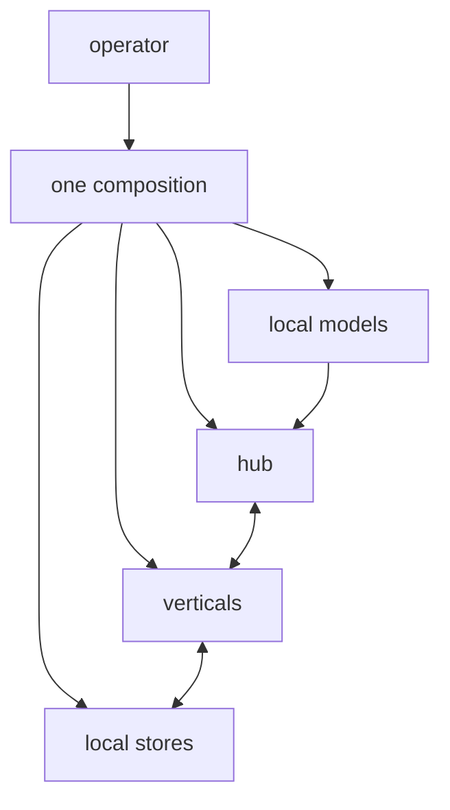

Before the system runs anywhere else, it runs here: one machine, every
service beside its neighbours, the full loop from question to answer on
hardware the operator can touch. The local stack is not a demo mode or a
crippled trial. It is the same system, composed for one machine, and for
many operators it is the only home they ever need.

## What it is for

The audience question is sufficiency: how much machine does this actually
need? The local stack answers by being ordinary. Services start side by
side, talk to each other over the machine's own network, and keep their data
in local stores. A developer runs the same composition they ship; a small
firm runs the whole product on one well-chosen box. Nobody needs permission,
an account, or a card on file to begin.

## How it works

Composition is declarative: one description says which services run, what
each needs, and how they reach each other. Starting the stack brings them up
in dependency order; stopping it puts everything away. The services behave
identically to their siblings in other homes — same contracts, same identity
checks, same tracing — because the code never learns which home it is in.
The only local concession is convenience: friendlier defaults, warmer
caches, and tooling that assumes a person is watching.

Seed content and example flows ship with the composition so the first run
answers real questions immediately. From there the operator grows into the
system by changing configuration, never by reinstalling it.

## Where it meets the rest

The local home meets the operator's working day: development, experiment,
demonstration, and honest small-scale production. When traffic or appetite
outgrows one machine, the same services move to the edge or to
self-hosted hardware with their contracts intact. Nothing written against
the local stack needs rewriting — that guarantee is what makes the local
home safe to invest in.

<Reference kind="guide" href="repo:docs/LOCAL_STACK.md" title="Local stack guide">
  Starting, stopping and understanding the one-machine composition.
</Reference>

## Trade-offs

One machine is finite: memory, accelerators and disk set real ceilings, and
a laptop that sleeps pauses the system with it. Backups are the operator's
job, not the platform's. Against that, the local home offers zero marginal
cost per question, total data custody, and the fastest possible development
loop. The system is frank about the ceilings — scaling guidance names them —
so outgrowing the home is a planned step, not a surprise.

## Roadmap

Local tooling improves toward less setup and clearer ceilings: faster first
starts, plainer status, and guidance that says exactly when one machine
stops being enough. The composition stays the reference the other homes are
measured against — if it works locally, the design is sound.

> **Why digithings.** A serious AI stack that starts on a laptop with no
> account and no meter is rare enough to be the point. The local home means
> evaluation costs nothing, development stays fast, and small operators never
> pay for scale they do not have.
