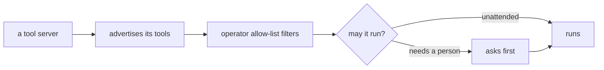

A system with dozens of capabilities needs a way to say what each one does
that both people and models can read. The industry answer is the Model
Context Protocol: tools described with names, schemas and permissions, over
a standard transport. digithings adopts it everywhere — every capability the
system offers is a described tool, and every model-facing call goes through
the same gate.

## What it is for

The audience question is extension: how does something new plug in? The
answer the protocol gives is uniformity. A new search source, a new analysis,
a new integration — each arrives as a tool description, and every consumer
in the system already knows how to read descriptions. Nobody patches the
hub, the chat or the dashboard to adopt it. Describing is integrating.

## How it works

Tools live behind servers that advertise them. The hub and the verticals
list what a server offers, filter that list through the operator's
allow-list, and expose only what survives to the model. Invocation carries
the same identity the rest of the system uses, so a tool call is authorised
with the same scopes as any request. A per-server gate decides which tools
may run unattended and which need a person to approve — and that gate is
checked where the tool executes, not only where it is offered, because
offering and executing are different promises.

The subtle rule: a model is never offered a tool it could not invoke, and
invocation never trusts the offer alone. Both halves are checked, every
time, which is what keeps a clever prompt from reaching past its grant.

## Where it meets the rest

The protocol is the system's connective tissue. Verticals publish their
tools through it; the hub consumes them through it; outside agents and
editors connect to the system's own tool servers through it. Operator-owned
integrations — project trackers, team chat, ticketing — arrive as tool
servers under the same gate, scoped as narrowly as the operator allows.

<Reference kind="architecture" href="repo:digigraph/ARCHITECTURE.md" title="digigraph architecture">
  The hub side: discovery, the per-server gate and the execution check.
</Reference>

## Running it in each home

The protocol is transport-agnostic, so homes change nothing about the
contract. Locally, tool servers run as neighbours on the machine. On
Cloudflare they sit behind the same bindings as everything else. Self-hosted
they run wherever the operator keeps services. What changes per home is
only which tool servers the operator connects — the gate, the scopes and
the approval flow travel unchanged.

## Trade-offs

A uniform tool layer centralises risk in one gate: if the gate is wrong,
every tool is wrong. The system answers with defence in depth — allow-lists
at offer time, the approval gate at execution time, scopes on the identity
throughout — so no single check carries the whole promise. The price is
configuration the operator must actually read: a tool layer that asks for
approval on everything trains people to approve everything. Defaults lean
toward asking, and operators narrow from there.

## Roadmap

The tool surface grows outward: more operator integrations, finer approval
policies, and richer descriptions as the protocol itself matures. The gate
stays where it is — at execution — no matter how many servers advertise.

> **Why digithings.** Tool access is usually bespoke glue per integration.
> Standardising on the open protocol means integrations compose instead of
> accumulating, and the approval gate means a model with many tools is still
> governed. Modularity you can audit, not just admire.
