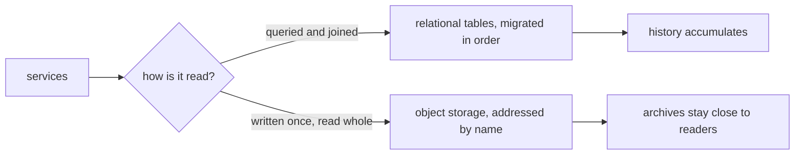

Everything the system learns has to land somewhere. Conversation history,
research briefs, scheduled digests, market history, uploaded documents —
each with a different shape and a different query pattern. The data chapter
is about the two stores that hold it all and the discipline that keeps them
honest: structured facts in tables, bulk bytes in object storage, and a
clear rule for which lives where.

## What it is for

The audience question is durability: where does yesterday's work sleep, and
will it be there tomorrow? Operators need conversation history that
survives restarts, research outputs that accumulate instead of evaporating,
and market data cached close to the pipeline that reads it. Two stores
answer those needs without pretending to be each other.

## How it works

Structured facts — conversations, briefs, digests, schedules, ledger rows —
live in relational tables with explicit schemas and migrations. Each change
to the shape is a versioned migration, applied in order, so the schema's
history is as reviewable as the data. Bulk bytes — market archives,
document stores, pipeline checkpoints, backups — live in object storage,
addressed by name and fetched whole. The rule for which lives where is
about access pattern: queried and joined goes in tables, written once and
read whole goes in objects.

Migrations run automatically with deployment, in the same pipeline that
ships the code expecting them — schema and code never drift apart silently.
Cached market data refreshes on schedule with provenance attached, so a
consumer can tell how fresh the bytes are and where they came from.

## Where it meets the rest

Every vertical reads here. The chat surface persists conversations, the
research pipelines store briefs and digests, the quant vertical leans on
cached market history, and search indexes documents whose originals rest in
object storage. Retention is per-kind rather than per-store: conversation
history, research outputs and caches each age out on their own policy.

<Reference kind="reference" href="repo:docs/DEPLOYMENT.md" title="Deployment reference">
  Migrations, stores and how each home wires them.
</Reference>

## Running it in each home

The shapes stay constant; the backends vary by home. Locally the tables
live in a nearby database and objects on local disk — fast, free, and the
operator's to back up. On Cloudflare the tables move to the platform's
database offering and objects to its object storage, reached through
bindings. Self-hosted, the operator picks equivalents and points the
services at them. In every home the migration order and the access rules
are identical; only addresses change.

## Trade-offs

Two stores means two things to operate: schemas to migrate and buckets to
retain. The alternative — one store pretending to do both jobs — has been
tried everywhere and bills its confusion forever. The honest costs are
migration discipline (every shape change reviewed, ordered and reversible
where possible) and retention judgement (history is valuable until it is a
liability, and the line moves per kind).

## Roadmap

Data work heads toward clearer provenance and calmer retention: every row
and object able to say where it came from and how long it stays. The
two-store shape holds — it matches how the system actually reads.

> **Why digithings.** Your history and your archives live in standard stores
> you can inspect with ordinary tools, on infrastructure you chose. No
> proprietary data layer standing between you and everything the system ever
> learned for you. Ownership that includes the past.
