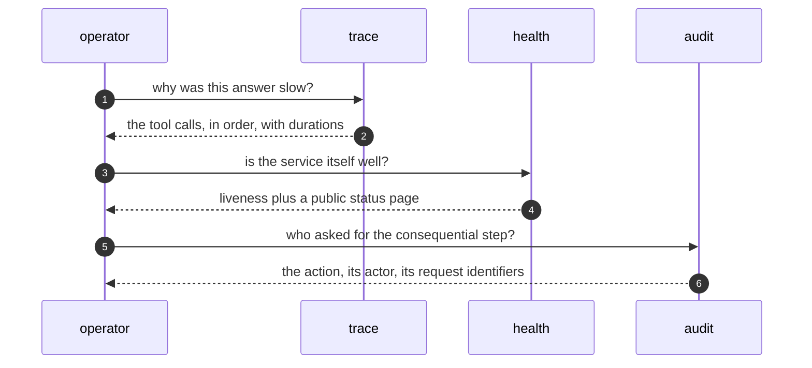

A request that cannot be replayed cannot be understood. Every request the
hub routes carries identifiers from edge to edge, and each step it takes —
which tools ran, in what order, how long each took — is recorded as a span
beside the answer. When an answer surprises you, the trace is the first
thing you read: it shows the path the request actually took, not the path
you expected.

Three properties keep the instruments honest. The trace identifiers travel
with the request, so a span from any service joins the same story. Health
signals are deliberately minimal and free of secrets, so they can be probed
continuously and even publicly without leaking anything. And the audit
trail records consequential actions immutably, with the identifiers that
tie each entry back to the trace that caused it.

<Reference kind="architecture" href="repo:SECURITY.md" title="Security posture">
  Which signals are public by design, and which records stay private.
</Reference>

> **Why digithings.** A surprise you can replay is a question; a surprise
> you cannot is an incident. Open tracing over standard protocols means the
> replay never depends on a vendor's dashboard being available.
