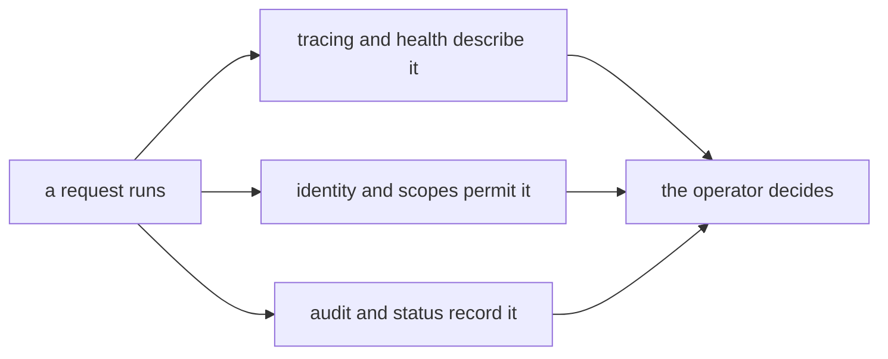

A system that researches, searches and analyses on your behalf is a system
you must be able to watch. Operating digithings is not a separate discipline
bolted onto the side — it is three views of the same running system, each
answering a question the others cannot. What is happening right now?
Who is allowed to make it happen? And where is the record, so yesterday's
run can be replayed and understood?

The audience question this chapter answers is the operator's: can I trust
this stack to run unattended, and when something surprises me, where do I
look first? Answer: in three places, each with one job.

## What it is for

The first view is observability: traces of every request, health signals
from every service, and an audit trail of consequential actions. The second
is security: identity on every hop, least privilege on every credential, and
a default posture that assumes a hostile network and a single trusted
machine. The third is the boring machinery that makes the other two
possible: reproducible deploys, smoke checks after every release, and one
operator runbook per surface.

None of the three substitutes for the others. A green health signal does
not prove a request was authorised; a valid credential does not prove the
system behaved; and a passing test suite does not prove the deployed build
is the one that was tested. The chapters below keep the three views apart
on purpose, so each can be checked independently.

## Where it meets the rest

Operations touches every module and owns none of them. The hub reports
which tools ran; the model layer reports what each call cost; the data
layer reports what was stored and when. Identity arrives from the one
issuer and is checked at every edge, so the operator configures trust in
one place and every service enforces it. The tracing library is deliberately
backend-neutral: spans flow to whichever backend the operator chose, and the
book never names one as the answer.

<Reference kind="architecture" href="repo:SECURITY.md" title="Security posture">
  The threat model, the non-negotiable defaults, and how to report a problem.
</Reference>

## Running it in each home

The three views travel with the stack. On a laptop the same health signals
answer, the same audit trail appends, and the same identity checks run —
only the backends are smaller and local. On Cloudflare the signals come
from the platform's own telemetry alongside the stack's, and the audit
trail is the deploy's memory of itself. Self-hosted, the operator picks
the backends and keeps the same three questions. Portability of the views
is what lets a run verified locally predict behaviour in production.

## Trade-offs

Three views cost three kinds of attention. On the good side, a surprise is
cheap to place: a slow answer is a tracing question, a refused call is an
identity question, and a disputed action is an audit question — and the
wrong view fails loudly rather than answering for another. On the sharp
side, no single dashboard tells the whole story, and the audit trail is
only as honest as the process that writes it. The stack accepts that cost
because the alternative — one blended signal — fails silently in exactly
the cases that matter.

## Roadmap

The direction is remote sinks for the audit trail, per-tenant quotas beside
the per-address limits, and a runtime interlock where today there is a
source-tree gate. None of that changes the three questions — only how
completely each one is answered.

> **Why digithings.** Most stacks treat operations as the price of admission:
> closed dashboards, proprietary agents, telemetry that only flows one way.
> digithings keeps the views open and standard — open protocols for
> discovery and tracing, reproducible deploys from the same source anyone
> can read — so watching the system never depends on renting the watcher.
