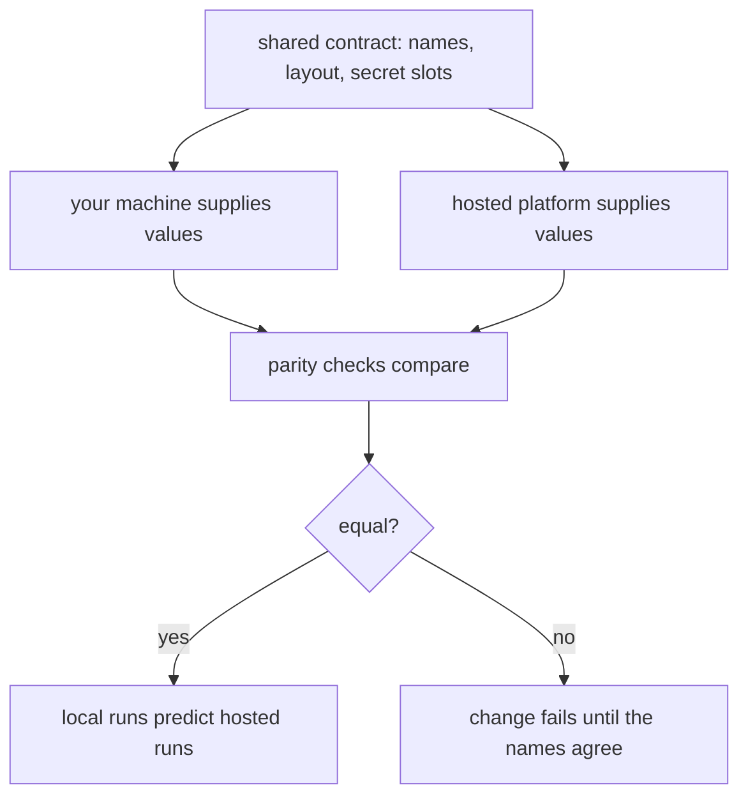

Two homes for one stack only stay honest through a shared contract. The
contract names every setting, every service address shape, and every secret
slot once. Your machine and the hosted platform each supply values for
those names. Neither side renames, reorders or reinterprets them — because
the moment one side invents a name, local verification stops predicting
production behaviour.

Today the contract is a convention: both homes use the same setting names
and the same port layout, and the reference lists them. The diagram shows
where it is going, and that part is planned, not built. Three properties will
make it hold. Settings named once, in one manifest both homes read. Secrets
rendered per home from that manifest with strict file permissions, never
echoed. And parity checks that compare the two homes and fail a change when
they disagree, so drift is caught at review time rather than during an
outage.

<Reference kind="guide" href="repo:docs/SELF_HOST.md" title="Self-hosting reference">
  The contract, the profiles, and what each plan slice adds.
</Reference>

> **Why digithings.** Configuration drift is how most self-hosted setups
> die: the documented path rots while production moves on. A contract both
> homes read, and in time one checked on every change, keeps the documented
> path alive.
