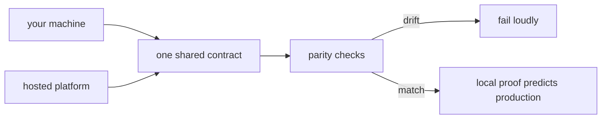

Most infrastructure projects treat running locally as a favour to
developers: a smaller, vaguer cousin of the real thing. digithings treats
your machine as a first-class home. The stack runs there fully — hub,
verticals, chat, tracing — and anything verified locally is expected to
behave the same way in production, because both homes read the same
contract.

The audience question this chapter answers is the sceptic's: why should I
believe a demo on a laptop predicts production at all? Answer: because the
two variants are not allowed to drift apart, and the checks that prove it
run on every change.

## What it is for

Self-hosting has two jobs. The first is independence: the software works
without any hosted platform, so owning your infrastructure is a real
option, not a slogan. The second is verification: interfaces, chat
surfaces and tool integrations are proven fully connected locally before
anything ships to the hosted platform. Local-first is the gate production
walks through, not the waiting room beside it.

That only works if the two variants share one contract: the same setting
names, the same service layout, the same secrets manifest. A variant
supplies values; it never invents a name. Parity checks compare the two
homes continuously, and drift fails loudly instead of accumulating quietly.

Modularity follows the same principle. Each capability opts in separately,
so you run only what you need — the core set, the chat surface, the
tracing backend, the tool integrations — and each addition is one explicit
choice rather than a bundle you accept whole.

<Reference kind="guide" href="repo:docs/SELF_HOST.md" title="Self-hosting reference">
  The full operator document: prerequisites, profiles, and the plan slice by slice.
</Reference>

## Where it meets the rest

The self-host variant touches everything the hosted one does: the same hub
routes, the same model layer answers, the same data layer persists. The
local model runner stands in for hosted inference; the local database
stands in for the hosted one. Nothing in any module prefers one home —
that neutrality is what the parity checks are actually testing.

## Running it in each home

This chapter describes the home you own. The hosted platform is production
only: there is no hosted development stack, because duplicating the whole
infrastructure for development would double its cost. Development, review
and verification happen on machines; production is where verified work
lands. The asymmetry is deliberate and one-directional.

## Trade-offs

A local-first gate is a bet with two sides. On the good side, every
developer holds the whole system, surprises surface before they cost
money, and independence is demonstrated continuously rather than claimed
annually. On the sharp side, one machine is not the hosted platform: load,
scale and multi-tenancy are verified by reasoning and by narrower checks,
not by reproducing production locally. The book says that plainly so no
reader mistakes the gate for a guarantee.

## Roadmap

The plan completes the variant slice by slice: the config contract, local
data services, worker emulation, one command to raise the stack, seeding,
and the parity checks that hold it all together. Each slice lands as
reference documentation first, so the target state stays readable while it
is still being built.

> **Why digithings.** Most platforms let you rent their cloud or leave.
> digithings proves, on every change, that its software runs without them —
> open source, reproducible steps, the same contract in both homes. That is
> the self-hosting position in one practice: independence you can verify.
