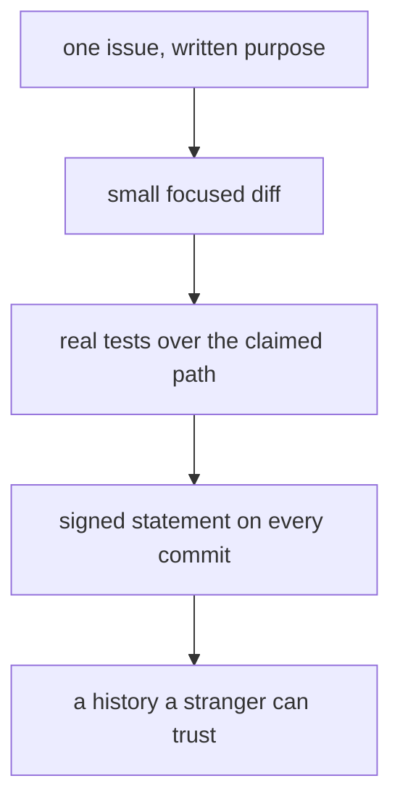

A good change has four parts, and a reviewer checks them in order. First,
scope: the work answers one issue, so its purpose is written down before
the code exists. Second, size: the branch stays small and focused, so a
person can hold the whole diff in mind at once. Third, proof: tests
exercise the claimed behaviour for real — no trivial assertions, no
stubs standing in for the path being claimed, and the end-to-end journey
still passing. Fourth, origin: every commit carries a signed statement
that its author has the right to submit it, so the project's history is
also its licence record.

Two properties keep the bar honest rather than theatrical. The automated
checks run before any person looks, so mechanical problems never spend
human time. And the origin statement is checked mechanically too — a
change without it cannot land no matter how good it is — because a
licence record that depends on reviewers remembering to ask is not a
record at all.

<Reference kind="guide" href="repo:CONTRIBUTING.md" title="Contributing guide">
  Titles, tests, review policy, and the origin statement in full.
</Reference>

> **Why digithings.** Trust in open source is a property of the history,
> not of the people. A change a stranger can verify — scope, proof,
> origin — is a change anyone can build on.
