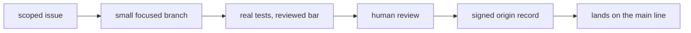

An open-core project lives or dies by how it treats changes from people it
has never met. Too little process and the stack rots; too much and nobody
contributes twice. digithings asks for a small set of things, each with a
reason an outsider can check: work scoped to an issue, changes small enough
to review, tests that actually exercise the claimed behaviour, and a signed
statement that the contributor has the right to submit the work.

The audience question this chapter answers is the newcomer's: what do I
have to do for my change to be taken seriously? Answer: less ceremony than
you fear, and more honesty than you may expect.

## What it is for

Every contribution rule defends something concrete. New capabilities arrive
as discoverable tools, so the hub can route to them without special cases.
Quantitative code goes through the one backtesting core, so results stay
comparable. Models are reached through the one router with caching, so
token spend stays visible. Components ship in containers from the root
layout, so anyone can reproduce the running system. And interfaces document
their own changes where they live, so the architecture notes never lag the
code by more than one change.

None of this is taste. Each rule exists because violating it once cost the
project real time: a special-cased capability the hub could not see, two
backtest numbers nobody could compare, a model bill nobody could explain.
The rules are the project's memory of those incidents.

## Where it meets the rest

Contributing touches the whole repo but lands through one path: an issue
for scope, a branch for the work, a pull request with the template filled
in — what changed, why, how it was tested. Automated checks run first:
style, unit tests, documentation links. People review second, and some
changes always need a person: authentication, live-trading paths, new
infrastructure, or any decision the records do not cover yet. Those go
through an architecture record before they go through review.

<Reference kind="guide" href="repo:CONTRIBUTING.md" title="Contributing guide">
  The required reading, the hard rules, and the workflow step by step.
</Reference>

## Running it in each home

Contributing is the same in every home because it happens before any home
matters: the change is written, tested and reviewed against the shared
source, and only deployed homes differ afterwards. A contributor never
needs production access; the local variant from the previous chapter is
the whole verification environment.

## Trade-offs

A review bar is a bet with two sides. On the good side, every change
carries its reasoning and its proof, so the project stays legible as it
grows and a newcomer can trust the history. On the sharp side, review
takes human time, and the bar can feel slow to someone with a one-line
fix. The project accepts that cost because the alternative — fast merges
nobody understands — compounds until nobody can change anything safely.

## Roadmap

The direction is faster honest feedback: more checks that run before a
person looks, clearer ownership per surface, and records for the decisions
that currently live only in discussion. None of that lowers the bar — it
moves the waiting earlier, where it costs less.

> **Why digithings.** Many open projects optimise for stars: easy to start,
> hard to trust. digithings optimises for the opposite — a contribution
> path strict enough that running the result is safe, and open enough that
> anyone can walk it. That is the open-core position in one practice.
