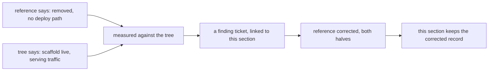

Writing this book caught its own source disagreeing with the system. The
deployment reference described the chat's edge scaffold — worker plus
container — as removed on a past date, with no deploy path, on the grounds
that containers need a paid platform tier the project did not hold. Both
halves of that sentence had gone stale: the scaffold is live in the tree,
it serves real traffic on the main site, and the platform tier it needs is
the one the project holds.

The corrected record, which this section keeps: the chat edge scaffold is
present and live, it requires the paid tier, and the chat surface ships
through two paths — the worker and container on the edge, and the chat
service on operator machines for the project's own use. Those are
different surfaces with different deploy paths, and the reference now
names both instead of describing one as gone.

Two properties make this section load-bearing rather than anecdotal.
First, it is the worked example of the review loop: writing surfaced the
drift, the drift became a ticket under the book's epic, the ticket went to
the owner of the deployment surface, and the reference was corrected
there — not in the chapter that found it. Second, it records the failure
mode honestly: a sentence that was true when written, stale a season
later, with no check to catch it. The parity thinking from the
self-hosting chapter applies to documents too — a claim nobody re-checks
is folklore, however it reads.

<Reference kind="guide" href="repo:docs/DEPLOYMENT.md" title="Deployment reference">
  The corrected operator document, naming both chat surfaces and their lanes.
</Reference>

> **Why digithings.** A book that hides the mistakes it found is marketing.
> Keeping the corrected record — what was claimed, what the tree said, and
> where the fix landed — is what lets the next reader trust the rest.
