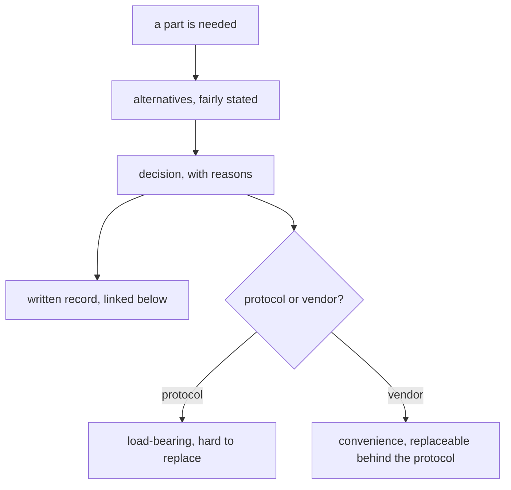

Every stack is a pile of choices its authors stopped questioning. This
chapter re-opens them: for each major integration — the model router, the
edge platform, the data layer, the tool protocols, the charts — what it
does, what else could have done it, and why this one won. The point is not
to flatter the choices. It is to leave the reasoning where the next
author can argue with it.

An architect replacing a part needs to know which parts are load-bearing and
which are convenience. The protocols are load-bearing; the vendors are not.

## What it is for

Models are reached through one routing layer with caching and spend
visibility, instead of every service holding its own provider accounts.
That single decision is what keeps model spend explainable and what lets
a local runner stand in for hosted inference without touching any caller.
The alternative — each service integrating providers directly — was
rejected because its bills cannot be reconciled and its failures cannot
be compared.

Compute at the edge runs on the workers platform: the chat surface, the
data API and the scheduled jobs all run there, with durable state and
object storage from the same provider. The alternative — serving
everything from containers on rented machines — was rejected for the
surfaces where global placement and zero upkeep matter, and kept where
they do not: the chat container still runs beside its worker, because
some workloads want a full machine.

Data lives in one database family with migrations as the contract, an
archive object store beside it, and a vector backend behind the search
vertical. One family means one backup story, one migration story, and one
place where the retention rules live. Tools are described over the open
tool protocol and discovered at runtime, so a new capability joins by
describing itself rather than by patching the hub — the modular position
from the architecture chapter, applied to vendors.

Charts come from a shared visualisation library rather than bespoke
rendering per surface, so every dashboard, report and embedded view speaks
the same visual language. The alternative — each surface drawing its own —
was rejected because inconsistent pictures of the same numbers erode trust
faster than any single bug.

<Reference kind="guide" href="repo:docs/adr/README.md" title="Architecture decision records">
  The written record of each decision, newest first, each immutable.
</Reference>

## Where it meets the rest

Integration choices constrain everything before them and are constrained by
what follows. The hub assumes runtime tool discovery; chat assumes the edge
worker; data assumes the migration contract; operations assumes the tracing
backend. Changing any one of them ripples outward, which is why each choice
links the written record behind it instead of paraphrasing it.

## Running it in each home

Choices are evaluated per home, not once globally. The model router runs
in both homes with different providers behind it. The edge platform is
production only; locally, ordinary processes stand in. The database family
is the same in both homes at different sizes. A choice that only works in
one home is a liability the contract chapter calls out, not a detail to
discover during an outage.

## Trade-offs

Documented choices are a bet with two sides. On the good side, the next
author inherits reasoning instead of archaeology, and replacing a vendor
behind a stable protocol is ordinary work. On the sharp side, records go
stale, and an unrechecked record becomes folklore with a number on it. The
case below is the honest example: the drift it records was found while
preparing this material, became a ticket, and the record below is what the
ticket established.

## Roadmap

The direction is fewer vendors behind steadier protocols: more of the
system described over open standards, fewer bespoke integrations, and
records revisited on a rhythm rather than by accident. Each new record
follows the same template, so the collection stays arguable-with rather
than archival.

> **Why digithings.** Most vendors sell the bundle: their models, their
> cloud, their database, their charts — each convenient, all of them
> together a lock-in. digithings picks each part against alternatives,
> writes down why, and keeps the protocols open so any part can leave.
> That is the no-lock-in position in one chapter.
