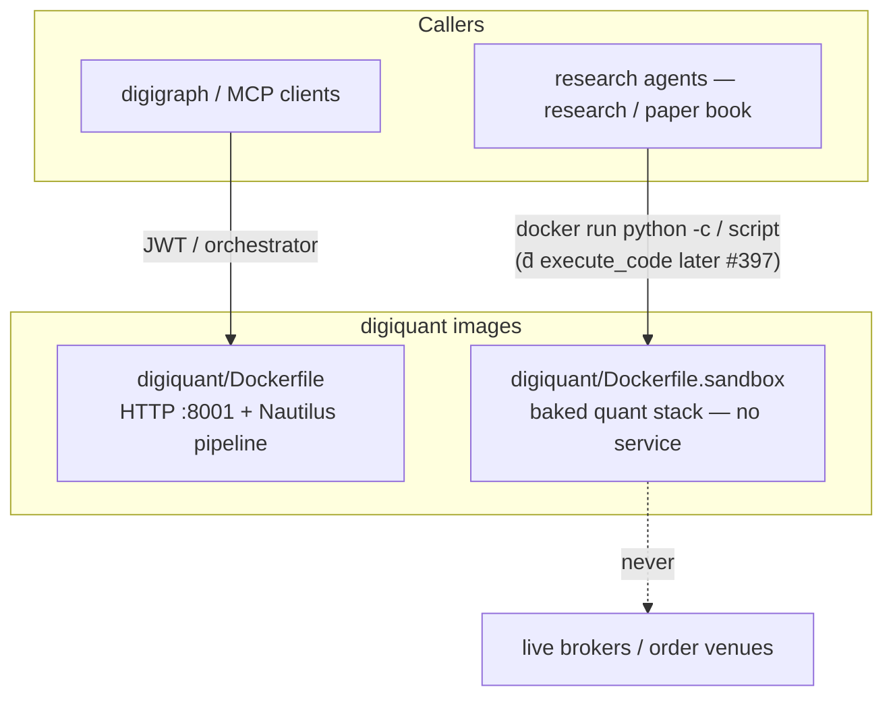

# digiquant Architecture

**Version:** 0.1.x
**Last updated:** 2026-09-01
**Audience:** Engineers, reviewers, and agents working on or integrating with digiquant.

---

## Table of Contents

1. [Overview](#1-overview)
2. [Current Implementation State](#2-current-implementation-state)
3. [API Surface](#3-api-surface)
4. [Data Model](#4-data-model)
5. [Internal Architecture](#5-internal-architecture)
6. [Security Analysis](#6-security-analysis)
7. [Scalability Analysis](#7-scalability-analysis)
8. [Performance Analysis](#8-performance-analysis)
9. [Integration Points](#9-integration-points)
10. [Docker and MCP Composition](#10-docker-and-mcp-composition)
11. [Phase 2+ Gaps and Roadmap](#11-phase-2-gaps-and-roadmap)
12. [Redesign Recommendations](#12-redesign-recommendations)

---

## 1. Overview

digiquant is the deterministic quant engine of the digithings stack. Its primary role is to own and execute the ordered pipeline: **validate → backtest → optimize → export**. No other service in the stack is permitted to make performance claims (Sharpe, PnL, trade count) without a result originating from this service.

digiquant operates as an internal vertical in the federated hub model. Typical callers are:

- **digigraph** (orchestration hub) — calls via HTTP orchestrator endpoints and dispatches tool invocations through `/v1/orchestrator_invoke`
- **MCP clients** (IDE, Claude Desktop, digiclaw) — attach directly via `streamable-http` or `stdio` transport on port 8767
- **Power users** — call HTTP endpoints directly or use the `digiquant` CLI
- **digiclaw** (heartbeat service) — polls `/check_drift` for ADDM-triggered re-optimization

### NautilusTrader Integration

NautilusTrader is the sole backtest and live-trade execution engine. Its key properties relevant to architecture:

- **Rust core** for the event loop, order book, and fill simulation — Python strategies attach via the Actor/MessageBus pattern
- **`BacktestEngine`** is the synchronous entrypoint; digiquant calls `engine.run()` in the current thread
- **Bar-driven** by default: OHLCV data is fed through `BarDataWrangler` and replayed bar-by-bar to the strategy's `on_bar()` callback
- **`TestInstrumentProvider.equity()`** is used for simulation instruments; no real market microstructure (no bid/ask spread, no partial fills) in the default configuration
- **Optional dependency**: installed via `digiquant[nautilus]`. The backtest entry point falls through to `None` if `nautilus_trader` is not importable.

The Polars-to-pandas boundary in `nautilus_runner.py` is a deliberate, documented exception to the "Polars only" rule. Nautilus's `BarDataWrangler.process()` requires a pandas DataFrame with a `timestamp` UTC index. All other data handling in digiquant (CSV loading, account report parsing, result assembly) uses Polars.

**Version pinning and lockfile authority ([ADR-0033](../docs/adr/0033-nautilus-trader-exact-pin.md)):**

`nautilus_trader` is pinned **exactly** to `==1.230.0` in `pyproject.toml`. This is the build we ship. Do not widen it back to a range.

- **Why exact.** A *minor* bump inside the old `>=1.190,<2` range moved the Python-visible return type of `PortfolioAnalyzer.realized_pnls()` between 1.228.0 and 1.230.0. Our honesty envelope reads that value, so a ranged pin meant "silently moves" rather than "compatible". This is a deliberate, recorded exception to the root `AGENTS.md` rule that runtime deps stay unbounded — the root rule's own escape hatch applies (a known incompatibility, with the reason commented next to the pin).
- **One lock: the repo-root `uv.lock`.** It is the single authoritative lock for the whole uv workspace; `digiquant` is a `[tool.uv.workspace]` member. **No module ships its own `uv.lock`.** `digiquant/uv.lock` was deleted under ADR-0033 — it was inert (68 packages against the root lock's 297), referenced by nothing, and last touched at the April 2026 baseline; uv resolves the workspace root and never opened it. If you find a module-level `uv.lock`, it is dead weight that reads as a pin but pins nothing — delete it and say so in an ADR.
- **Why the pin, not the lock, is the shipping control.** `digiquant/Dockerfile` copies only `digiquant/pyproject.toml` and runs `uv pip install --system -e ".[nautilus]"`. No lockfile is copied and `uv pip install` does not read `uv.lock`. So the `==1.230.0` in `pyproject.toml` is the **only** thing that pins `nautilus_trader` in that image — the one `docker-compose.yml` builds. Before ADR-0033 it resolved whatever was newest on PyPI at build time. **Scope of that claim:** the image is *not* reproducible. `polars`, `optuna`, `cryptography`, `fastapi`, `uvicorn`, `langgraph`, `httpx`, `requests`, `statsmodels` and every transitive dependency of `nautilus_trader` itself still float, so a rebuild of an unchanged commit produces different bytes. **The pin reaches one build surface, not the whole service:** the Cloudflare Workers stack builds `digiquant/Dockerfile.mcp`, which installs `[research,mcp]` with no `nautilus` extra, and `Dockerfile.digiquant-runner` already installs `--frozen` from the root lock. Nothing in the repository publishes this image — `publish-service-images.yml` was removed in `f54af7052` — so there is no `:latest` or `:v0.1.0` tag being overwritten; the live consequence of that removal is that `infra/self-host/compose.ghcr.yml:34-36` pulls a tag nobody publishes. ADR-0033 names reproducibility as open work, not as fixed.
- **CI is frozen to the root lock.** 35 of the 40 `uv sync` invocations across 29 workflow files use `--frozen`. `test-digiquant.yml` syncs without the nautilus extra on purpose (Linux SIGABRT, #42); `test-nautilus.yml` is the mirror lane that does include it. Both run from the repo root. Editing a manifest without re-locking desyncs the lock and breaks every `--frozen` lane.
- **Known gap.** A local venv that was not re-synced still runs whatever it installed. Local == CI only after `uv sync --frozen --package digiquant --extra nautilus`.
- **Bumping is deliberate, with a checklist** — change the pin, `uv lock` at the repo root, read the diff (more than the `nautilus-trader` specifier line means stop), verify `uv lock --check` from the root and from inside `digiquant/`, update the version named here and in `AGENTS.md`, run the DIG-937 analyzer-shape matrix, and amend or supersede ADR-0033.

The 2.x series introduced an async-first API surface with breaking changes to `BacktestEngine.run()` and the Actor registration model; the exact pin is also what keeps us off it.

**Linux CI crash (SIGABRT / exit 134) — tracked in #42:**
`BacktestEngine.run()` registers C++-level SIGTERM/SIGINT handlers in its Rust runtime. On Linux, `uvicorn[standard]` installs `uvloop` and sets it as the global asyncio event loop policy, which also claims those POSIX signal handlers via libuv. When both runtimes attempt to own signal handling, a C-level assertion fires → SIGABRT. Mitigation: `tests/dq/conftest.py` resets the asyncio policy to `DefaultEventLoopPolicy` before the dq suite runs, preventing uvloop from conflicting with Nautilus's signal registration. The three integration tests that run a real `BacktestEngine` are skipped on Linux CI (`CI=true`) until the per-component test suite (#43) re-enables pytest and the fix is confirmed green on Ubuntu.

### Pipeline Ownership

digiquant owns the ordered quant workflow internally via a LangGraph `StateGraph` in `digiquant/src/digiquant/graph/pipeline.py`. This graph is not the same as digigraph's supervisor — it is a local, synchronous, domain-specific pipeline that ensures validate runs before backtest, backtest before optimize, and optimize before export. digigraph is the external orchestration hub that decides *when* to call digiquant, not *how* digiquant sequences its own steps.

---

## 2. Current Implementation State

### What Is Built

**6 registered strategies** in `digiquant/src/digiquant/strategies/`:

| Canonical Name | File | Type | Description |
|---|---|---|---|
| `ema_cross` | `ema_cross.py` | Nautilus wrapper | Fast/slow EMA crossover, long and short |
| `ema_cross_long` | `ema_cross_long.py` | Nautilus wrapper | EMA crossover, long-only |
| `ema_cross_trailing` | `ema_cross_trailing.py` | Nautilus wrapper | EMA crossover with ATR trailing stop |
| `rsi_momentum` | `rsi_momentum.py` | Custom Nautilus | RSI overbought/oversold momentum |
| `bollinger_mr` | `bollinger_mr.py` | Custom Nautilus | Bollinger Band mean reversion |
| `macd_trend` | `macd_trend.py` | Custom Nautilus | MACD signal-line crossover trend |

**Strategy aliases** (defined in `strategy_specs.py`):

| Alias | Resolves To |
|---|---|
| `ema`, `s`, `mean_reversion_tech`, `momentum_tech` | `ema_cross` |
| `mean_reversion_stat_arb` | `bollinger_mr` |
| `momentum_energy` | `rsi_momentum` |
| `btc_sdca` | `sdca` (param specs / walk-forward optimize). Registry canonical remains `btc_sdca`; `sdca` is a registry alias. |

**3 optimization engines** in `optimize.py` and `optimize_bayesian.py`:

| Method | Implementation | Parallelism |
|---|---|---|
| `grid` | Cartesian product via `infer_param_grid()` → `ProcessPoolExecutor` | `DIGIQUANT_OPTIMIZE_WORKERS` or `os.cpu_count()` |
| `random` | `sample_random_params()` → `ProcessPoolExecutor` | Same as grid |
| `bayesian` | Optuna `TPESampler` (`digiquant[optimize]`) | Sequential (Optuna's own trial loop) |

**5 export targets** in `export.py`:

| Target | Artifact | Status |
|---|---|---|
| `nautilus` | JSON config file | Written; no deployment |
| `nautilus_bundle` | ZIP with `manifest.json`, `params.json`, `README.txt` | `ema_cross` only |
| `tradingview` | JSON config file | Written; no Pine codegen |
| `alpaca` | JSON config file | Written; no broker wiring |
| `quantconnect` | JSON config file | Written; no QC deployment |

**Broker adapter stubs** in `digiquant/src/digiquant/brokers/stubs.py`:

All three adapters (`IBAdapterStub`, `AlpacaAdapterStub`, `QuantConnectAdapterStub`) raise `NotImplementedError` on every method. There is no credentials management, no OAuth flow, and no live order routing.

**Source file reference table:**

| File | Role |
|---|---|
| `server.py` | FastAPI app, all HTTP routes, rate limiting, correlation ID middleware |
| `service.py` | Shared service layer called by HTTP, CLI, and MCP |
| `graph/pipeline.py` | LangGraph pipeline: validate → backtest → optimize → export |
| `nautilus_runner.py` | NautilusTrader engine wiring, Polars↔pandas boundary |
| `backtest.py` | `run_backtest()` entrypoint, optional result caching |
| `optimize.py` | Grid/random optimization, `ProcessPoolExecutor` parallelism; SDCA dispatches to walk-forward (`sdca` / `btc_sdca`) |
| `optimize_bayesian.py` | Optuna Bayesian optimization |
| `export.py` | Artifact writing with path confinement |
| `strategies/registry.py` | Strategy registration and lookup |
| `strategy_specs.py` | Param ranges, alias map, grid/random/Optuna space inference. `sdca` holds the six shape params plus `valuation_weight` / `m2_weight` / `rs_eth_weight` / `dxy_weight`; `btc_sdca` aliases to it. |
| `models.py` | Pydantic v2 result models |
| `constraints.py` | `satisfies_constraints()` filter |
| `addm.py` | Rolling Sharpe Z-score drift detection |
| `audit.py` | Thin `audit_log` → `digibase.audit.emit_event` |
| `mcp_server.py` | FastMCP server wrapping `service.py` |
| `orchestrator_tools.py` | OpenAI-style tool manifest for digigraph |
| `brokers/stubs.py` | IB, Alpaca, QuantConnect stubs (all `NotImplementedError`) |
| `tradingview.py` | PyneCore stubs (not implemented) |
| `data/loader.py` | Polars OHLCV CSV loading and synthetic data generation |
| `data/prices/_primitives.py` | Shared Wilder/true-range/ATR `pl.Expr` primitives (promoted from `technicals.py`, #137) |
| `data/prices/levels.py` | Causal ATR / swing-pivot / Donchian levels engine (config, causal derivations, trail stop) (#137) |
| `data/prices/levels_api.py` | Levels JSON contract + caller-frame parsing + non-blocking ticker-cache convenience (#137) |
| `tearsheet.py` | Plotly HTML tearsheet orchestration (`create_tearsheet`); helpers split in #1185 |
| `tearsheet_extract.py` | Equity/fill/drawdown extraction from Nautilus reports (#1185) |
| `tearsheet_stats.py` | Categorized / full / risk HTML stats tables (#1185) |
| `tearsheet_page.py` | Tearsheet HTML page layout + CSS/JS (#1185) |
| `tearsheet_data.py` | Unified `TearsheetData` schema + `from_pine`/`from_nautilus` adapters; emits the JSON consumed by the React strategy-tearsheet library (`apps/digiquant-web` `/strategies` routes on digiquant.io) |
| `strategy_aliases.py` | Canonical alias → registry-name map + `resolve_param_spec_name` (SDCA `btc_sdca` → `sdca` for optimize specs) (#1185) |
| `cli/` | `digiquant backtest | optimize | export | strategy | prices | web-search | policy-replay` CLI |

---

## 3. API Surface

REST endpoints, MCP hosting (`mcp.digithings.ai`, scope `digiquant:backtest`, container `DigiQuantMcpContainer`), the CLI, and market-data reads are in [API surface](docs/architecture/api-surface.md).

## 4. Data Model

### BacktestResult

Defined in `models.py`. Returned by `run_backtest()`, the pipeline's backtest node, and the async job endpoint.

| Field | Type | Description |
|---|---|---|
| `run_id` | `str` | `nautilus-{hex8}` or `multi-{hex8}` |
| `strategy_name` | `str` | Strategy label as provided |
| `symbols` | `list[str]` | Instruments used (uppercased) |
| `start_time` | `str` | ISO 8601 UTC, derived from first bar `ts_init` |
| `end_time` | `str` | ISO 8601 UTC, derived from last bar `ts_init` |
| `total_pnl` | `float` | `final_balance - 1_000_000.0` (hardcoded starting capital) |
| `total_return_pct` | `float` | `total_pnl / 1_000_000.0 * 100` |
| `sharpe_ratio` | `float | None` | Annualised from the account-report **balance path**, never from the analyzer (DIG-462) |
| `max_drawdown_pct` | `float | None` | Negative percent (e.g. `-15` is −15%), from the same balance path |
| `num_trades` | `int` | Row count of `generate_order_fills_report()` |
| `per_symbol_pnl` | `dict[str, float]` | Populated for multi-symbol runs; empty for single-symbol |
| `missing` | `list[str]` | Names that could not be produced — the machine-readable form of the "missing metrics" clause in `message`. Empty when `status` is `ok` |
| `honest_rate` | `HonestRateBlock \| None` | Win rate with its denominator and interval. `None` when no realized-PnL series was extracted — never a fabricated zero and never `num_trades` |
| `honest_rate_by_symbol` | `dict[str, HonestRateBlock]` | Per-symbol `honest_rate` blocks for multi-symbol backtests. Declared on the model by DIG-845 (L3); populated by DIG-847 (#5298), so it is `{}` until that leaf lands |
| `status` | `str` | `ok` | `partial` | `error` |
| `message` | `str` | Optional detail |

`sharpe_ratio`, `max_drawdown_pct` and `total_return_pct` all derive from one
source: the balance column of `generate_account_report(Venue("SIM"))`, one row
per fill. Returns are the percent change between consecutive balance rows,
`years = (last_ts - first_ts) / 365.25 days`, and the annualisation factor is
`sqrt(n_returns / years)` — **not** `sqrt(252)`. The fill path is irregular in
time, so the observation count is the only correct scaler; `sqrt(252)` on a
per-position series produced `sharpe_ratio = -76.34` against a true `-3.10%`
return. `sharpe_ratio` stays `None` rather than a fabricated `0.0` when there
are fewer than two returns, when dispersion is zero, or when no usable
timestamps exist; such results are `partial`.

Two of those `missing` names are worth knowing: `returns_series` (the chart
return series could not be confirmed against `analyzer.portfolio_returns()`
and was withheld rather than published unverified — see
`_verified_returns_series`) and `returns_series (k/n symbols)` (same, counted
for a multi-symbol run). **Never take a metric from a Nautilus stats dict
without confirming the key exists**: `get_performance_stats_pnls()` has no
`Max Drawdown %` key, and the missing key used to fall through to a wrong
fallback silently.

### Result provenance (DIG-945, decision)

Every published `models.BacktestResult` (the Nautilus path above) carries its
own build inside the artifact — a resolved engine stamp plus the lock it was
resolved from — rather than asserting the build in CI. Decided 2026-10-14;
DIG-427 (balance-path Sharpe/drawdown fix) is merged and verified, so the
sequencing hold that delayed this stamp is lifted.

Contract (`EngineProvenance`, owned next to the model in `models.py`):

| Field | Type | Source (never hand-written) |
|---|---|---|
| `engine` | literal `"nautilus_trader"` | constant |
| `resolved_version` | `str \| None` | `importlib.metadata.version("nautilus-trader")` in the producing process; `None` when the extra is absent |
| `pin` | `str` | specifier text from the `nautilus` extra in `digiquant/pyproject.toml` (currently `nautilus_trader==1.230.0`, ADR-0033) — read off the manifest, not retyped |
| `lock` | `{file, sha256_12}` | `uv.lock` at the repo root (the one lock, ADR-0033) + first 12 hex of its bytes at generation time |
| `arithmetic` | literal `"balance_path"` | the `_balance_path_metrics` source (DIG-462/DIG-427): Sharpe, drawdown and total return derive from one balance path |
| `returns_series_verified` | `bool` | the `_verified_returns_series` outcome for this run |

Rules:

- Populated once, in `run_backtest`, from the live process. Never copied from
  another run, never asserted in CI. The research-venv drift that motivated
  this leaf (1.228.0 / 1.223.0 installed against a 1.230.0 lock) is detected
  exactly this way: `resolved_version != pin` is visible on the artifact.
- `resolved_version=None` (e.g. the Workers MCP image, which ships no
  `nautilus` extra) is fail-closed: `status` is `partial`,
  `engine_provenance` joins `missing`, and the tearsheet renders the block as
  "engine unresolved — not citable". Same shape as the DIG-427 missing-list
  guard: withhold, never fabricate.
- One builder owns all rendering — `engine_provenance_note(provenance)` next
  to the model. `generate_tearsheets.py` appends its output to
  `provenance_notes` (the line-762 / line-1024 insertion point) and formats no
  version string of its own. A second hand-formatted version line is a second
  answer to the same question and will drift; there is exactly one.
- Scope is the Nautilus path only. The `research/backtest.py` dataclass of
  the same name is a decision-sequence result (no Nautilus engine inside), so
  it carries no engine field — stamping a Nautilus version there would be
  false attribution.
- DIG-428's envelope is the same object: `honest_rate` is the stats half,
  `provenance` is the build half. One block, one owner, built once — never a
  one-off field in `generate_tearsheets.py` alongside a separate field on the
  model.
- The rejected alternative was a CI step failing when installed != locked.
  It passes by construction wherever `uv sync --frozen` runs (CI, runner
  image: installed == locked) and says nothing about which build produced
  last month's number. Only the in-artifact stamp attributes past numbers.

Why the delay-then-lift sequencing was right: stamping a precise build onto
the known-wrong Sharpe (-76.34, double-annualised) would have laundered it
into something citable. The counter-argument (stamp + caveat is more
informative than no stamp) is adopted structurally instead of temporally:
the stamp carries `arithmetic: balance_path` with it, so any future
arithmetic regression names the arithmetic it claims and cannot hide behind
a bare version string.

### OptimizationConstraints

Applied as a hard filter before scoring candidates. Any trial that fails these constraints is discarded; if all trials fail, `OptimizeResult.status` is `partial`.

| Field | Type | Meaning |
|---|---|---|
| `min_trades` | `int | None` | Minimum trade count |
| `max_drawdown_pct` | `float | None` | Negative percent (e.g. `-15` is −15%); compared directly with `BacktestResult.max_drawdown_pct` |
| `min_sharpe` | `float | None` | Minimum Sharpe ratio |
| `min_return_pct` | `float | None` | Minimum total return |
| `max_trades_per_year` | `float | None` | Activity cap |
| `min_trades_per_year` | `float | None` | Minimum activity |

### OptimizeResult

| Field | Type | Description |
|---|---|---|
| `run_id` | `str` | `optimize-{hex8}` |
| `strategy_name` | `str` | |
| `symbols` | `list[str]` | |
| `best_params` | `dict[str, float | int | str]` | Winning parameter set |
| `best_backtest` | `BacktestResult | None` | Backtest at best params (None if all trials failed) |
| `num_evaluations` | `int` | Total trials run (including failed/pruned) |
| `status` | `str` | `ok` | `partial` | `error` |
| `message` | `str` | |

### ExportResult

| Field | Type | Description |
|---|---|---|
| `run_id` | `str` | `export-{hex8}` |
| `target` | `str` | One of `SUPPORTED_TARGETS` |
| `strategy_name` | `str` | |
| `artifact_path` | `str | None` | Absolute path to written file/zip |
| `status` | `str` | `ok` | `partial` | `error` |
| `message` | `str` | Note on deployment status |

### QuantPipelineState (LangGraph)

The `TypedDict` passed through the internal LangGraph pipeline:

| Key | Type | Notes |
|---|---|---|
| `strategy_name` | `str` | Required |
| `symbols` | `list[str]` | Required |
| `data_path` | `str | None` | |
| `data_dir` | `str | None` | |
| `strategy_params` | `dict | None` | Initial params for baseline backtest |
| `constraints` | `OptimizationConstraints | None` | |
| `export_target` | `str` | Default `"nautilus"` |
| `run_optimize` | `bool` | Default `True` |
| `run_export` | `bool` | Default `True`; also gated by `DIGIQUANT_ALLOW_EXPORT` |
| `method` | `str` | `grid` | `bayesian` | `random` |
| `n_trials` | `int` | Default 50 |
| `backtest` | `BacktestResult | None` | Written by `node_backtest` |
| `optimize` | `OptimizeResult | None` | Written by `node_optimize` |
| `export` | `ExportResult | None` | Written by `node_export` |
| `error` | `str | None` | Set by any node on failure; gates all downstream nodes |
| `trace` | `list[dict]` | Annotated with `add` — nodes append step records |

---

## 5. Internal Architecture

The LangGraph pipeline, the strategy registry, the SDCA engine, and the market-data clients are in [Internal architecture](docs/architecture/internal-architecture.md).

## 6. Security Analysis

### digikey JWT Scopes

Access control is enforced by `DigiAuthMiddleware` from `digikey.integrations.service_middleware`. Scope requirements per path, as defined in `digiquant_path_scopes()`:

| Scope | Required For |
|---|---|
| `digiquant:backtest` | `/run_backtest`, `/run_export`, `/backtest/start`, `/backtest/*`, `/v1/jobs/*`, `/v1/orchestrator_tools`, `/strategies` |
| `digiquant:optimize` | `/run_optimize` |
| `digiquant:backtest` + `digiquant:optimize` | `/run_pipeline`, `/v1/workflow`, `/v1/orchestrator_invoke` |
| None (public) | `/health`, `/docs`, `/redoc`, `/openapi.json` |

When digikey is not configured or `DIGI_API_KEY` is not set, the middleware may fall through to unauthenticated access depending on the middleware implementation. Production deployments must set digikey JWKS URL and audience.

### Strategy Sandboxing Gap

This is a significant security concern. The strategy registry resolves and instantiates strategy classes at backtest time within the HTTP server process. While the default strategies are repo-controlled and safe, the architecture has no isolation barrier. A future feature allowing user-supplied or tenant-provided strategy code would execute with full access to the server process, file system, and network. The export path confinement (`_validate_export_dir()`) and the `data_dir` path traversal check in `nautilus_runner.py` (`.is_relative_to()` guard) are the only sandbox-like controls in place. These protect artifacts and data access, not strategy execution.

The grid/random optimization path uses `ProcessPoolExecutor`, which does provide subprocess isolation as a side effect, but this is not a security boundary — the worker processes inherit the same environment and credentials as the parent.

### Broker Adapter Auth Management

All three broker adapters are stubs with no implementation. There is no credentials management, no token storage, no OAuth flows, and no secrets handling for any broker. When these are implemented, credentials will need to be injected via environment variables or a secrets manager, not hard-coded in config files or logged in audit events (the audit redaction pattern provides a foundation for this).

### CORS Wildcard Risk

CORS is configured via the shared `digibase.cors.install_cors(app, service="digiquant")` helper. The allowlist is read from `DIGIQUANT_CORS_ORIGINS` → `DIGI_CORS_ORIGINS` → legacy `DIGI_ALLOWED_ORIGINS`, defaulting to **empty** (most restrictive). Methods and headers are restricted to `GET/POST/PUT/DELETE/OPTIONS` and `Authorization/Content-Type/X-Request-ID` respectively. See `SECURITY.md` §"CORS policy".

### Audit Log Secret Redaction

`digibase.audit.emit_event` (via `redact_mapping`) redacts payload keys
containing `password`, `api_key`, `token`, or `secret`. This is a substring
match, so it catches variations like `api_key_prefix` or `access_token`, and it
recurses into nested dicts and lists. Secrets can still leak through
non-obvious keys (e.g., `bearer`, `credential`, `auth`) or values under safe
key names. The default redaction list is hardcoded; callers may pass an
extended `redact=` tuple.

The audit JSONL file is world-readable if default filesystem permissions apply.
In Docker, the file is mounted at `./digiquant/results/audit` and shared with
the digigraph and digiclaw containers. Access controls on this directory should
be reviewed.

---

## 7. Scalability Analysis

### In-Memory Rate Limiting (Single-Node Limitation)

The rate limiter uses a module-level `dict` of `deque` objects keyed by client IP, protected by a single `threading.Lock`. This state is not shared across processes. In a multi-worker deployment (e.g., Gunicorn with multiple workers, or Kubernetes with multiple replicas), each worker maintains its own independent rate limit window. A client can send `10 * num_workers` requests per minute before hitting any limit. The limiter is suitable for single-node Docker Compose; it must be replaced before horizontal scaling.

### NautilusTrader Single-Threaded Event Loop

`engine.run()` is synchronous and single-threaded. One backtest consumes one CPU core for its duration. The HTTP server's synchronous route handlers (`def`, not `async def`) for `/run_backtest` and `/run_optimize` block the FastAPI thread pool. Under concurrent load, backtest requests queue in the thread pool. The async job pattern (`/backtest/start` → background thread → SSE) correctly offloads this to a daemon thread, but the thread still consumes a core while running. A 10M-row backtest targeting < 2s occupies that core for the full 2s per concurrent caller.

### Optimization Parallelism

Grid and random methods use `ProcessPoolExecutor` with `DIGIQUANT_OPTIMIZE_WORKERS` workers (default: `os.cpu_count()`). Each worker runs a full Nautilus backtest. A 50-trial grid on a 4-core machine can run ~4 backtests in parallel. On macOS with `spawn` context, the executor may silently fall back to sequential execution. For Bayesian (Optuna), trials are sequential by default; Optuna supports a multi-process study via a shared RDB backend, but this is not configured.

`_run_trials_parallel()` has a fallback path that catches all exceptions and retries sequentially. This means a silent executor failure during optimization will produce correct results but at sequential speed with no user-visible warning beyond a log entry.

### Long-Running Backtest vs HTTP Timeout

The synchronous `/run_backtest` endpoint has no server-side timeout. A large dataset or a complex strategy can hold the connection indefinitely. Upstream proxies (nginx, load balancers) typically impose 30–120s timeouts. The async job pattern addresses this for callers that use `/backtest/start` + SSE, but the synchronous path remains exposed. The orchestrator invoke handler that calls `service_run_backtest` directly is also synchronous and unbounded.

### No Persistent Strategy Versioning

Strategy registrations are ephemeral — they exist only in the process memory of the running server. There is no database of strategy versions, no immutable record of which strategy code produced a given `run_id`. A `run_id` in the audit log cannot be reproduced without the same code commit, same data, and same parameters. The audit log records `strategy_name` and `symbols`, not the strategy source hash or a code version.

The in-process backtest job table (`_backtest_jobs`) has a documented 5-minute TTL but no active cleanup task. Jobs accumulate until the process restarts.

The digiquant strategy store (#1064; see [§ digiquant Data Layer](docs/architecture/data-layer.md#digiquant-data-layer--strategy-store--shared-data-1064)) now provides the durable substrate for per-strategy config, fitted calibration, trades, tearsheets, and live signals. Wiring `service_run_backtest` / the Slapper recompute job to persist canonical run records there (strategy git sha, params hash, data fingerprint) is the remaining step toward reproducible `run_id`s — tracked by #1067/#1068.

---

## 8. Performance Analysis

### Polars for OHLCV Ingestion

`data/loader.py` uses Polars for all CSV loading. The standard column contract is `timestamp, open, high, low, close, volume, symbol`. Bar period is inferred from median timestamp delta using Polars operations (`.dt.total_microseconds().median()`), not Python loops. The result DataFrame is held in memory for the duration of the backtest.

The Polars-to-pandas conversion in `_prepare_bar_data()` is a full materialization (`.to_pandas()` with `.astype("float64")`). For 10M rows with 5 OHLCV columns, this is approximately 400 MB as a pandas DataFrame. Nautilus's `BarDataWrangler.process()` converts this into a list of `Bar` objects; the memory footprint roughly doubles during this phase before the pandas DataFrame can be garbage collected.

### NautilusTrader Rust Core Performance

Nautilus's event loop, order matching, and fill simulation run in Rust via Cython bindings. The Python-visible overhead is `on_bar()` callback dispatch. For strategies with simple indicator lookups (`self.fast_ema.value`), the per-bar Python cost is dominated by the function call overhead. The 10M-row / 2s target is achievable for simple strategies on modern hardware; complex strategies with many Python operations per bar may exceed this.

### Optuna Bayesian Optimization Convergence

The Bayesian optimizer uses Optuna's default `TPESampler`. For strategies with 2–3 parameters, TPE typically converges meaningfully within 30–50 trials. The default `n_trials=50` is appropriate for the built-in strategies. For strategies with 5+ parameters or correlated search spaces, convergence requires more trials and the single-objective formulation may miss Pareto-optimal trade-offs (e.g., high Sharpe with low drawdown). Pruned trials (constraint violations or `None` Sharpe) count against `n_trials`, effectively reducing useful evaluations.

The Bayesian path runs one final `run_backtest()` with the best parameters after `study.optimize()` completes, adding one additional full backtest to the total wall time.

### Backtest < 2s for 10M Rows Target

The target applies to the NautilusTrader event loop itself. Total wall time for a backtest request also includes: CSV loading and Polars processing (~50–200ms for 10M rows), pandas conversion (~200–400ms), `BarDataWrangler.process()` (~200–500ms), Nautilus `engine.run()` (< 2s target), and metric extraction from the analyzer. End-to-end HTTP latency for a 10M-row backtest is therefore likely 3–5s even if the Nautilus target is met.

### Export Format Generation Overhead

JSON export is near-instant (file write of a small JSON object). The `nautilus_bundle` ZIP uses `zipfile.ZipFile` with `ZIP_DEFLATED` compression on a small in-memory buffer; overhead is negligible. Tearsheet generation (Plotly) is the most expensive export-adjacent operation and runs only when `tearsheet_path` is explicitly provided.

---

## 9. Integration Points

### Orchestrator Tools Contract with digigraph

digigraph discovers digiquant's capabilities via `POST /v1/orchestrator_tools`, which returns an OpenAI function-calling compatible manifest of 16 tools (11 digiquant + 5 dashboard policy-replay). digigraph then dispatches tool calls via `POST /v1/orchestrator_invoke` with `{"tool": "<name>", "arguments": {...}}` (digiquant_* or dashboard_*).

The manifest is built by `build_orchestrator_tool_manifest()` in `orchestrator_tools.py`. It is static (not dynamically generated from Pydantic schemas), which creates a risk of schema drift if `BacktestRequest` or `PipelineRequest` evolves without a corresponding update to the manifest.

The `_normalize_symbols()` helper in `server.py` normalizes symbols in `v1_orchestrator_invoke` (uppercase, strip whitespace, filter empty) to prevent common LLM formatting artifacts from causing validation failures.

### digikey Auth Middleware

`DigiAuthMiddleware` from `digikey.integrations.service_middleware` is mounted as an ASGI middleware before route handlers. It validates JWT Bearer tokens against the digikey JWKS endpoint (`DIGIKEY_JWKS_URL`), checks issuer (`DIGIKEY_ISSUER`), audience (`DIGIKEY_AUDIENCE`), and required scopes via `digiquant_path_scopes()`. When digikey is not available or misconfigured, the middleware behavior depends on the digikey package's failure mode.

### digitrace Tracing

OpenTelemetry instrumentation is set up via `setup_otel_fastapi(app, service_name="digiquant")` from `digibase.otel`. This instruments all FastAPI routes with spans. The OTEL exporter is configured via the standard `OTEL_EXPORTER_OTLP_ENDPOINT` env var. When the endpoint is not set, tracing is a no-op. digiquant does not explicitly add custom span attributes with `workflow_id`, `request_id`, or `session_id` — these would need to be added from `request.state.request_id` (set by the correlation ID middleware) if tracing is actively used.

### Dashboard digichat popup (#3422)

The operator UI at `/dashboard/` (`apps/dashboard`) mounts a Desk+ digichat
popup that iframes digichat `/embed` (digigraph backend → digillm). Grounding,
web search, and model tiers are digichat tenant config (`DIGICHAT_EMBED_TENANTS`
for `digiquant.io`), not digiquant HTTP. Plan gate: `glassbox_economics` (Desk+).

### digiclaw Heartbeat and ADDM Drift Detection

The digiclaw heartbeat container calls `GET /check_drift?strategy_id=…` on a schedule. The `check_drift()` function in `addm.py` performs a rolling Sharpe Z-score calculation against in-process history built by `record_sharpe()`. The HTTP handler accepts optional `current_sharpe` (wired from digiclaw when available) and `service_run_backtest()` records Sharpe after successful backtests. With fewer than three observations, `check_drift()` still returns `implemented=False`; operators must feed history via backtests or explicit `current_sharpe` before drift detection is meaningful. History is in-process only (not durable across restarts).

---

## 10. Docker and MCP Composition

### Component layers (service vs research sandbox)

digiquant ships **two** Docker images. They must not be merged:



| Image | Dockerfile | Role |
|-------|------------|------|
| Service | `digiquant/Dockerfile` | FastAPI + `digiquant[nautilus]` on port 8001 |
| Research sandbox (#396) | `digiquant/Dockerfile.sandbox` | Isolated Python env with TA / portfolio / risk packages baked in for research agent code |

The sandbox is paper-book / research only: no broker credentials, no live-order path, no Nautilus live engine. Free-data clients (`yfinance`, `pandas-datareader`) may use outbound HTTPS; do not point the image at trading venues. MCP `execute_code` wrappers that consume this image are tracked separately (#397).

### Docker Compose Service Definition

The `digiquant` service in `docker-compose.yml`:

```yaml
digiquant:
  build:
    context: .
    dockerfile: digiquant/Dockerfile
  image: digi-digiquant:latest
  container_name: digi-digiquant
  ports:
    - "127.0.0.1:8001:8001"
  env_file: .env
  volumes:
    - ./digiquant/data:/app/data:ro
    - ./digiquant/results:/app/results
  depends_on:
    digikey:
      condition: service_healthy
  healthcheck:
    test: ["CMD", "curl", "-f", "http://127.0.0.1:8001/healthz"]
    interval: 15s
    timeout: 5s
    retries: 3
    start_period: 10s
```

The data volume is mounted **read-only** (`/app/data:ro`), preventing strategies from writing to the data directory. The results volume (`/app/results`) is writable, which is where exports and tearsheets land. The audit log is mounted into the digigraph and digiclaw containers at `./digiquant/results/audit`.

The image always installs `digiquant[nautilus]` (NautilusTrader + Polars pipeline). It does **not** download upstream Nautilus test CSVs at build time — market samples for backtests are under `digiquant/data/` (compose-mounted). Optional Nautilus package fixtures for local unit tests: `python digiquant/scripts/fetch_nautilus_test_data.py`.

### research sandbox image (#396)

Build context is the `digiquant/` directory (not the monorepo root):

```bash
docker build -f digiquant/Dockerfile.sandbox -t digiquant-sandbox digiquant
docker run --rm digiquant-sandbox \
  python -c "import skfolio, riskfolio, pandas_ta, arch, alphalens"
```

Manifest: `digiquant/requirements.sandbox.txt`. Notable bake choices:

- **TA-Lib:** `TA-Lib>=0.7` manylinux wheels bundle `libta-lib` — debian slim has no `libta-lib-dev`. Apt install of that package is documented as a historical/OS-dependent alternative in the Dockerfile header.
- **`pandas_ta`:** `pandas-ta-classic` installs as `pandas_ta_classic`; a thin shim under `digiquant/sandbox/pandas_ta/` (on `PYTHONPATH=/opt/digiquant_sandbox`) restores `import pandas_ta`.
- **pandas 2.x:** pinned `<3` so `alphalens-reloaded` / `pyfolio-reloaded` resolve; `vectorbt` is pinned to `1.0.0` (1.1 requires pandas 3) and `plotly>=5.18,<6` (vectorbt 1.0 templates still use `scattermapbox`).
- **yfinance retries:** `yfinance_retry.download_with_retry` / `history_with_retry` are baked for Yahoo rate-limits.
- **Size budget:** keep the image under 3GB; record the measured size from `docker images digiquant-sandbox` in the PR that lands or verifies the build. Verified locally at **1.59GB**.

The sandbox runs as UID `10001` (`sandbox`). It does not install digiquant itself — agents import the baked third-party stack only.

### Environment Variables

| Variable | Default | Description |
|---|---|---|
| `DIGI_CORS_ORIGINS` / `DIGIQUANT_CORS_ORIGINS` | (empty) | Comma-separated CORS origins (supports `${VAR}` expansion). Legacy `DIGI_ALLOWED_ORIGINS` still honored. |
| `DIGI_DISABLE_RATE_LIMIT` | `""` | Set to `1`/`true`/`yes` to disable rate limiting |
| `DIGIQUANT_ALLOW_EXPORT` | `"1"` | Set to `0`/`false` to disable export node globally |
| `DIGIQUANT_OPTIMIZE_WORKERS` | `os.cpu_count()` | Parallel processes for grid/random optimization |
| `DIGIQUANT_DATA_DIR` | `""` | Default data directory when `data_dir` not specified in request |
| `DIGIQUANT_STRATEGY_SPECS_PATH` | `""` | Path to YAML file with custom/tenant param specs |
| `EXPORT_OUTPUT_DIR` | `digiquant/results/exports` | Allowed root for export artifact writes |
| `AUDIT_LOG_PATH` | `digiquant/results/audit/events.jsonl` | JSONL audit log path |
| `DIGIKEY_JWKS_URL` | `http://digikey:8005/.well-known/jwks.json` | digikey JWKS endpoint |
| `DIGIKEY_ISSUER` | `http://digikey:8005` | JWT issuer |
| `DIGIKEY_AUDIENCE` | `digi-ecosystem` | JWT audience |
| `DIGIKEY_PUBLIC_KEY_PEM` | `""` | Inline PEM for offline JWT verification |
| `GLOOMBERB_ENABLED` | unset (OFF) | Kill switch for the 89 `digifetch_*` Gloomberb tools. Only `1`/`true`/`yes`/`on` enable the family; any other value (including a typo) disables it, and every call then returns a typed `upstream_error` without a request |
| `LUXALGO_ENABLED` | unset (ON) | Kill switch for the 14 `luxalgo_*` hosted tools (#4779 P0 Library + #4844 edge/trackers). Only `1`/`true`/`yes`/`on` enable the family; any other explicit value disables it, and every call then returns a typed `upstream_error` without a request |
| `LUXALGO_COMMERCIAL_LICENSE` | unset (OFF) | Commercial Library license flag for LuxAlgo indicator source code (#4845). Default OFF: unset, blank, or any non-truthy value keeps the 9th tool (`library_get_source_code`, CC BY-NC-SA) out of every surface — the dispatcher refuses it with a typed `invalid_input` envelope and no request. Only `1`/`true`/`yes`/`on` enable it, and even then only the dispatcher may carry the 9th tool (MCP, manifest, entitlements, read scope stay at 14). Procurement is owner-side; nothing is wired yet |
| `GLOOMBERB_SESSION_COOKIE` | `""` | Optional Gloom session cookie for the 41 cookie-gated tools (37 `session` + 1 `preview` + 3 `pro`, declared once in `data/gloomberb/entitlements.py`): the original nine reads (holders, analyst research, corporate actions, research search, statements, ticker tweets, tweet search, short interest, saved searches) plus equity diagnostic (preview) and transcripts/screener/options-flow (pro), the 15 probe-backed Cloud reads, and the 13 inert workspace/broker tools. The `/public/proxies/*`, `/public/risks/*`, and `/public/events/*` filing reads are open and never send it. Bare token or `name=value`; never logged, never echoed into payloads, forwarded only to same-origin redirect hops — operator runbook: [docs/ops/gloomberb-session-cookie.md](../docs/ops/gloomberb-session-cookie.md) |
| `OTEL_EXPORTER_OTLP_ENDPOINT` | `""` | OpenTelemetry collector endpoint |
| `LOG_LEVEL` | `"INFO"` | Logging level for MCP server |

### MCP Server Startup

The MCP server is not started by the Docker Compose configuration. It must be launched separately:

```bash
pip install -e "digiquant[mcp]"
python -m digiquant.mcp_server
# or with stdio transport for Claude Desktop:
python -m digiquant.mcp_server --stdio
```

The MCP server shares no state with the HTTP server. Both use `service.py` as their shared implementation layer, so any in-process caching in `backtest.py` would be cache-private to each process.

### NautilusTrader Data Volume

NautilusTrader's backtest engine holds all bar data in memory. There is no on-disk Nautilus data store; the digiquant data volume contains only OHLCV CSV files loaded by `data/loader.py`. Nautilus's own persistence layer (Parquet catalog, `BacktestNode` data infrastructure) is not used — digiquant uses the lighter `BacktestEngine` directly.

---

## 11. Phase 2+ Gaps and Roadmap

### VectorBT Pro Sweeps

The `sweep.py` module currently implements a plain Python loop that calls `run_backtest()` for each parameter set. This is equivalent to grid optimization without the parallel executor. VectorBT Pro's vectorized approach would compute all parameter combinations in a single Numba-compiled pass over the price series, targeting the "100k-param sweep < 30s" performance goal. VectorBT Pro is listed as an approved package but is not installed or integrated. Integrating it requires a two-path abstraction: VectorBT for fast sweeps and Nautilus for final validation and live parity.

### ML/RL Pipelines (Qlib, FinRL)

No ML or RL code exists. The approved packages (Qlib, FinRL, XGBoost) are named in `ARCHITECTURE.md` but have no implementation path. Adding them requires: feature engineering on OHLCV data (Polars transforms), model training as a pipeline step, signal → strategy wiring into the Nautilus actor pattern, and a new `ml_backtest` optimization method. This is a significant architectural addition, not a drop-in.

### ADDM Drift Detection (In-Process; Persistence Gap)

`addm.py` implements rolling Sharpe Z-score drift detection. `service_run_backtest()` calls `record_sharpe()` when `sharpe_ratio` is present; `GET /check_drift` accepts optional `current_sharpe` and returns `implemented=False` until at least three observations exist for the strategy. History lives in an in-process `deque` — it is lost on restart and is not shared across replicas. Remaining work: persist history (Postgres or Redis), wire digiclaw to pass `current_sharpe`, and productize re-optimization when `drift_detected=true`.

### Remote Worker Delegation

Heavy optimization runs (large Bayesian jobs, VectorBT sweeps) should be offloaded to remote or batch compute. The `ARCHITECTURE.md` mentions Modal and self-hosted workers. The current architecture has no job queue (Redis, RabbitMQ, Celery), no artifact store keyed by job ID, and no worker process. The in-process `ProcessPoolExecutor` is a stopgap for single-node parallelism only.

### Broker Adapter Implementations

IB, Alpaca, and QuantConnect adapters all raise `NotImplementedError`. Implementing them requires: credential management (OAuth tokens, API keys via secrets), order submission with proper error handling and idempotency, position reconciliation after reconnects, and human-gate enforcement before any live order submission. The `SECURITY.md` requirement for human gates before live trading is architecturally important — the broker adapter implementation must enforce this, not merely document it.

### Sandboxed Strategy Execution

There is no sandbox for **Nautilus strategy** code inside the HTTP service process. That gap remains under "Isolation (custom strategy code)." Enabling user-supplied strategies without sandboxing exposes the server to arbitrary code execution.

Separately, the **research sandbox image** (`Dockerfile.sandbox`, #396) isolates agent-written research Python (indicators, portfolio maths, tearsheets) from the service process. It does not yet replace strategy-code isolation for `run_backtest`; MCP `execute_code` that shells into the sandbox is #397.

### Persistent Run History

Each `BacktestResult` has a `run_id` but no persistent store. The audit JSONL is append-only and not queryable. There is no `GET /runs/{run_id}` endpoint. Run history for comparison (A/B backtests) requires either a digiquant-owned store (SQLite/Postgres) or a shared digichat Postgres table. This gap blocks the "compare runs" user journey described in `DIGIQUANT_CHAT_PRODUCT_GAP.md`.

### Gloomberb Market-Data Integration (#3927, implemented in #4069; coverage expanded in #4110)

Scoping spec: [`2026-09-12-digifetch-scoping-design.md`](../docs/superpowers/specs/2026-09-12-digifetch-scoping-design.md). The original 13 `digifetch_*` tools (12 over Gloomberb Cloud `api.gloom.sh`, including ungated news; 3 session-gated; one Yahoo-backed earnings calendar) landed in #4069. #4110 phase 1 added 7 more read tools on the same envelope/attribution semantics: `digifetch_econ_calendar`, `digifetch_econ_series`, `digifetch_yield_curve`, `digifetch_cds` (`days` 1–90 validated client-side), session-gated `digifetch_research_search`, `digifetch_congress_trades`, and `digifetch_transcripts` (**requires Gloomberb Pro** — the free-session `Pro plan required` body is a typed `pro_required`). `digifetch_congress_trades` was among them but is now **refused on every surface** (DIG-1057; 5 U.S.C. 13107(c)(1)(B) forbids obtaining or using a House/Senate disclosure report for a commercial purpose other than news-and-communications-media dissemination). It is a deny-list entry in `digiquant.tool_refusals`, not a deletion — its client, normalizer and models stay in-tree so the route can be restored if Counsel clears it. Its upstream is **live**, not dead: probed 2026-10-05, `GET https://api.gloom.sh/cloud/congress/house?limit=3` → HTTP 200, `source: "house-clerk"`, `filingCount: 407`, `filingsParsed: 20`. Earlier notes in this document claiming a Mistral OCR spend-cap HTTP 500 for this route were wrong and are corrected above. **#4110 phase 2** added the remaining 7: `digifetch_statements`, `digifetch_ticker_tweets`, `digifetch_tweet_search`, `digifetch_venues`, `digifetch_screener` (Pro-only; the 200 `PRO_REQUIRED` envelope and the 402 text body share the typed `pro_required` error), `digifetch_13f_funds`, and `digifetch_13f_holdings` (`cik` zero-padded to 10 digits; live-probed against the real API, with the 13F `holders` route still answering upstream 400 for every period format probed). **#4110 phase 3** closed the plugin-only panes that had a real endpoint with 6 more: `digifetch_shiller` (valuation), `digifetch_proxy_statements` and `digifetch_risk_reports` (executives / risk factors; anonymous `/public/*` open reads), `digifetch_filing_events`, `digifetch_short_interest` (session-gated), and `digifetch_equity_diagnostic` (POST AI review; pending-or-report). **#4110 phase 5** added the entitlement layer (`pro_required` vs `auth_required`, the per-tool `entitlement` declaration on MCP + manifest, and the preview marker) — see Entitlements above. **#4110 phase 4a** shipped the two residual endpoints: `digifetch_transcripts` gained its `transcript_id` detail mode (`GET /cloud/transcripts/{id}`) and the new session-gated `digifetch_saved_searches` covers `GET /cloud/search/saved` (probed 2026-09-16; the saved-searches route is session-gated, not Pro, and the transcript detail shape stays probe-pending until a Pro-account probe). **#4813** added the venue-direct `digifetch_prediction_markets` (Polymarket + Kalshi catalog). **#4837** (130-function coverage) took the family to 89 tools: calculators + compositions, portfolio-math compositions, the options-scenario composer, 15 probe-backed session-gated Cloud reads, 5 venue-direct ToS readers, and 13 inert session-gated workspace/broker tools (read-only posture, execute disabled) — see §5. It remains an **enrichment** read path for agents, digichat, and a future same-origin dashboard market-data page — plus external deep links with "Sourced from Gloomberb" attribution. It is explicitly **not** a pipeline data-source replacement (15-minute free-tier delay, rate limits, 5Y history caps).

Phase 1 (the `data/gloomberb/` data layer + unit tests, `digifetch`/`httpx` declared) and Phase 2 (MCP registration + orchestrator manifest + attribution) landed in #4069; #4110 phases 1–3 (macro/credit/search/transcript; statements/tweets/venues/screener/13F; valuation/executives/risk/filing-events/short-interest/equity-diagnostic) merged via #4112/#4119/#4126 (entitlement layer #4135), and the remaining surface (plugin-only panes, digiquant surface integration) stays open in that issue. #4097 wired the **`/v1/orchestrator_invoke` dispatch branch** for the family: a `digifetch_*` name declared in `DIGIFETCH_DISPATCH` routes through the same shared `build_digifetch_tool_dispatcher()` the pipeline agents use, so hub callers get the §7 attribution envelope under `data`. Gated names are accepted rather than filtered (the endpoint never 400s a declared tool): a gated call without `GLOOMBERB_SESSION_COOKIE` returns the typed `auth_required` envelope (`pro_required` once a free session is supplied for the Pro-only tools), reported as `ok: false` with the typed message at `error` and the full envelope preserved under `data`. The coinbase/BGeometrics/CoinMetrics fetch tools remain manifest-only (no dispatch branch). Remaining open items from #4069: the **human gate** (new external service dependency `api.gloom.sh` — the implementation PR may not self-merge per `agents.yml` `human_gates`), the `bunx gloomberb api list --json` diff, the `1wk`/`ALL` truncation (widened by #4100's explicit `startDate`/`endDate` window; `rangeKey=ALL` alone still returns the ~29-bar default), container-egress verification including `Origin`/User-Agent, and the ToS/volume review (spec §12 item 5).

---

## 12. Redesign Recommendations

The following recommendations are specific, architecturally grounded, and prioritized by impact-to-effort ratio.

### (a) Strategy Sandboxing via Subprocess Isolation or gVisor

**Problem:** User-supplied strategy code runs in the main server process with full filesystem and network access.

**Recommendation:** Execute custom (non-registry) strategy code in a dedicated subprocess with restricted capabilities. Two options:

- **Subprocess with restricted environment:** Spawn a child process via `subprocess.run()` or `multiprocessing` with `os.setuid()` to a low-privilege user, `chroot` to a read-only data directory, and no network namespace. The child serializes results back via stdout/pipe.
- **gVisor (`runsc`) sandbox:** Run optimization worker containers under gVisor in the Docker Compose configuration. gVisor intercepts all syscalls and limits the blast radius of malicious strategy code to the container's allowed capabilities.

The `ProcessPoolExecutor` path already exists for grid/random optimization; extending it with `setuid`/`chroot` or replacing it with gVisor containers is a natural evolution. Registry-controlled default strategies should remain in-process for performance; only user-provided strategies need sandboxing.

### (b) Persistent Strategy Version History in Postgres

**Problem:** `run_id` is not reproducible; strategy code version is not recorded; no run comparison is possible.

**Recommendation:** Emit a canonical run record from `service_run_backtest()` and `service_run_optimize()` to a Postgres table (or digibase when available). The run record should include: `run_id`, `strategy_name`, `strategy_git_sha` (from `__version__` or git tag), `params_hash` (SHA-256 of sorted params JSON), `symbols`, `data_fingerprint` (SHA-256 of first/last row of CSV), `result_json`, `created_at`. This enables `GET /runs/{run_id}` for reproducibility checks and a comparison endpoint (`GET /runs?strategy_name=&symbols=`) for the digichat A/B workflow.

### (c) Async Job Queue for Long Backtests (Avoid HTTP Timeout)

**Problem:** The synchronous `/run_backtest` and `/v1/orchestrator_invoke` paths block indefinitely. In-memory job table does not survive restarts. No persistent job queue exists.

**Recommendation:** Replace the in-process `threading.Thread` + in-memory `_backtest_jobs` dict with a lightweight task queue. For single-node Compose, Redis + Celery (or `arq`, which has lower overhead) provides durable job submission, worker isolation, result TTL, and retry logic. The existing async job API surface (`/backtest/start`, `/backtest/{id}/progress`, `/v1/jobs/{id}/status`) maps directly onto Celery task IDs and requires no client-side changes. For multi-node scale, the same Celery workers can be distributed across machines sharing a Redis broker.

The synchronous paths (`/run_backtest`, `/run_optimize`) should be kept for backward compatibility but given configurable timeouts (e.g., `DIGIQUANT_SYNC_TIMEOUT_SECS=30`) that return a `{"job_id": ...}` redirect rather than blocking indefinitely.

### (d) Distributed Optimization Workers with Ray or Celery

**Problem:** `ProcessPoolExecutor` is limited to a single machine, falls back silently to sequential, and has no progress visibility.

**Recommendation:** For grid and random optimization, replace `ProcessPoolExecutor` with a Ray remote function or Celery task map. Each trial becomes an independent task with its own retry, result storage, and visibility in a dashboard. Ray is preferred for compute-heavy workloads (native GPU support, shared memory for large datasets) and has a direct Optuna integration (`ray[tune]`) that enables distributed Bayesian optimization. Celery is preferred if the team already uses Redis and wants operational simplicity.

The `_run_trial()` function in `optimize.py` is already structured as a top-level picklable callable — it can be decorated with `@ray.remote` or `@celery_app.task` with minimal changes.

### (e) ADDM Persistence and Heartbeat Wiring

**Problem:** Sharpe history is in-process only; digiclaw may skip drift checks when no digikey bearer is configured (`drift_check_skipped`), even though `/check_drift` is implemented.

**Recommendation:**

1. Persist rolling Sharpe history to Postgres or Redis keyed by `strategy_id` so restarts and replicas share state.
2. Pass `current_sharpe` from the heartbeat when a baseline metric is available.
3. When `drift_detected=True`, enqueue re-optimization with strategy-specific symbols (replace hardcoded `["AAPL", "MSFT", "GOOGL"]` in `digiclaw` heartbeat).

### (f) Prometheus Metrics for Backtest Throughput and Optimization Convergence

**Problem:** There is no operational visibility into backtest latency, optimization trial counts, constraint failure rates, or SSE connection health.

**Recommendation:** Expose a `GET /metrics` endpoint (Prometheus text format) via `prometheus-fastapi-instrumentator` or manual `prometheus_client` counters. Key metrics to instrument:

- `digiquant_backtest_duration_seconds` (histogram, labeled by `strategy_name`) — tracks the < 2s target
- `digiquant_optimize_trials_total` (counter, labeled by `strategy_name`, `method`, `status`) — tracks convergence efficiency
- `digiquant_optimize_constraint_failures_total` (counter) — identifies over-constrained optimization runs
- `digiquant_job_queue_size` (gauge) — tracks in-flight async jobs
- `digiquant_rate_limit_rejections_total` (counter, labeled by `path`) — identifies rate limit pressure

These metrics complement digitrace's LLM-level tracing by providing infrastructure-level observability on the compute-intensive quant path.

## Observability

This service exposes a Prometheus `/metrics` endpoint (counter, histogram, in-flight gauge for every HTTP route) via `digibase.metrics.install_metrics`; scraped by the `observability` compose profile per [ADR-0003](../docs/adr/0003-observability-baseline.md).

## Input Validation Posture

All HTTP request bodies are typed with Pydantic v2 models using `ConfigDict(extra="forbid")`, which rejects unknown fields with HTTP 422 at the framework boundary. Shared validation-error shape lives in `digibase.errors`.

## research + portfolio Sub-graphs (ADR-0009 + ADR-0015 + ADR-0020)

Research and portfolio sub-graphs, evidence bundles, and the lineage ledger are in [Research and portfolio](docs/architecture/research-portfolio.md).

## digiquant Data Layer — Strategy Store + Shared Data (#1064)

The strategy store and shared market-data tables are in [Data layer](docs/architecture/data-layer.md).

## digisearch Integration (#199)

How digiquant calls digisearch is in [digisearch integration](docs/architecture/digisearch-integration.md).

## Run health telemetry — `run_diagnostics` (#1736)

Per-attempt run diagnostics are in [Run health](docs/architecture/run-health.md).

## Stage contracts (ADR-0030)

Swappable handoffs live in `digiquant.stages`. `ResearchDigest` is the stage-1
briefing (`date`, `body`, `regime_label`) plus `source` and `composition_id`.
`TradeIdeaSnapshot` is the stage-2 trade-idea row. `refuse_order_intent` raises
`ExecutionOptInRequired` and does not build an `OrderIntent`.

Consensus timeframes are `medium` and `long`. Other strings are display-only
(`split_timeframe`). twelve-x trade generation stays in the twelve-x repo.
twelve-x does not execute. `PortfolioState` remains an alias of `ResearchState`.
The portfolio `--from-digest` CLI still loads a full `ResearchState`.

Plan: `docs/plans/adr-0030/README.md`. Decision: ADR-0030.

## execution contracts

Broker adapters, the credential vault, and the execution router are in [Execution contracts](docs/architecture/execution-contracts.md).

## Notifications (email v0)

Email notification v0 is in [Notifications](docs/architecture/notifications.md).

## Billing (T2)

Billing v0 is in [Billing](docs/architecture/billing.md).

## Overlay runs

Overlay runs are in [Overlay runs](docs/architecture/overlay-runs.md).

