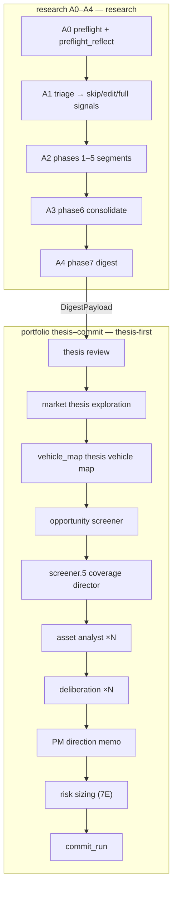
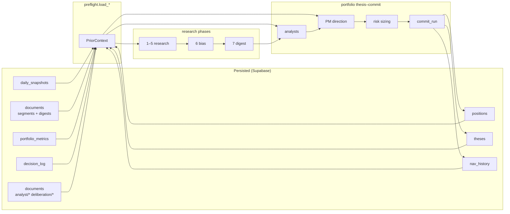

## research + portfolio Sub-graphs (ADR-0009 + ADR-0015 + ADR-0020)

> Split out of [digiquant/ARCHITECTURE.md](../../ARCHITECTURE.md) (DIG-3399). Prose is unchanged. Relative links were adjusted for this directory.

digiquant ships two sibling sub-graphs that compose end-to-end on **one daily topology**
([#930](https://github.com/digithings-ai/digithings/issues/930), spec
[`docs/superpowers/specs/2026-06-20-olympus-daily-thesis-design.md`](../../../docs/superpowers/specs/2026-06-20-olympus-daily-thesis-design.md)):

**digigraph product graphs (#3415).** Production direction is digigraph-hosted
`research-portfolio-chain` (`digigraph.graph.product_graphs`) invoking digiquant
over HTTP (`digiquant_compile_research_portfolio` dry path first; full apply
cutover later). The CLI `python -m digiquant.portfolio.chain` remains the apply
entry until that cutover. Prompt / structured-output walk for the same pass:
[#3424](https://github.com/digithings-ai/digithings/issues/3424) —
`digiquant.dashboard.prompt_walk_inventory` and
`research/docs/PROMPT_STRUCTURED_OUTPUT_WALK.md`.

- **research** (`digiquant/src/digiquant/research/`) — research only. **A0–A4:**
  preflight → triage → phases 1–5 segments → phase6 consolidate → phase7 digest.
  Preflight (#2609 Track B) pins a versioned `ProfileConfig` onto
  `ResearchConfigBundle.profile_config_version_id` / `.profile_config`: omitting the pin
  selects the digithings **house** default (always-on, immutable); an overlay pin
  fails closed when the exact `olympus_profile_config.id` is missing. Overlays must
  not fork the graph or cancel the house run. Models:
  `digiquant.dashboard.profile_config`. Optional nested
  `pipeline_schedule` / `execution_policy` (#3611) record workspace stage-day intent
  and calendar-vetoable execution constraints inside the same append-only payload
  (no new table). Stage gates (#3618) resolve today's `PipelineSchedule` inside
  `digiquant.portfolio.chain.run_research_then_portfolio` (and the overlay path that
  calls it): disabled research / deliberation stages are skipped (preflight hydrates
  overlay `ProfileConfig` before the research skip). Typed outcomes
  (`ran` | `disabled` | `deferred` | `failed`) persist on
  `ResearchState.pipeline_stage_outcomes` and the diagnostics breakdown key
  `pipeline_stages`. Execution is not invoked in this compose (`execute_at_open`
  remains a separate job); the report records schedule eligibility / disable /
  calendar-deferral. Calendar deferral is a typed thin hook
  (`MarketCalendarContext`) — when unavailable, execution gates on schedule only.
  Models: `digiquant.portfolio.stage_gates`. Market-hours venue I/O remains follow-on.
  Shared research corpus (#2613 Track B / WP12-class) uses tenant-agnostic keys
  `theme:` / `asset:` / `segment:` in `olympus_research_corpus` with
  publish-if-missing only — house writes defaults; overlays never fork per-user
  research trees. Models/store: `digiquant.dashboard.research_corpus`.
  **Phase 3 research-state contracts (#2841 / WP12.1, hardened #2856).** Frozen/extra-forbid
  Pydantic models in `dashboard/research_retrieval/models.py`
  (`EvidenceRecord`, `BeliefVersion`, `ExpectedEventVersion`, `ResearchPatch`,
  `ResearchStateManifest`, `ResearchStateVersion`, `ResearchStatePin`,
  `LegacyDocumentRef`) establish append-only structured research memory before
  persistence. UTC temporal order (`event_time` / `effective_as_of` / `known_at` /
  `recorded_at`), typed `TypedProvenance`, immutable sorted+deduped ID tuples, UUID5
  content identity independent of input ordering (lineage in evidence/patch IDs;
  `state_version_id` includes `schema_version`), parent/supersession validation, and
  pin invariants (`requested_as_of <= knowledge_cutoff_at <= pinned_at` with
  `pinned_at >= requested_as_of`). Prose `documents` remain views — never authoritative
  truth; do not parse legacy prose into claims. Distinct from Track B corpus pins
  (theme/asset/segment identity).
**Research-state store (#2854 / WP12.2, hardened #2867).** Private append-only tables in
  migration `088_olympus_research_state.sql` (pin temporal CHECKs in `089`) plus
  in-memory `research_retrieval/store.py` (`ResearchStateStore`; SQL IO adapter later):
  content-idempotent appends, changed content appends new content-addressed rows (never
  UPDATE), `select_state_as_of`, `pin_state_for_run`, exact `load_state_version` (byte-
  equivalent after newer rows), child-parent checks. Pins reject future-known children and
  `effective_as_of` after `requested_as_of`; appends reject children known after the
  version envelope. Strict reads exclude future-known (`known_at` after cutoff) and
  legacy-null-known inventory rows. Dark launch — no public base view.
  **Research-state preflight pin (#2863 / WP12.3).** research preflight selects one
  exact `ResearchStatePin` via `research_retrieval.pin.pin_research_state_for_preflight`
  (`select_state_as_of` / optional explicit `requested_research_state_version_id`,
  then `pin_state_for_run`). Result lands on `ResearchState.research_state_pin`
  + `research_state_status` (`pinned` | `state_unavailable`). Resume reuses the
  run/attempt pin (checkpoint + store `get_pin`); same-run child versions must
  name the pinned root as `parent_state_version_id` (`child_version_must_name_parent`).
  Typed `state_unavailable` when store missing/unusable — including fail-closed
  store rejections (look-ahead children / `effective_as_of` after `requested_as_of`).
  Compatibility `documents` path remains shadow-only until exact-state coverage; never
  `load_latest` after pin. Helper uses WP12.1 ID helpers only (no redefine).
  Soft API for WP12.3 must sit on the hardened store (#2868 / #2867).
  **Legacy research-state inventory (#2870 / WP12.4).** Operator backfill
  `digiquant/scripts/research/backfill_research_state.py` (default dry-run; `--apply` appends
  to in-memory `ResearchStateStore` only — SQL IO adapter later) maps existing
  `documents` / JSON sources into `LegacyDocumentRef` inventory via
  `research_retrieval.legacy_backfill.backfill_legacy_manifests` — hashes source
  payloads with WP12.1 `content_digest` / `legacy_document_ref_id`, sets
  `known_at=None` + `legacy_manifest_only=True`, and never appends evidence,
  belief, expected-event, or patch rows. Idempotent counts
  (`source == inserted + skipped + unverifiable`); strict `load_state_version`
  continues to omit legacy refs. Audit/degraded compatibility only — not strict
  replay/training.
  **Compiled research-state prose views (#2877 / WP12.5).** Deterministic brief/digest
  markdown from one exact `ResearchStateVersion` via `research_retrieval/views.py`
  (`compile_research_brief` / `compile_research_digest` / `compile_views_from_store`).
  Entities are sorted by UUID; every view embeds `state_version_id`, state
  `content_hash`, `schema_version`, and `manifest_content_hash`. Same pinned version
  recompiles byte-identically after newer store rows. `publish_compiled_views` fails
  closed when structured write did not succeed (no misleading view publication).
  research publish dual-writes `research-state-brief` / `research-state-digest` only when
  `research_state_status=pinned` and `PublishDeps.research_state_store` can exact-load
  the pin; incumbent digest/segment writers remain. Default research/portfolio CLI leave
  `research_state_store` unwired (WP12.3 shadow pattern), so dual-write is inactive
  until callers inject the store; not yet an operator-authoritative document surface.
  Never `load_latest`; never parse prose into claims.
  **Ticker evidence bundles (#2844 / WP11.1 + #2892 / WP11.2).** Immutable analyst base
  `TickerEvidenceBundle` plus append-only `MissingFactRequest` /
  `EvidenceBundleAmendment` contracts in `research_retrieval/models.py`.
  Private migration `090_olympus_evidence_bundles.sql` (+ `091` base/request
  consistency trigger) and in-memory `EvidenceBundleStore`: content-idempotent
  base append, one base per run/ticker, amendments must FK one base + one
  missing-fact request (zero unlinked amendments), public grants denied, no
  public view. Reuses WP12 UUID5 / `content_digest` / `TypedProvenance`
  conventions — does not invent a parallel hash scheme. WP11.2
  (`research_retrieval/evidence_bundle.py`) builds one canonical analyst base per
  ticker (dedupe, temporal span, conflicts/missing fields) **before** the
  provider call (`portfolio_common` / `analyst`), retains
  `PhasePortfolioState.ticker_evidence_bundles` even when analyst fails, and cites
  bundle/evidence IDs on newly materialized `ForecastTerms`. Default portfolio
  graph leaves `EvidenceBundleStore` unwired (same shadow pattern as
  `research_state_store`): typed in-run bundles always materialize; store
  append runs only when a caller injects the store. `DIGIQUANT_EVIDENCE_BUNDLE_WRITER=off`
  then skips that append while retaining the typed bundle. Not
  operator-durable yet — SQL IO adapter still later. WP11.3
  (`research_retrieval/planner.py`) adds deterministic `DeliberationSelection`
  (reasons/features/budget) wired into `deliberation`:
  `DIGIQUANT_H6_SELECTION_MODE=off|shadow|enforce` (default `shadow` records
  selection beside full incumbent deliberation; `enforce` actuates low-value carry with
  zero provider calls; planner failure falls back to full incumbent deliberation, never
  an unrecorded skip). Materiality (`weight_pct`) is a selection feature only
  — never injected into deliberation prompts. Selected success still meets the two-round
  floor. WP11.4 (`research_retrieval/deliberation_amendment.py`) constrains deliberation to at most one
  validated missing-fact supplement per base bundle: PM ``MissingFactProposal``
  (claim_id/question/source_kind/reason) → blinded ``query_research`` only (no
  generic ``live_search``) → append-only ``MissingFactRequest`` +
  ``EvidenceBundleAmendment`` with base ``content_hash`` unchanged; invalid,
  exhausted, or failed paths record ``evidence_amendment_outcome`` on
  ``DeliberationSummary`` and continue on the analyst base. WP11.5
  (`EvidenceBundleStore.dump_snapshot` / `from_snapshot`, simulator
  `evidence_bundle_store` + `invoke_through_h5` / `invoke_portfolio_from_h6`,
  `tests/dq/research/test_pipeline_simulation.py::TestDurableH5H6LineageRoundTrip`)
  proves analyst bases + deliberation amendments survive store serialize/reload across the
  analyst→deliberation checkpoint boundary with byte-equivalent lineage, two-round floor,
  accepted/invalid amendment provenance, and no generic deliberation ``live_search``.
  WP11 closes on develop when this lands.
  AttentionPlan shadow (#2616 Track B / WP13-class) records typed pre-provider
  decisions + stable `RefreshReasonCode`s via `digiquant.dashboard.attention_plan`
  (`plan_attention_shadow`) beside incumbent `resolve_edit_mode`. Modes are
  `off` \| `shadow` only (no enforce); `actuated` is always false. House
  ProfileConfig is the default pin; overlay pins fail closed when missing. The
  planner cannot expand screener roster/cap or carry direction/sizing authority fields.
  **Research attention policy (#2918 / WP13.1).** Versioned YAML at
  `digiquant/config/research_policy.yaml` (override via
  `DIGIQUANT_RESEARCH_POLICY_PATH`) defines thresholds, session budgets, mode
  estimates, and exploration floor — not hard-coded in planner source.
  `research_retrieval/planner.py` exposes `AttentionFeatures`,
  `AttentionDecision`, `AttentionPlan`, `ResearchAttentionPolicy`,
  `route_attention`, and `plan_research_attention` with five modes
  (`carry` \| `metric_patch` \| `section_patch` \| `challenge` \| `deep_refresh`)
  and rollout `off` \| `shadow` \| `enforce`. Identical state/policy/target set
  yields byte-identical plan + resource totals; exploration reservations survive
  session budget trimming.   `deliberation_selection_to_attention_decision` bridges WP11.3
  `DeliberationSelection` without forking ID schemes. API-only in 13.1 — portfolio
  runtime wiring is WP13.4 (landed #2930); persistence is WP13.2; research pre-provider routing is
  WP13.3.
  **Attention persistence (#2922 / WP13.2).** Migration
  `092_olympus_attention_context.sql` + in-memory
  `research_retrieval/store.py` `AttentionStore` persist append-only
  `AttentionPlan` / `AttentionDecision` / `AttentionContextManifest` /
  `AttentionPolicyEvaluation` rows with run/attempt/state/policy/reason/feature/
  budget lineage and per-decision WP1 `provider_attempt_id` links. Exact
  `recorded_at` as-of reads; `reconcile_plan` joins planned budgets to actual
  attempt usage and sets `complete=False` when telemetry is missing (rollback:
  disable writes/enforcement). Storage only until WP13.3+ callers opt in via
  `DIGIQUANT_RESEARCH_ATTENTION_MODE`.
  **research attention routing (#2926 / WP13.3).** After triage,
  `research/research_attention.py` calls `plan_research_attention`, persists reasons
  to `AttentionStore`, and stores the plan on `ResearchState.research_attention_plan`.
  Provider-owning nodes (`_node_factory.build_segment_node`, `phase7_synthesis`) require
  the plan before `build_grounding` when mode is `shadow`/`enforce`. `enforce` actuates
  `carry`/`metric_patch` as zero-call paths (deterministic structured patch); `shadow`
  records decisions while the incumbent edit path still runs. Rollback: `off`/`shadow`.
  Env: `DIGIQUANT_RESEARCH_ATTENTION_MODE=off|shadow|enforce` (default `shadow`).
  **portfolio attention routing (#2930 / WP13.4).** After screener fixes the focus roster,
  `portfolio/research_attention.py` plans per-ticker attention over that roster only
  (cannot add/remove/reorder/expand or consume exploration). Stores
  `ResearchState.portfolio_research_attention_plan` and persists to the shared
  `AttentionStore`. analyst branches on enforced `carry`/`metric_patch`/`full` before
  provider work; deliberation re-routes with post-analyst features (`challenge` vs `carry`).
  screener roster/exclusions are byte-identical across `off`/`shadow`/`enforce`.
  Rollback: `off`/`shadow` restores incumbent analyst/deliberation paths.
  **Attention shadow evaluation (#2934 / WP13.5).** File-only CLI
  `digiquant/scripts/research/evaluate_research_policy_shadow.py` joins `AttentionStore`
  plans/decisions to exact WP1 `provider_attempt_id` usage and per-target
  downstream outcomes (carries, amendments, forecast, direction, exploration) via
  `research_retrieval/shadow_evaluation.py`. Missing telemetry or downstream
  linkage sets `complete=False`; eligible shadow runs require 100%
  decision-attempt reconciliation before enforcement. Rollback: shadow-only —
  no `enforce` activation.
  **Role context compiler (#2938 / WP14.1).** `research_retrieval/context.py`
  defines frozen `ContextCapsule`, `ContextItem`, `ContextManifest`, and per-role
  allowlists (`analyst`, `deliberation`, `direction`). `compile_context_capsule`
  / `compile_context_manifest` compile bounded structured JSONL bodies from one
  exact pinned `ResearchStateVersion` plus optional bundle/amendment/attention
  artifacts. Deterministic sort/hash, byte/token budgets, typed omission reasons,
  and reject unpinned bundle/state mismatches at compile time. Models + compiler
  only — analyst/deliberation/direction provider wiring is WP14.2–14.4; drill-down manifest pinning is
  WP14.4. **WP14.2 (#2942)** wires analyst/deliberation via
  `research_retrieval/context_wiring.py` (`DIGIQUANT_CONTEXT_COMPILER_MODE`
  `off|shadow|enforce`): shadow compiles the capsule/manifest and returns them on
  `RoleContextWireResult` (since #4609 it no longer re-serializes the shadow
  blobs into the uncached `phase_inputs` by default — set
  `DIGIQUANT_CONTEXT_SHADOW_IN_PROMPT=1` to restore the old in-prompt blobs);
  enforce strips portfolio/PM keys and injects `structured_context`
  with manifest linkage fields for WP1 telemetry. Prompt guards live in
  `research_retrieval/blinding.py` (`assert_blinded_analyst_prompt` /
  `assert_blinded_deliberation_prompt`). **WP14.3 (#2946)** wires direction via the same mode knob:
  `direction_decision_context.py` compiles typed sections (mandate, calibration,
  contribution/cost, pre-trade risk, prior authorization, unresolved/matured
  forecasts) from pinned research state plus `direction_prerequisite_snapshot` (preflight);
  `wire_direction_phase_inputs` records shadow beside incumbent PM inputs or enforces
  `structured_context` without target weights; direction output schema unchanged.
  **WP14.4 (#2950)** pins drill-down retrieval to compiled manifests via
  `DIGIQUANT_RETRIEVAL_MANIFEST_MODE` (`off|shadow|enforce`, default `shadow`):
  `build_retrieval_query_pin` binds document access to pinned state legacy refs;
  `build_research_tool_dispatcher` rejects un-pinned calls and latest-date
  fallbacks in enforce; `RoleRetrievalManifestStore` persists pre-call manifests and
  append-only WP1 token links (`ProviderAttemptTokenLink`) without mutating
  manifests; `retrieval_pin_from_wire_result` bridges WP14.2/14.3 linkage fields.
  **Outcome-learning contracts (#2954 / WP15.1).** Frozen Pydantic v2 models in
  `dashboard/learning/outcome_models.py` (`OutcomeEpisode`, `ComponentAttributionReport`,
  `OutcomeLessonVersion`, disposition/eligibility/quality enums) connect forecast →
  decision → execution → realized outcome → learning eligibility without persistence.
  UTC temporal contract (`OutcomeTemporalContract`), UUID5 version IDs, SHA-256 content
  hashes, and disposition-aware validation: excluded/no-op/rejected forbid fabricated
  commit links or realized returns; authorized requires them; unavailable attribution and
  ineligible components require typed reasons; causal sizing/timing P&L requires
  `counterfactual_replay` with `replay_artifact_id`. Legacy `beliefs_distillation` prose
  remains non-authoritative. **Outcome-learning store (#2959 / WP15.2).** Private append-only
  `OutcomeLearningStore` in `dashboard/learning/outcome_store.py` persists episodes, component
  attribution reports, and lesson versions (migration `093_olympus_outcome_learning.sql`).
  Content-idempotent retry; changed content appends a new version; supersession requires parent;
  `select_episode_as_of` / `select_lesson_as_of` honor `available_at` and knowledge cutoff;
  exact load never fabricates history. **Outcome episode assembler (#2963 / WP15.3).**
  `OutcomeEpisodeAssembler` in `dashboard/learning/outcome_assembly.py` joins typed reader
  protocols only (WP2 ledger lineage, WP3 accounting slices, WP5 matured forecasts, WP7 cost
  refs, WP9 pre-trade risk) to build one deterministic `OutcomeEpisode` per matured forecast.
  Assembly failures return `AssemblyBlocker` without fabricating partial numbers; content-idempotent
  retry via `OutcomeLearningStore`; corrections supersede prior versions. **Component attribution
  (#2967 / WP15.4).** `ComponentAttributor` in `dashboard/learning/component_attribution.py` builds
  independent `ComponentAttributionReport` observations from one `OutcomeEpisode` plus optional
  `PairedReplayEvidence`. Forecast error uses identical-horizon instrument returns; execution compares
  expected vs realized cost; timing latency/price drift are descriptive only; sizing/timing causal P&L
  requires `counterfactual_replay` with a paired manifest hash and declared baseline — one-at-a-time
  deltas from different replay artifacts are rejected.   Active-return waterfall declares order, baseline,
  and residual without summing independent counterfactuals or substituting zero for missing data.
  **Lesson compiler (#2971 / WP15.5).** `LessonCompiler` in `dashboard/learning/lesson_registry.py`
  aggregates eligible episodes and component attribution reports into immutable
  `OutcomeLessonVersion` records via Polars (mean/std), low-sample prior/shrinkage toward a
  declared compilation policy, deterministic SHA-256 content hashes, and append-only persistence
  through `OutcomeLearningStore.append_lesson`. Cutoff rules honor `available_at` /
  `knowledge_cutoff_at`, exclude the consuming run's own outcomes, and expose every source
  episode/report ID — rendered prose is never authoritative. **Preflight lesson pin (#2975 / WP15.6).**
  `research/phases/outcome_maturation.py` runs inside existing `preflight` (no new graph node) in
  order: pinned `knowledge_cutoff_at` → `OutcomeEpisodeAssembler.assemble_pass` +
  `ComponentAttributor.attribute_and_persist` for prior-run matured forecasts →
  `LessonCompiler.compile_and_persist` / `OutcomeLearningStore.select_lesson_as_of` →
  `outcome_lesson_pin` on `ResearchState` and `DirectionPrerequisiteSnapshot.outcome_lesson_*`
  for WP14 analyst/direction context. Structured `outcome_lesson:{id}` replaces `decision_log` prose in
  prior-authorization sections when pinned; consuming-run episodes are excluded. Unwired
  `outcome_maturation_deps` → typed `store_unavailable` (legacy paths continue).
  pin one timezone-aware UTC `ResearchState.knowledge_cutoff_at` before
  graph construction (`digiquant.dashboard.temporal`). Registry readers must call
  `require_knowledge_cutoff_at` — missing cutoff fails closed (no `now()`
  fallback). Checkpoint resume preserves the pinned value; naive / non-UTC
  stamps are rejected at capture and on the state field validator.
  **Typed forecast contracts (#2637 / WP4.2, #2649 / WP4.3, #2656 / WP4.4).** Frozen Pydantic
  models in `portfolio/models/forecast.py` (`ForecastTerms`, `ForecastAssessment`,
  `ForecastAmendment`, `EffectiveForecast`, `PriceAnchor`) separate scenario economics
  from UUID5 identity / content hash. Optional `AnalystPayload.forecast` may carry terms;
  legacy `conviction_score` / `price_targets` never synthesize them. analyst full/edit
  materializes an immutable `ForecastAssessment` via
  `portfolio/phases/portfolio_common.py` (`materialize_forecast_assessment`,
  serializer includes assessment; legacy priors without typed forecast force
  full; skip preserves identity; partial nested forecast edits are rejected, and a
  stance edit on an evidence-bearing prior must re-itemize `/body/evidence` in the
  same patch, because `conviction_score` is derived from those counts and would
  otherwise be re-derived from the prior call's counts (#4583). Those counts are
  itemized against the analyst's **own call** (its `stance`), not against the market
  thesis the vehicle is mapped to: an analyst may disagree with the thesis it carries,
  and the families contradicting that thesis then confirm the call.
  **Five-family evidence sum (#4585).** Both counts are drawn from one five-family
  universe — technicals, fundamentals, flows/positioning, macro regime, sentiment/news —
  and each family is itemized once, on the confirming or the contradicting side.
  `EvidenceAssessment` enforces `independent_confirming_signals + contradicting_signals
  <= 5` with a cross-field `model_validator` that **rejects** an overcount (the pre-fix
  schema bounded each field at `le=5` independently, so `analyst/IBIT` 2026-09-22 stored
  `4 + 4` — eight families over five). A **persisted/prior** body that violates the sum is
  repaired on read by `repair_legacy_evidence_counts` (skip/carry, metric-patch, and
  edit-fallback paths): it preserves the net `confirming - contradicting` — so the derived
  `conviction_score` is unchanged — while reducing the pair to fit (`4+4 -> 2+2`,
  `5+2 -> 4+1`, `2+5 -> 1+4`). Fresh LLM output is validated strictly, so an impossible
  generation is caught and retried rather than silently rewritten.
  deliberation appends optional evidence-linked `ForecastAmendment` without rewriting the base;
  LLM envelopes that nest economics under `terms` (SLV/IAU in house GHA 33426508863)
  unwrap before validate, and missing `horizon_sessions` / `half_life_sessions` copy
  from the analyst base tenor (GLD in the same run). Scenario economics are never filled
  from the base; invalid probability sums still reject.
  Out-of-range deliberation `conviction_delta` (live `-3` on `DeliberationAnalystTurn`) clamps
  to `[-2, 2]` at the model boundary so the debate is kept.
  `resolve_effective_forecast` selects base or accepted amendment (invalid/failed
  amendments and post-cutoff known_at preserve base). Fingerprint skip and slim prior
  carry retain effective identity/time/hash **and** the accepted `forecast_amendment`
  dump (`supabase_io._slim_deliberation_summary`, deliberation payloads) so commit can
  re-persist after registry fail-soft (#2790). **direction forecast-reference-only (#2660 / WP4.5):** after the
  PM LLM (or fail-soft prior-memo carry), `bind_forecast_references` attaches one
  typed `ForecastReference` per `TickerDirection` from current deliberation lineage IDs
  (`effective_forecast_id` / nested `effective_forecast`) — identity only, never
  terms/weights; missing lineage is an explicit degraded reference (null IDs +
  `degradation_reason`, no fabricated UUIDs); fail-soft rebinds from the current
  map and cannot retain prior refs. sizing still reads direction/rank only.
  **commit forecast registry (#2663 / WP4.6):** after portfolio booking, commit fail-soft
  appends prospective `olympus_forecast_assessments` / `olympus_forecast_amendments`
  via `research/forecast_registry.py` (exact retry / content conflict; exact-ID cutoff
  reads). Registry failure keeps the one committed book and cannot rebook; status
  lands on the commit manifest (`schema_version` 1.3). No calibration writers.
  **Forecast calibration contracts (#2672 / WP5.1 + #2676 / WP5.2 + #2680 / WP5.3 +
  #2684 / WP5.4):** frozen models in
  `portfolio/models/forecast_calibration.py` (`ForecastOutcome`, `ForecastCalibration`,
  `CalibratedForecast`, `SessionPriceSnapshot`) plus private append-only tables in
  migration `080_olympus_forecast_calibration.sql`. Prospective labels only (no
  portfolio contribution); trading-session maturity; UUID5 + content-hash identity.
  **Outcome resolver (#2676 / WP5.2):** `research/forecast_outcomes.py` runs beside
  `preflight_reflect` (not inside `decision_log`), snapshots due typed forecasts into
  `olympus_forecast_outcomes` using the trading calendar + first observed closes,
  cutoff eligibility, same-run exclusion, and append-only idempotency. Missing
  calendar/close stays pending (never zero-return) — including a ticker with no
  sealed R2 generation (`UnknownTickerError`), where a matured forecast that has left
  the universe stays pending instead of crashing the research graph (#4120). **Shadow calibrator (#2680 / WP5.3):**
  `portfolio/forecast_calibration.py` shrinks cohort residual bias toward a declared
  zero-mean prior (`PRIOR_DEFINITION` / `METHOD_VERSION`), reports Brier/log scores via
  Polars aggregation, and emits observational `CalibratedForecast` subjects with
  non-zero uncertainty and sample-bounded reliability. **Shadow persistence (#2684 /
  WP5.4):** `attach_shadow_calibrations*` runs at the existing deliberation→direction boundary (no new
  node); cutoff-bounded outcomes via `list_resolved_outcomes_as_of`; typed state slots
  `phase_portfolio.forecast_calibrations` / `calibrated_forecasts`; commit fail-soft appends
  via `forecast_registry.persist_shadow_calibrations` after booking. sizing remains
  untouched. **WP5 Gate-2 follow-up (#2797):** outcomes stamp `horizon_sessions`;
  cohort attach filters residuals to the subject horizon; migration 087 adds
  `UNIQUE (effective_forecast_id, maturity_session)` and refuses wall-clock
  `as_of` when knowledge cutoff is missing. **Canonical outcome hashing + repair
  (#4298):** `ForecastOutcome` hashes return fractions at fixed 8dp
  (`canonical_return_fraction`, shared `forecast_outcome_hash_payload` between
  writer and validator) so Postgres `numeric` trailing-zero loss cannot change the
  digest; `list_resolved_outcomes_as_of` fails loud with
  `ForecastOutcomeIntegrityError` rather than silently skipping a stale row, and
  `scripts/research/repair_forecast_outcome_hashes.py` rewrites stale
  `content_hash`/`outcome_id` (privileged direct PG; append-only trigger disabled
  within one transaction). That rewrite changes `outcome_id` (its UUID5 input), so
  any `olympus_forecast_calibrations.outcome_ids` entries citing the pre-repair
  UUID are left stale: the array is not a foreign key and no runtime path joins on
  it, so this does not break a run, but it is a documented lineage-only decision
  (see the repair script docstring) rather than a live reference.
  **Risk policy contracts (#2692 / WP6.2, #2803):** frozen models in
  `portfolio/models/risk_policy.py` (`RiskPolicy`, `CovarianceSnapshot`, provenance
  leaves, explicit Phase 1 unavailable factor/stress/tail capabilities) plus pure
  resolver in `portfolio/risk_policy.py` (`incumbent-*-@v2`). Resolves incumbent defaults
  from config/preferences into one fully provenanced policy and one canonical
  correlation snapshot (63-day Pearson). Incomplete Pearson pairs fail closed as
  ``unavailable`` (structural identity placeholder only; ``unavailable_reason`` is
  hashed so distinct failures cannot share ``snapshot_id``). Bridge helpers derive
  `SizingCaps` / `BreakerConfig` for parity tests only — production sizing still calls
  `size_portfolio` directly in Phase 1.
  **Risk snapshot persistence (#2698 / WP6.3, #2803):** `portfolio/sizing_risk_snapshots.resolve_sizing_risk_artifacts`
  runs at the existing sizing entry before incumbent sizing and always returns typed
  artifacts (resolver exceptions become visible ``unavailable`` dumps); typed state
  slots `phase_portfolio.risk_policy` / `covariance_snapshot`; commit fail-soft appends via
  `risk_policy_registry.persist_sizing_risk_snapshots_from_state` after booking (manifest
  `schema_version` 1.4). Never feeds resolved objects into `size_portfolio` in Phase 1.
  **Action cost input binding (#2700 / WP7.1):** adapters in
  `portfolio/action_cost_inputs.py` translate authoritative Phase 0 ledger rows
  (`PortfolioCommit`, `DecisionIntent`, `OrderIntent`, `PaperExecution`) and
  accounting `PeriodFill` into frozen `ActionCostInput` / `RealizedCostInput`
  without inferring notional from NAV/weights. Currency is caller-supplied (Phase 0
  rows carry no currency column); missing fee/slippage on pre-070 executions raises
  `ActionCostBindingError` rather than defaulting to zero. commit / preflight resolve
  currency only via explicit `config.preferences.investor_currency` (or `currency`)
  — never silently invent `USD` (#2808); missing currency fail-softs as
  `currency_missing`.
  **Observational cost/liquidity (#2703 / WP7.2):** pure contracts in
  `portfolio/models/cost_liquidity.py` and estimator in `portfolio/cost_liquidity.py`
  consume `ActionCostInput`, prospective OHLCV/technicals, and resolved
  `RiskPolicy.cost_coefficients` to emit `LiquiditySnapshot`, `ActionCostEstimate`,
  and `ActionCostOutcome`. Spread uses labeled high-low range fractions (not quotes);
  missing economics map to `unpriceable`/`degraded` with explicit reasons — never
  zero-by-omission. Phase 1 observational only — estimates do not feed turnover.
  **Cost/liquidity persistence (#2709 / WP7.3):** after commit mints `order_intent_id`,
  `portfolio/commit_cost_evidence.py` builds bundles and
  `research/cost_liquidity_registry.py` append-writes to migration `082` tables
  (fail-soft after booking). `preflight_reflect` resolves `ActionCostOutcome` when
  paper executions arrive; typed state slots `liquidity_snapshots` and
  `action_cost_estimates` on `PhasePortfolioState`.
  **sizing allocation input contracts (#2727 / WP8.2 + #2730 / WP8.3 + #2734 / WP8.4 +
  #2738 / WP8.5):** frozen
  `AllocationInputBundle` models in `portfolio/allocation_contracts.py` with SHA-256
  helpers in `portfolio/allocation_hashes.py`. `portfolio/allocation_inputs.py` assembles
  one validated bundle at sizing entry from direction mandate + exact Phase 1 forecast /
  policy / covariance / cost versions + prior weights; typed state slot
  `phase_portfolio.allocation_input_bundle`. WP8.4 cutover: when
  `sizing_input_mode=calibrated` (default) and the bundle yields at least one
  AVAILABLE positive-alpha score, incumbent `size_portfolio` raw weights use
  `reliability × max(0, μ) / σ_ε` — rank→conviction and fixed-premium Kelly are
  absent from that path. Missing/empty coverage falls back to characterized
  incumbent (`incumbent_fallback`); set `sizing_input_mode=incumbent` to force
  the legacy path. Every sized book stamps `allocation_input_bundle_hash` +
  `sizing_input_mode`. sizing then scales each long by direction `confidence` (cash-first;
  missing → 0.5). Downstream caps/corr/vol/breaker/grid/continuity stay in the
  same order; confidence is a reduce-only haircut after vol-target so leftover
  cash is not redistributed. WP8.5 locks that shell in
  `tests/dq/portfolio/test_allocation_invariants.py` (explicit
  `INCUMBENT_CONTROL_ORDER`, cash-first caps, continuity/cadence/turnover/final
  caps, calibrated mode stamps).
  **Pre-trade risk report (#2742 / WP9.1, #2746 / WP9.2, #2750 / WP9.3):** the same
  `portfolio/allocation_contracts.py` module defines frozen `PreTradeRiskReport`
  (plus `ScalarMetric` leaves, book/trade views, exposure/risk/concentration/
  cost/forecast/control blocks). Every required metric is a value +
  `MetricProvenance` or typed `UNAVAILABLE`/`DEGRADED` with reason — no hidden
  zeroes, no LLM numbers, no weight mutation. SHA-256
  `pretrade_risk_report_content_hash` / `pretrade_risk_report_hash_payload` live
  in `portfolio/allocation_hashes.py`. Pure builders in `portfolio/pretrade_risk.py`
  compute variance/MRC/CRC (CRC reconciles to σ_p), concentration/effective bets,
  turnover, and cost/liquidity from the exact WP6 correlation snapshot +
  caller-supplied annualized vols and WP7 observational scalars — never
  re-estimating covariance/cost or fabricating factor/scenario values. sizing
  (`phase7e_risk_sizing`) attaches `phase_portfolio.pre_trade_risk_report` after the
  final control shell only; `final_book_weights_fingerprint` must equal the final
  sized-book fingerprint. Typed report failure omits the report without changing
  the book. commit (`commit_run`) validates attached report hashes under
  `DIGIQUANT_PRETRADE_RISK_MODE` (`off`|`shadow`|`enforce`; default `shadow`) and
  append-only persists to `olympus_pretrade_risk_reports` (migration `083`) via
  `research/pretrade_risk_registry.py` + `commit_io.validate_pretrade_risk_report` /
  `persist_validated_pretrade_risk_report` (#2754 / WP9.4). Enforce fails closed
  on missing/unknown/fingerprint or bundle-hash mismatch before booking; exact
  retry skips; commit never imports report builders. Manifest schema 1.6 carries
  `pretrade_risk_report_id` / `pretrade_risk_report_hash` + write counts.
  **Shadow allocation artifact (#2758 / WP10.1):** frozen
  `ShadowAllocationArtifact` in `portfolio/shadow_artifact.py` binds the exact
  `AllocationInputBundle`, incumbent final book, `PreTradeRiskReport`, and
  minimal commit metadata under one SHA-256 `artifact_content_hash`. Chain
  exports canonical JSON atomically (temp + replace) after portfolio when
  `DIGIQUANT_SHADOW_ARTIFACT_MODE=export` (default) into
  `DIGIQUANT_SHADOW_ARTIFACT_DIR` (default `artifacts/`). Fail-soft — export
  failure never reruns or mutates sizing/commit. No challenger optimizer, replay, or
  broker imports on the production path; `pipeline-digiquant.yml` uploads
  `shadow-allocation-*.json` with run artifacts for WP10.2+ isolation.
  **Write-denied shadow workflow (#2762 / WP10.2):**
  `pipeline-digiquant-allocation-shadow.yml` +
  `digiquant/scripts/research/check_allocation_shadow_isolation.py` enforce
  artifact-in / file-out isolation (no `secrets: inherit`, no production
  credentials, read-only permissions, trusted producer workflow/branch,
  schema/hash gates). Disable the shadow workflow to roll back without
  touching production sizing/commit.
  **Solver-free robust challenger (#2770 / WP10.3):**
  `portfolio/shadow_optimizer.py` — deterministic coordinate-search on the robust
  objective (uncertainty + covariance risk + linear cost + L1 turnover) under
  shared feasibility (caps/grid/authorization). Shadow-only; never wired into
  production sizing/commit; no SciPy/CVXPY; abstains on incomplete/invalid inputs.
  **Shared-cash Nautilus portfolio replay (#2784 / WP10.4):**
  `dashboard/replay/` — one `BacktestEngine`, one cash account, all instruments,
  global event ordering, next-bar target deltas, and real engine fills/costs.
  Parent API `run_portfolio_replay_isolated` spawns a fresh worker with JSON
  I/O; crash/timeout → typed inconclusive (never a fabricated book). Must not
  call `nautilus_runner._run_multi_symbol_backtest`. Shadow/challenger only —
  production sizing/commit must not import `dashboard.replay`.
  **Schedule replay, schema 2.0 (#3695):** `models.py` adds
  `ScheduledTargetWeights(effective_date, weights)` + optional
  `PortfolioReplayRequest.weight_schedule` (requires `schema_version="2.0"`,
  empty `target_weights`, `next_bar_execution=False`; every effective_date
  must equal a bar date). `nautilus_portfolio.py` executes each entry once at
  its bar's close with same-bar fills (sells-before-buys two-pass), i.e. the
  row dated D is submitted and filled at D's close — the causal convention
  the house-book restatement (June→Sept 2026) was validated against (engine
  matched the arithmetic chain to <1e-6 on that run; the enforced forward
  guard band is 25bp fail / 1bp warn — see verify_nav_replay.py).
  Legacy single-target trigger semantics unchanged when the schedule is empty
  (submission now uses the sells-first ordering for both paths).
  Forward verify: `digiquant/scripts/research/verify_nav_replay.py` rebuilds
  the causal schedule + bars from Supabase and fails non-zero on NAV breach.
   **Single source of truth (#3695, hardened #3803/#3804):** the engine is the last writer of
   `nav_history` under normal ordering via `verify_nav_replay.py --write`
   (inception-100 normalization; `pipeline-research-metrics.yml` runs it before
   metrics). The booking path (`portfolio_materialize.py`, commit
   `commit_io.book_portfolio`) still writes provisional house rows at book time,
   but an existing row for the same `(workspace_id, date)` now keeps the stored
   NAV (refreshing only commit-owned `cash_pct`/`invested_pct`) — a book re-dispatch
    after the engine step keeps the engine NAV instead of clobbering it (#3804). Fetches
    seek by keyset over a deterministic `(date, ticker)` order (never offsets), sized
    under the PostgREST `max_rows` cap (a full page means "more", only a short page
    ends the loop; asking above the cap raises), and refuse to verify or write from a
    truncated/unstable page (#3803/#3948). Bars whose stored `open`/`close` fall
    outside `[low, high]` (vendor/float64 noise; first prod row SPY 1993-02-12) are
    reconciled by widening the envelope to contain the observed prices — the engine
    marks and fills at `close`, so NAV is unaffected — instead of aborting the
    replay (#3995); non-finite bounds (NaN/±Inf, storable in Postgres `numeric`)
    are refused before any widening (#3994). A read-only
   `verify_nav_replay` (no `--write`) step runs after metrics so drift fails
   loudly.
   **Bookless mark-to-market (#3439):** the scheduled engine step passes
   `--mark-through <today UTC>`, which extends the replay grid past the last
   committed book through today. The last book's positions are held (no schedule
   entry, no fabricated rebalance) and marked at each intervening close, so a
   failed house run no longer leaves the NAV/PnL series flat. Only the grid is
   extended — `positions` is never written — so the missing-book signal and the
   metrics step's exit-3 stale-book alarm are preserved.
  `refresh_performance_metrics.refresh_nav_point` only guards the engine row;
  `pnl_pct` reads the stored engine series (finalized-accounting precedence
  retired — it caused the Sept 2026 scale break); `update_tearsheet.py` no
  longer writes `nav_history` / `portfolio_metrics` (simulation kept for the
  tearsheet artifact only). Dashboard + tearsheets read the stored series.
  **Paired shadow comparison evidence (#2799 / WP10.5):**
  `dashboard/replay/allocation_comparison.py` + packaged
  `replay/shadow_criteria/v1.json` + CLI
  `digiquant/scripts/research/compare_allocation_shadow.py`. Loads frozen criteria
  before inspecting arm results; requires identical data/cost/execution hashes;
  emits absolute + paired metrics with explicit unavailable/inconclusive leaves;
  hard-constraint breaches stay visible even when challenger return is stronger;
  atomic file-only report output. No auto-promotion, production config write, or
  sizing/commit wiring.
  **Policy replay manifests (#2979 / WP16.1):** `dashboard/replay/models.py` adds
  `PolicyVersionRef`, `PolicyBundle`, `SharedInputIdentity`, `WalkForwardFold`,
  `ReplayInputManifest`, `ReplayArmSpec`, and `ReplayPairSpec` — strict frozen
  contracts that separate shared as-of inputs from arm-specific policy refs.
  `dashboard/replay/canonical.py` centralizes SHA-256 digests (data/cost/seed/fill/
  cash/manifest/pair) reused by WP10.5 shadow comparison. Paired arms must share
  one `manifest_content_hash`; `build_replay_pair` rejects unequal shared inputs.
  Allowlisted policy families only; path/pickle-like version IDs rejected. Offline
  models/canonical hashing only — persistence lands in WP16.2.
  **Policy replay governance store (#2983 / WP16.2):** `dashboard/replay/store.py`
  `PolicyReplayStore` + `governance_models.py` persist manifests, pairs, append-only
  run events, immutable arm results, comparison reports, gate criteria versions,
  evaluations, and human decisions. Migration `094_olympus_policy_replay.sql`.
  Content-hash dedupe for manifests/pairs; paired arms require identical shared
  manifest hash; run status derived from events (no mutable running row);
  `load_gate_evidence` reconstructs full gate lineage from immutable IDs/hashes.
  Dark launch — gate evaluator is WP16.7 (`replay/governance.py`); portfolio workers
  ship in WP16.4.
  **As-of policy replay inputs (#2987 / WP16.3):** `dashboard/replay/asof_dataset.py`
  materializes cutoff-bound bars/cash/costs/timing/seed and builds
  `ReplayInputManifest` envelopes; `dashboard/replay/policy_registry.py` resolves
  only allowlisted registered policies (`research_plan`, `portfolio_target`,
  `observed_shadow` plus infrastructure refs). All reads filter
  `known_at <= replay_as_of`; missing/unregistered/incomplete state fails closed;
  unavailable research output is typed — never fabricate analyst/deliberation counterfactuals.
  Later source mutations cannot change a historical manifest at the same cutoff.
  No network/provider calls. Offline only.
  **Policy portfolio replay (#2991 / WP16.4):** `dashboard/replay/policy_portfolio.py`
  binds WP16.3 `AsOfDatasetSnapshot` + `ReplayInputManifest` + `ReplayArmSpec` to
  the WP10.4 shared-cash adapter. Registered `portfolio_target` policies supply
  sorted target weights; walk-forward folds slice eval bars deterministically
  (`slice_series_for_eval_fold`). `build_policy_arm_request` validates manifest/arm
  hash alignment and shared-input identity; `run_policy_arm_replay_isolated` spawns
  one fresh worker per arm/fold. `reconcile_portfolio_replay_result` in
  `nautilus_portfolio.py` asserts every OK result reconciles NAV, cash, holdings,
  fills, and commission totals in one engine. Unavailable/mismatched policy → typed
  ERROR inconclusive (never fabricated book). No `nautilus_runner`, no vectorized
  fallback, no `BacktestResult` changes.
  **Purged walk-forward folds (#2995 / WP16.5):** `dashboard/replay/walk_forward.py`
  builds deterministic train/calibration/eval assignments from WP15
  `OutcomeEpisode` temporal fields and WP16.1 `WalkForwardFold` windows.
  `WalkForwardScheduleParams` versions all fold/sample parameters with a content
  hash; crossing-horizon labels are purged from train/calibration, late-known
  episodes are excluded at role cutoffs, and embargo gaps separate train from
  eval. Paired replay arms share identical fold plans; undersampled history returns
  `insufficient_history` — never silent drop or pass/fail by omission.
  `verify_fold_assignments` property-checks zero train/eval overlap and embargo
  boundaries.
  **Paired policy comparison reports (#2999 / WP16.6):** `dashboard/replay/comparison.py`
  aggregates fold/arm evidence into a rich `PolicyComparisonReport` across required
  metric groups — research (calls/searches/tokens/cost/latency/budget), signal
  quality (novelty/conflict/coverage/exploration/staleness), forecast calibration/
  proper scores/uncertainty, actions/turnover/cost/fills, NAV/active return/
  drawdown, tail/scenarios/constraints, and engine/data/failure metadata. Shared
  manifest hash is required; every leaf carries direction, absolute/delta,
  count/missing, provenance, and evidence mode. Observed and modeled evidence are
  never pooled into one leaf; missing inputs are typed unavailable (never zero).
  Undersampled folds, accounting breaches, and hard-constraint breaches block
  promotion (`eligible_for_governance=False`) while remaining visible. Fold IDs
  are retained; `report_content_hash` is deterministic. `to_governance_envelope()`
  projects into the WP16.2 store `PolicyComparisonReport` persistence row. Gate
  criteria evaluation remains WP16.7+.
  **Immutable gate criteria evaluation (#3003 / WP16.7):** `dashboard/replay/governance.py`
  applies pre-versioned `HumanAuthoredGateCriteria` (metric/cohort, absolute or
  paired delta, direction/threshold, evidence mode, min sample/folds/duration,
  missing-data and confidence-bound rules, author/rationale/effective time/hash)
  to a WP16.6 `PolicyComparisonReport`. Machine output is
  `eligible_for_human_review` / `rollback_eligible_for_human_review` only —
  never promotion or activation. Empty criteria fail closed; missing metrics are
  insufficient; accounting/hard-constraint breaches and ineligible comparisons
  block review; per-criterion results are retained; rollback is evaluated
  separately from promotion. `persist_gate_evaluation` appends into
  `PolicyReplayStore` via immutable criteria/evaluation IDs. No source-code
  production thresholds, no evaluator-authored criteria, no config write.
  **Authenticated human decisions (#3007 / WP16.8):** `record_policy_governance_decision`
  in `dashboard/replay/governance.py` appends approve/reject/defer/rollback-review
  `PolicyGovernanceDecision` rows via `PolicyReplayStore.append_decision`. Actor
  identity comes only from an `AuthenticatedPrincipal` value object (construct
  with `AuthenticatedPrincipal.from_digi_auth` from digikey middleware's
  `request.state.digi_auth` / `DigiAuthContext` — no digikey source edits). There
  is no caller-supplied actor string parameter; MCP cannot impersonate. Approve
  requires `eligible_for_human_review`; reject/defer need non-empty rationale;
  rollback-review links `evaluation_id` + `current_policy_version_id`. Decisions
  are immutable and may supersede prior decisions. **No activation, deploy,
  broker, or policy mutation** — production activation remains an external
  human-controlled process. Library API is the secure recording boundary;
  WP16.9 exposes the DigiAuth HTTP write only (never unauthenticated MCP).
  **Policy replay service/MCP/CLI exposure (#3011 / WP16.9):**
  `dashboard/replay/exposure.py` + `service.py` provide typed summary I/O —
  `service_run_policy_replay`, `service_get_policy_replay`,
  `service_get_policy_comparison`, `service_evaluate_policy_gate`,
  `service_get_policy_gate_evaluation` — returning artifact IDs / coarse status
  only (no confidential evidence dumps). Invalid IDs fail closed. MCP tools and
  orchestrator manifest register the five `dashboard_*` recommendation tools;
  CLI group `digiquant policy-replay` (`dashboard/replay/cli.py`) mirrors run/
  get/evaluate. `POST /v1/dashboard/policy_governance_decisions` records
  decisions from `AuthenticatedPrincipal.from_digi_auth(request.state.digi_auth)`.
  Running/evaluating cannot change active policy; no promote/activate/set-live
  tools exist. **Phase 4 lock surface (#3015 / Integration 4.1):**
  `tests/dq/replay/test_phase4_end_to_end.py` + `phase4_e2e_fixtures.py` pin the
  governed learning loop across WP15–WP16 — reconciled accounting before learning,
  episode assembly (authorized/excluded/no-op), late-known correction supersession
  without changing historical replay manifests, observed vs counterfactual attribution,
  lesson pin at preflight cutoffs, identical paired-arm manifests, shared-cash
  portfolio replay (real Nautilus gated by ``SKIP_NATIVE_CRASH`` on Linux CI #42),
  purged walk-forward when history suffices, all comparison metric groups or typed
  unavailable, eligible/ineligible/insufficient gate evaluation, authenticated human
  approval without activation, and byte-stable rerun hashes. Production policy
  activation remains external.
  **Phase 2 lock surface (#2820 / Integration 2.1):**
  `tests/dq/portfolio/test_phase2_allocation_contracts.py` (+
  `phase2_e2e_fixtures.py`) pins Gate 2 composition across WP8–WP10 — direction/sizing/commit
  ownership, rank-gap independence of calibrated magnitude, final-book report
  bind, commit hash validation without report rebuild, byte-stable shadow artifacts,
  production import fence vs challenger/replay, write-denied isolation checker,
  and hard-failure visibility on shared-cash replay. Challenger selection and
  live trading remain disabled.
  **Phase 3 lock surface (#3019 / Integration 3.1):**
  `tests/dq/portfolio/test_phase3_research_contracts.py` (+
  `phase3_e2e_fixtures.py`, extended `tests/dq/research/test_pipeline_simulation.py`)
  pins Gate 3 composition across WP11–WP14 — one A0–A4/thesis–commit graph with no
  planner node/service, screener roster preservation under shadow attention routing,
  immutable analyst bundles + deliberation amendments (no broad live search), deliberation two-round floor
  + carry/failure provenance, blinded deterministic analyst/deliberation/direction contexts from one
  pinned research-state version, byte-identical exact-version replay and evidence
  bundle serialize/reload, and pre-call manifest → WP1 token reconciliation.
  Rollout stays `off`/`shadow` only — no runtime policy promotion or second graph.
  Glass-box persistence (#1945 / #2622): `digiquant.dashboard.attention_plan_io`
  publishes `document_key='attention-plan'` / `doc_type='Attention Plan'` with
  refresh-reason labels + read-only profile pin. Daily wiring:
  `attention_plan_graph.maybe_publish_attention_plan_shadow` runs inside research
  `publish_phase` (fail-soft) when triage decisions exist and
  `DIGIQUANT_PLANNER_MODE=shadow` (default; `off` skips). Migrations `077` (doc_type)
  and `078` (category `planner`) register allow-list values. UI must not invent
  rows without a published document.
  Inspectable I/O (pipeline operator review WP-B): `publish_phase` also fail-soft
  publishes `document_key='inputs'` (watchlist, hashed profile identity, market-data
  freshness, prior-context dates, attention-plan pointer) and `document_key='bias-row'`
  (deterministic `phase6_bias_row` table) via `dashboard.research.inspectable_io`. portfolio thesis
  publishes `thesis/thesis-review`; screener publishes `opportunity-screener` (`doc_type`
  `opportunity_screen`). Overlay uses `portfolio_document_key` for portfolio keys; research
  inspectable keys stay unprefixed with `workspace_id` on the row.
  Per-artifact `resolve_edit_mode` (`skip` \| `edit` \| `full`) controls LLM spend;
  `edit` emits `DocumentPatch` ops merged via `digiquant.dashboard.edit_mode`. The
  merge implements the RFC 6901 `-` append token (repeated `set /list/-` = sequential
  appends) and fail-soft list indices (past-end set → append; OOR remove → no-op).
  LLM `PatchOp.op='add'` (RFC 6902's name for that write) maps onto `set` so a
  hedge like house GHA 33426508863 `ops.6.op='add'` does not force a full-mode
  regeneration. Digest `RiskItem` maps the live typo `horizon_hourse` onto
  `horizon_hours` (same run; otherwise the edit merge fell back to full). A segment
  whose patch cannot merge falls back to full-mode regeneration
  instead of carrying + degrading the run (#1641). That fallback is **counted, not
  silent** (#1741): the node records `state.merge_fallbacks[segment] = reason` and
  `research.telemetry.merge_fallback_breakdown` — registered through the #1736
  `register_breakdown_contributor` seam — projects it into the diagnostics
  `breakdown` as a non-gating `merge_fallback` key, the same shape as
  `circuit_breaker_skips`. Run
  status is unchanged — a fallback that then succeeds in full mode is still `ok` —
  but a segment that paid for a patch call *and* a full regeneration is now visible
  to a cost audit.

  **Content identity (#1749/#1751).** A merge can succeed structurally and change nothing:
  the model emits `set` ops whose values already hold, or declares `status="skipped"`.
  `edit_mode/content_identity.py` owns that question and the two provenance keys that record
  the answer, both in `documents.payload` (jsonb, no migration):
  `content_unchanged` and `unchanged_since`. `MergeStats.content_changed` carries the verdict
  — `ops_applied` counts ops *submitted*, so a patch can report six applied ops and change
  nothing, which is what 54 of 69 frozen production rows did. Four consequences:

  * `_run_edit_segment` stamps the merged body — `mark_unchanged` **propagates** the prior
    chain's `unchanged_since` rather than resetting it; `clear_unchanged` is the matching
    reset, needed because `apply_ops` copies the prior body.
  * `PriorPublished.content_date` (`None` when the row carries no marker) feeds
    `resolve_edit_mode`, which measures `gap_days` from the content date. Before this, a
    no-op republish wrote a fresh `documents` row and `prior.date` followed it, so the gap was
    1 on every run of a frozen chain and §5.3.2's `DIGIQUANT_STALE_FULL_DAYS` hard cap could
    never fire — `alt-politician-signals` published five rows carrying one body across seven
    days at `gap_days=1` each. **This is not the verbatim guard §5.3.1 rejects** (ADR-0019 Q1,
    *won't do*): the trigger is still purely elapsed days, only its input is corrected. The
    markers are prospective — no already-published row carries one.
  * `SegmentFreshness.source` is three-way: `today`, `frozen` (ran, changed nothing, `as_of`
    is the content's own date), `baseline` (not regenerated). Keep
    `research/snapshot.py`'s copy in lockstep — it is the read-path validator, `extra="forbid"`,
    so a value the writer emits but that `Literal` omits is a ValidationError on every later
    read.
  * `research.telemetry.content_freeze_breakdown` projects `state.content_freezes` into
    `breakdown` as a non-gating `content_freeze` key. `segments_ok` is deliberately
    **unchanged** — it counts segments that produced a row today, which stays true of a frozen
    one, and it is read by `run_health` (041), `run-episodes.ts` and three frontend
    components.

  Scoped to segments. The digest's equivalent freeze was fixed by #1559's
  `carried_from`/`continuity` markers on the synthesis-carry path. Phase 1–5
  research validates as `ResearchMemo` (`segment`, `date`, markdown `body`,
  optional `sources` / `internal_bias` / `regime_label`; `extra="allow"` for
  historical metric slots). The daily digest is a stitched markdown briefing
  (`DigestSnapshot`: `date`, `body`, `regime_label`; `extra="allow"` for
  historical bias/headline/summary slots). thesis/market read
  `digest_briefing_for_portfolio` (`date` / `body` / `regime_label` only).
  `ResearchMemo` and `SegmentReport` both run `_apply_literal_axis_normalization`:
  an unrecognized value degrades to `None` on an Optional axis and is still
  rejected on a required one. A field that declares its
  own `mode="before"` validator (`internal_bias`, `bias`, `data_quality`) keeps
  ownership of its vocabulary and is skipped by the generic pass. `internal_bias`
  / `bias` still consult `_LITERAL_SYNONYMS` after `_BIAS_SYNONYMS` (house GHA
  33426508863 `cautious` → `neutral`); unknown `internal_bias` degrades to
  `None`, unknown required `bias` stays rejected.
- **portfolio** (`digiquant/src/digiquant/portfolio/`) — thesis-aware portfolio loop.
  **thesis–commit:** market thesis review → exploration → vehicle map → opportunity screener →
  coverage director (screener.5) → unified asset analyst (×N) → PM↔analyst deliberation (×N) →
  PM direction memo → deterministic risk sizing (sizing / legacy 7E) → `commit_run` terminal booking.
  Split from research in epic #471 per [ADR-0015](../../../docs/adr/0015-research-vs-portfolio.md);
  topology canonical in [ADR-0020](../../../docs/adr/0020-dashboard-mvp-daily-delta.md).
  **screener is the sole fan-out cap chokepoint** — `roster_cap.capped_tickers` bounds the
  analyst/deliberation roster width to `max(DIGIQUANT_MAX_ANALYSTS, len(prior_book))`; the prior book is
  the only sanctioned overshoot (#936) and thesis vehicles are prioritised within the
  cap rather than exempt from it (#1767). The `build_analyst` /
  `build_deliberation` compile-time builders also call it, but are test-only —
  `graph.py` wires the runtime `build_analyst_from_state` / `build_deliberation_from_state` fan-outs.
  Roster width lands in `run_diagnostics.breakdown` via
  `portfolio/roster_diagnostics.roster_breakdown`. screener.5 coverage director (#3739) narrows
  the screener roster behaviorally (refresh / explore / skip with reasons, reasoning-tier
  judgment, `portfolio/coverage/director: reasoning` pin) and can never widen it —
  screener remains the sole width ceiling; an LLM failure keeps screener's roster with a
  non-retryable PhaseError.

The handoff seam is `digiquant.research.snapshot.DigestPayload` — the only symbol
portfolio imports from research runtime.

**Not in v1:** a portfolio-lite env fork, `build_portfolio_phases_lite`, `run_type=baseline|delta`
graph forks, `phase7cd` bull/bear stack, phase9 evolution LLM on the daily path, or a
`monthly` synthesis cron. Operator full refresh uses `--refresh-scope all`
(manual `workflow_dispatch` / CLI) — not a separate graph or Sunday force.

#### Responsibility boundary (research vs portfolio positioning)

research **discovers and summarizes** market state. portfolio **translates research into
investment theses, maps vehicles, deliberates, sizes, and books positions**. The digest
must never carry portfolio tilts or trade verbs — `thesis_tracker` and
`portfolio_recommendations` are deprecated and zeroed on every new run (#927). Digest
`edit` mode patches the prior materialized snapshot; carried segments use `skip` (shallow
carry) or feed triage hints without full re-synthesis.

**Live graph** (`build_portfolio_graph` → `build_portfolio_phases_thesis`): research A0–A4 →
portfolio thesis–commit in-graph; chain terminal `publish_phase` flushes research artifacts
(`inputs`, `bias-row` when present, segments, digest) — portfolio terminal persist is
**commit `commit_run`** (positions, nav, theses sync, portfolio brief, `decision_log` append)
plus per-phase inspectable documents (thesis `thesis/thesis-review`, screener `opportunity-screener`).
Beliefs distillation runs **daily** as a short fold after the house chain
(`today's unfolded lessons` + prior beliefs body). ``refresh_scope=beliefs`` is the
full rewrite; an unfolded backlog above ``DIGIQUANT_BELIEFS_BACKLOG`` is an additional
full-fold catch-up. Empty-lesson days still publish a same-date `beliefs` document
that carries the prior body.

#### Day-over-day continuity contract (#859)

Supabase is the system of record. Preflight loads **pointers and slim summaries**;
phases **fetch** full history on demand via `query_research` / MCP — nothing stuffs
multi-day document dumps into every prompt. Group A books (`positions`,
`nav_history`, `position_events`, `portfolio_metrics`) default to the house
`workspace_id` when `eq` omits it, so overlay same-date rows cannot seed house
research agents or `digiquant_query_research`. Pass `eq.workspace_id` to read
another book. Market-data tables and `theses` are not injected.

| Field | Source table | Loaded in | In prompt | Fetch on demand |
| --- | --- | --- | --- | --- |
| `last_snapshots` | `daily_snapshots` | `load_prior_context` | last 2 bias rows (filtered per node) | older snapshots via `query_research` |
| `latest_segments` | `documents` | `load_prior_context` | own segment + declared extras only (#696) | full segment body by `document_key` |
| `prior_book` / `current_weights` | `positions` | `load_prior_book` | PM + risk: weights + held names | entry prices via `positions` tool |
| `prior_analyst_by_ticker` | `documents` (`analyst/*`) | `load_prior_analyst_summaries` | slim excerpt for **held** tickers | full analyst payload by key |
| `prior_deliberation_by_ticker` | `documents` (`deliberation/*`) | `load_prior_deliberation_summaries` | slim carry (net_stance, conviction_delta, conclusion excerpt) for **held** tickers; injected as deliberation `prior_deliberation` (#925) | full transcript by `document_key` |
| `active_theses` | `theses` | `load_active_theses_rows` | thesis–vehicle_map + direction PM | thesis history via `theses` tool |
| `portfolio_performance` | `nav_history` + `portfolio_metrics` | `load_portfolio_performance_snapshot` | latest NAV + metrics pointer | full NAV series via `nav_history` tool |
| `decision_lessons` | `decision_log` | `fetch_recent_lessons` | PM `past_context` (bounded) | older lessons via `decision_log` query |
| `phase7c_analysts` | in-run state (`phase_portfolio.asset_analysts`) | — | today's fan-out only | prior day → `prior_analyst_by_ticker` |

`portfolio_metrics` persists two distinct return horizons. `pnl_pct` is the daily
portfolio return. `net_return_pct` is the simple return between the first and latest
stored NAV observations; `benchmark_return_pct` uses the first and latest benchmark
closes available inside that NAV date range; `relative_return_pct` is their arithmetic
difference in percentage points. All metric writers use
`digiquant.dashboard.performance_returns.calculate_performance_returns`; frontend clients
must read these fields when present. The dashboard Performance view fills only missing
fields with the same deterministic first/latest calculation over live `nav_history` and
the benchmark closes inside that exact NAV window, and labels the result as a live-history
or mixed fallback.

**Dashboard UI SSOT (#3580).** Brief and Tearsheet share one accounting NAV view
(`public_accounting_nav_history`) and shared pure helpers
(`apps/dashboard/lib/performance-ssot.ts`). Tearsheet loads via
`getPerformanceBundle`; Brief rebuilds persisted headlines from the same view
already in `getFullDashboardData` snapshots. Invested % prefers the accounting tip;
book as-of is `committedBookDate`. Live marks on Brief are explicitly badged and must
not silently replace the persisted tip. Metrics lag (`portfolio_metrics` behind the
NAV tip) and `legacy_estimate` contract are visible chrome — do not extend flat
legacy as if healthy. Writer unblock on `main` (`uv.lock` `atlas` → `research`) is
tracked in #3563 / #3467.
Rows in
`current_book_lookback` (legacy alias view `position_attribution`) are a trailing-window
diagnostic with an explicit lookback interval — not inception-to-date contribution and
not realized daily P&L (#2598). The Performance cumulative contribution chart instead
applies each position snapshot's prior weight to the next interval's price return and
overlays the exact NAV-rebased portfolio return. Realized daily contribution is
`daily_realized_attribution` (finalized `dashboard_accounting_*` tip only).

##### Risk-metric scale contract (#1748, migration 058)

`portfolio_metrics.volatility` and `.max_drawdown` are **percent**, like every other
`_pct`-shaped column on the table: `18.4` is 18.4% annualized volatility and `-12.5` is a
12.5% peak-to-trough decline. All three writers now agree —
`portfolio/portfolio_materialize.py` (phase 9d) and `digiquant/scripts/research/refresh_performance_metrics.py`
already multiplied by 100, and `digiquant/scripts/research/update_tearsheet.py` does so via
`compute_nav_risk_metrics`, which is the only place that arithmetic lives in that script.
`sharpe` is a ratio, computed against the fraction-scale volatility, and is unaffected.

Migration 058 widens the two CHECK constraints to match (`volatility` 0–1000,
`max_drawdown` -100–0). The pre-058 bounds were fraction-scaled (`<= 10`, `>= -1`), which
the two percent writers could not satisfy: both are gated on `nav_history` reaching
`_MIN_NAV_HISTORY_ROWS = 20`, and the first running drawdown they compute (~-1.31%) raises
PostgREST `APIError 23514` — permanently, since running max drawdown is monotonically
non-increasing. New writers of these columns must emit percent; readers may take the stored
value directly (`apps/dashboard/lib/portfolio-risk-metrics.ts` maps them onto
`annVolPct` / `maxDrawdownPct` unchanged).

Known wart, deliberately not changed here: `computed_from` carries
`DEFAULT 'tearsheet'` (migration 012) and phase 9d upserts without setting it, so a phase-9d
row inserted before any `refresh_script` row for that date is labelled `tearsheet`. That
label also suppresses the `refresh_performance_metrics.py` overwrite guard.

#### Canonical market-thesis identity (#1615)

`theses.topic_key` identifies one durable market opinion independently of its daily title,
evidence, criteria, or confidence. market receives the full active thesis register and every
proposal declares `action=create|update`. An update preserves the active row's `thesis_id`
and `topic_key`; a create uses a topic absent from both the active register and the current
market output. `validate_market_thesis_proposals` rejects ID/topic collisions before
persistence, while migration 056's partial unique `(date, topic_key)` index prevents more
than one nonterminal market thesis for a topic on a date. The migration also consolidates
the legacy CTA and Advanced Materials duplicate clusters and rewires their relationships.
Different wording or evidence is an update, never a new opinion. market creates start as
`ACTIVE`; updates preserve thesis's same-run lifecycle decision, falling back to the prior
nonterminal status when thesis emitted no update. A `PAUSED` topic remains the same opinion and
cannot be replaced with a new ID.

#### Canonical instrument metadata (#1615)

`instruments` is the security master for every ticker tracked by `positions` or
`price_history`. Migration 055 backfills existing symbols and a `positions` trigger inserts
a non-destructive placeholder for every newly booked ticker. The daily
`digiquant prices fetch-quotes --instrument-metadata --supabase` job resolves Yahoo's best
available long name plus instrument type, exchange, currency, country, sector, and industry;
dashboard `sector_map` remains authoritative for the coarse `asset_class` and risk `category`.
Provider failures never overwrite a resolved row.

**Excluded from `latest_segments`:** `analyst/*` and `deliberation/*` keys — loaded
separately so research nodes never pay the per-ticker decision-artifact token tax.

### research (research)

- Entry point: `digiquant.research.graph.build_research_graph(deps, watchlist)`
  plus `digiquant.research.graph.ResearchInput` (`cadence=daily`, `refresh_scope`).
- **One daily topology** — triage always runs; per-segment `skip`/`edit`/`full` via
  `resolve_edit_mode` + triage signals. Operator full refresh: `refresh_scope=all`
  via manual `workflow_dispatch` / CLI (see `.github/workflows/pipeline-digiquant.yml`).
  House clocks run daily with `refresh_scope=none` by default.
- Skills under `digiquant/src/digiquant/research/skills/` (alt-data, institutional,
  macro, asset-class, equity, sector-research, digest, …).
  Loaded via `digiquant.research.skills.load_skill`.
  **Two shared instruction blocks are appended at the loader, not copied into the ~20 SKILL.md
  files** — a single chokepoint cannot drift between them. `EDIT_SCHEMA_CONSTRAINTS` (#1740) goes
  on edit skills only; `QUANTITATIVE_FINDING_RULES` (#1750) goes on **both** variants, because
  the undated-number defect it addresses appeared on the FULL path (the frozen XLV block came
  from a baseline run, which forces `resolve_edit_mode → full`). `Finding.as_of` is the field
  those rules target: optional and lenient by necessity — edit-mode re-validates bodies derived
  from prior published rows, so a required field would raise on all ~660 existing rows and #1641
  would convert each into a full regeneration, and #1740 showed a strict constraint on an
  informational field discards the whole patch. It makes a quoted figure auditable; it cannot
  tell whether the figure is real. House GHA 33426508863 `sector-real-estate` then showed a
  second failure class: missing `summary` (prose under `text`/`detail`) and Gemini JSON-string
  Object envelopes whose `properties`/`fields` maps arrive as JSON objects *or* lists of
  `[key, {stringValue}]` pairs (`}]],"type":"Object"` in the live ValidationError).
  `Finding`/`Source` coerce those shapes before validate so the node does
  not carry the sector baseline; summary/label fill only from explicit prose aliases
  (`text`/`detail`/…), never from leftover URLs or envelope keys. An `as_of`-only finding
  with no prose is still rejected.
- Standalone CLI: `python -m digiquant.research.graph` — research-only consumers.
- **Watchlist parse is the seal's parse (#4301).** `_parse_watchlist_md` delegates to
  `digiquant.data.prices.fetchers.parse_watchlist` (an absent file still returns `[]`), so the
  research fan-out excludes the non-sealable macro/header rows `ETF`/`DXY`/`VIX` and keeps
  hyphenated pairs (`ETH-USD`) exactly as the R2 seal does. `decision_log.resolve_pending`
  counts due rows whose ticker has no sealed generation and emits **one aggregated WARNING per
  pass** (a coverage/config gap, not a transient fault) instead of one WARNING per row per run;
  the transient-IO WARNING path is unchanged. Tolerant-reader contract: #4136/#4139, #4120.
- Terminal `publish_phase` is wired only when `deps.publish` is provided;
  the chain orchestrator passes `None` so publish runs once at the end (research artifacts).
- Web grounding pre-pass for `live_search` segments (#3853 / #3859): `fetch_web_grounding`
  (`research/data/web_grounding.py`) calls the first-party digisearch `web_search`
  tool (`call_web_search_tool` via digigraph's orchestrator hub over HTTP —
  never `import digisearch`), with enforced `include_domains` from
  `research/config/search_domains.yaml` (per-segment allowlists, capped at 5),
  plus that config's `recency_days` (clamped to digisearch's 1–365, #4165),
  `max_search_results`, and `provider` (search engine in digisearch vocabulary,
  default `auto`; forwarded to the tool only when set and not `auto` so a
  pre-#4722 digigraph never sees the unknown keyword, #4723). The query is a keyword search, not a prompt — the
  request params carry the scoping and the caller formats the returned rows.
  The cited summary is injected into `phase_inputs` before the normal
  structured-output research call. `live_search_is_fallback` segments (e.g. macro)
  skip the tool call on the fresh-data hot path (grounded-by-ingest skip).
  Tool-only with an unconditional abort: a requested search must succeed or raise
  `DashboardWebSearchError` — the run aborts rather than reasoning ungrounded.
  A scoped search that returns zero rows retries once without `include_domains`
  (logged at debug level; `relaxed_domains: true` on the tool result) before failing (#4086),
  because the hosted `ddgs` provider can only post-filter, not bias, by domain.
  There is no synthesis fallback and no fail-soft flag.
- Fail-fast web_search pre-flight (#4198): `python -m digiquant web-search healthcheck`
  (`cli/web_search.py`, backed by `research/data/web_search_health.py`) makes one cheap live
  probe through the real hub path — fixed minimal query, no domain allowlist, `max_results=1`,
  short timeout. Healthy means `ok: true` **and** a non-empty result set; anything else exits
  non-zero with the tool name, endpoint, elapsed seconds and the underlying error. The daily
  pipeline runs it immediately before the research pipeline (primary gate), and
  `run_research_then_portfolio` re-checks in-process for research-enabled runs (second line of
  defence — the deliberate fail-hard exception; #3859 policy unchanged).

### portfolio (thesis-aware portfolio loop)

- Entry points:
  - `digiquant.portfolio.chain.run_research_then_portfolio(research_input, deps)` —
    end-to-end: research (no publish) → portfolio thesis–commit → `publish_phase` (research only).
    Cron: `python -m digiquant.portfolio.chain --cadence daily`
    (`.github/workflows/pipeline-digiquant.yml`). The entry point installs an INFO stdout
    handler (`DIGIQUANT_LOG_LEVEL`, default INFO) and narrates its stages —
    `[n/5] preflight → research → portfolio → publish → beliefs` — with elapsed time
    (#4116), so `artifacts/run.log` shows where a run is while it runs.
  - `digiquant.portfolio.graph.build_portfolio_graph(watchlist, deps)` plus
    `python -m digiquant.portfolio.graph --from-digest <state.json>` for
    isolated portfolio runs.
- Skills under `digiquant/src/digiquant/portfolio/skills/` (thesis, market-thesis-exploration,
  thesis-vehicle-map, opportunity-screener, asset-analyst, deliberation, pm-direction, …).
  Each LLM node loads `*-full.md` or `*-edit.md` per `resolve_edit_mode`.
- Schemas under `digiquant/src/digiquant/portfolio/templates/schemas/`. Loaded via
  `digiquant.portfolio.schemas.load_schema`.
- **direction** emits `PMDirectionMemo` (direction + conviction rank + optional
  `confidence` in `[0, 1]` — no weights). Rank is order, not size.
  Each roster row may carry a deterministic `ForecastReference` to the effective
  forecast direction saw (`portfolio/models/pm_direction.py`); economics and identifiers are
  never LLM-authored. The dashboard `PmDirectionDocumentView` hides those audit
  fields. **sizing** (`phase7e_risk_sizing`) is the sole weight owner. On the
  calibrated path (`sizing_input_mode=calibrated`) raw size is
  `reliability × max(0, μ) / σ_ε`; rank is unused for magnitude. sizing then scales
  each long by direction `confidence` (cash-first: leftover stays cash, never renormalized
  into peers). Missing confidence on a mixed roster fail-softs to
  `SIZING_MISSING_CONFIDENCE_DEFAULT` (0.5), never 1.0. Pre-WP-G memos that omit
  confidence on every long skip the haircut so replay does not silently shrink.
  **commit** (`commit_run`) is the portfolio terminal: positions, nav, theses sync, brief
  publish, `decision_log` append, the portfolio lineage ledger commit chain (see
  below), and fail-soft prospective forecast-registry persistence (#2663).
- **Tool-round budget + log hygiene (#3299).** Every research/portfolio
  `run_research_agent(...)` call goes through the thin wrapper
  `digiquant.tool_rounds.run_digiquant_research_agent`, which injects
  `DIGIQUANT_MAX_TOOL_ROUNDS` (default **24**, set in
  `.github/digiquant-pipeline.yml`). The cap is high but finite:
  cheap models need room for data-tool grounding before Pydantic validation.
  digigraph chat keeps its own `max_tool_rounds=4` — never reuse this budget there.
  Transient Supabase faults (disconnects, `PGRST002`, 502s) retry 3× with short
  backoff (`digiquant.supabase_retry`) in data tools, retrieval queries, and
  `query_returns_window`; anything else (notably 42703) still fails fast.
   deliberation amendment envelopes unwrap one `{terms|amendment|forecast_amendment}` level,
   tenor fills from the analyst base, and the registry reason is always the short
   `deliberation_challenge_revision` (never `summary.conclusion`, which tripped the 2000-char
   CHECK). Invalid amendment economics **raise at unit level** instead of falling back to a
   REJECTED/base-preserved outcome (#3078) — a structurally invalid amendment is
   a model-output error that must surface, not be absorbed; the deliberation node catches it
   and degrades that ticker to carried + PhaseError, never killing the chain (#3738). The retired
   `query_data` reader (#4436) no longer serves market history at all (#3780): its table allowlist refused
   `price_history` / `price_technicals` / `macro_series_observations`, so those
   tables are simply not readable here; dedicated R2-backed tools
   (`digiquant_get_price_technicals`, `get_macro_series`) own those reads. The #3771 per-table column
   allowlist that once guarded the two price tables was deleted with the cutover
   (it could never run once the tables left the reader, #3959). For the tables
   still readable here, explicit columns/order/filter keys are shape-checked to
   bare column names (`_BARE_COLUMN_RE`) so no argument can smuggle PostgREST
   relationship syntax. commit cost
   evidence reads `hist_vol_21`/`atr_pct` through the R2 seam (migration 127
   dropped the Supabase `price_technicals` body, #4053; second read joined onto
   the history row) — never from `price_history`.
  The versioned R2 cache is the market-data **read path** (#4013; see
  *Market-data reads: R2* above). Within the pipeline under the flag, the only
  remaining Supabase market reads are same-day execution (`d > seal`, at-open
  opens / entry fills; D3) and `FEDPROB/*` odds (D2).
  `conviction_delta` clamps to ±2 before validation; `DocumentPatch` drops ops
  missing `op`/`path` before validation; bias synonyms map hawkish→bearish,
  dovish→bullish (tightening→bearish).

#### Risk-sizing layer (Pillar 2)

Implements the FinPos direction/sizing split: **direction** owns direction + conviction +
narrative + confidence; **sizing** deterministic code owns sizing, caps, and risk. Rank is
order only — it is not a size input on the calibrated path.

- `digiquant.portfolio.sizing.size_portfolio(...)` — pure, I/O-free. Turns per-ticker
  conviction + stance (or WP8.4 `calibrated_scores`) into final target weights: select →
  raw weights → position caps → sector caps → correlation de-dup → ex-ante vol-target
  (√(wᵀΣw), pure-Python) → drawdown-breaker scale → **PM confidence scale** (reduce-only /
  cash-first) → round-DOWN to grid → cash residual.
  Raw-weight modes: **calibrated** (`reliability × max(0, μ) / σ_ε`, #2734),
  conviction-∝ × inverse-vol, or fractional-Kelly (incumbent fallback only). Every
  reduction is **reduce-only / cash-first**: freed weight becomes cash, never redistributed
  up (re-breaching the cap). A pair with no estimated correlation falls back to an
  **asset-class bucket** ρ (`_bucket_corr`: equity↔bond ≈0, equity↔equity≈0.8; UNKNOWN class
  stays ρ=1.0 conservative) rather than full-correlation — the #934 over-cashing fix.
  `SizingCaps.from_preferences` reads `config/portfolio.json` constraints.
  A 12% portfolio vol budget plus the 5% weight grid can pin a name near 10% without
  rank driving size (operator 2026-08-31 gold observation; rank unused on calibrated).
- `digiquant.portfolio.sector_map` — buckets every holdable ticker for concentration
  control + exposure roll-ups, unifying GICS equity sectors (`config/sectors.yaml`) with the
  cross-asset sleeves (`config/asset_classes.yaml`: fixed-income / commodity / crypto / fx /
  international / equity-broad / cash). `asset_classes.yaml` is authoritative on conflict
  (true risk exposure beats research fan-out — e.g. USO is `commodity`, not Energy equity).
  `sector_bucket(t)` → fine-grained concentration slug; `asset_class(t)` → coarse class.
- `digiquant.portfolio.phases.phase7e_risk_sizing` — sizing enforcement node. Reads
  `PMDirectionMemo` (direction + ranks + confidence), assembles `AllocationInputBundle`,
  and on the calibrated path feeds bundle scores into `size_portfolio` (rank→conviction
  unused). sizing then scales each long by direction `confidence` (`SIZING_MISSING_CONFIDENCE_DEFAULT=0.5`
  when omitted). Falls back to dense rank→conviction when mode is `incumbent` or
  calibrated coverage is empty. Writes `phase_portfolio.sized_book` with
  `allocation_input_bundle_hash` + `sizing_input_mode`. After the final control shell
  (carry / cadence / backstop / grid / final caps), builds and attaches
  `phase_portfolio.pre_trade_risk_report` via
  `build_pretrade_risk_report_for_final_book` (WP9.3 / #2750) and stamps
  `pre_trade_risk_report_hash` on the book; report omission is fail-soft. Per-ticker vol
  from `price_technicals` and `sector_map` buckets still feed caps/vol-target. Wired
  in-graph via `PortfolioGraphDeps.risk_sizing`. Fail-soft on data errors. Real pairwise
  correlations load from `price_history` via `get_return_correlations` (look-ahead-guarded);
  a pair with no estimate uses the asset-class bucket fallback (#934). The sized book
  passes through `turnover.apply_rebalancing_cadence`, which dispatches to either
  `apply_turnover_to_sized_book` (on-cadence: applies turnover, the no-trade band, and
  the minimum-hold override, #934) or `hold_drifted_book` (off-cadence: holds continuing
  positions at their drifted weight, still honoring an explicit PM exit, #955).
- `digiquant.portfolio.risk_controls` — the drawdown circuit breaker. Pure
  `compute_breaker_scale(navs)` maps the book's drawdown from its recent NAV peak to a
  gross-exposure `scale ∈ [1 − max_reduction, 1.0]` (1.0 above the soft drawdown, ramping
  to the floor at the hard drawdown — only ever *reduces* gross, never levers up);
  `breaker_scale_from_nav_history` reads the recent `nav_history` window (look-ahead-guarded,
  fail-soft → 1.0). phase7e feeds the scale into `size_portfolio`. Thresholds come from
  `BreakerConfig.from_preferences` (`breaker_soft_dd_pct` / `breaker_hard_dd_pct` /
  `breaker_max_reduction`; defaults −8% / −20% / 0.5).

#### sizing adjustment-event taxonomy (#2417)

Explanation-only at emission time: every place sizing moves a ticker away from its raw
requested value emits an in-memory `digiquant.portfolio.sizing_events.SizingAdjustment`
(frozen, `extra="forbid"`, `unit: Literal["pct", "conviction"]`) alongside the weight it
computes — never fed back into the weight math, and never reordering or renaming an
existing control. Since #2768, commit persists `unit="pct"` events as durable
`TargetAdjustment` rows (migration 095); `unit="conviction"` stays in-memory only.
`SizingAdjustmentType` enumerates all 12 causes and where each is emitted:

| Type | Emitted by | Reduce-only? |
|------|-----------|--------------|
| `CONVICTION_FLOOR` | `phases.phase7e_risk_sizing._cap_unchallenged_convictions` | n/a (clips conviction, `unit="conviction"`) |
| `SINGLE_NAME_CAP` | `sizing.size_portfolio` (position-cap step) | yes |
| `SECTOR_CAP` | `sizing.size_portfolio` (sector-cap step) | yes |
| `CORRELATION_DEDUP` | `sizing.size_portfolio` (correlation de-dup step) | yes |
| `VOLATILITY_SCALE` | `sizing.size_portfolio` (ex-ante vol-target step) | no — bidirectional by design; #943 added the up-scale path to correct chronic under-risking ("over-cashing") whenever the book sits below its vol budget, so this can raise a weight as well as trim one |
| `DRAWDOWN_BREAKER` | `sizing.size_portfolio` (breaker-scale step) | yes |
| `GRID_ROUNDING` | `sizing.size_portfolio` (round-down-to-grid step) | yes |
| `CADENCE_HOLD` | `turnover.hold_drifted_book` (off-cadence, continuing position) | no — holds at drifted weight |
| `MINIMUM_HOLD_OVERRIDE` | `turnover.apply_turnover_to_sized_book` (`inside_hold` branch) | no — lockup overrides a PM exit |
| `CONTINUITY_CARRY` | `phases.phase7e_risk_sizing._apply_held_continuity_backstop` | no — restores a dropped held position |
| `FINAL_GROSS_SCALE` | `sizing.size_portfolio` (gross/pos/sector-cap-binding scale step); `phases.phase7e_risk_sizing._cap_total_invested` (total-invested cap) | no — two sites, two directions: the `size_portfolio` binding-scale step can raise a weight in an under-invested-book edge case (the candidate scale it picks among is not capped at 1 from below), while `_cap_total_invested` only ever fires when total invested exceeds 100% and is therefore strictly reduce-only |
| `FLAT_EXIT` | `turnover.hold_drifted_book` (off-cadence PM exit); `phases.phase7e_risk_sizing._apply_held_continuity_backstop` (direction-flat branch) | yes (to 0) |

`_held_carry_weights` computes the drifted-weight candidate for a held-but-memo-unaddressed
ticker but does not itself emit `CONTINUITY_CARRY` — its caller,
`_apply_held_continuity_backstop`, is the sole emitter, firing only when the carry actually
sticks (a prior CodeRabbit round on #2434 fixed a double-emission bug where emitting
unconditionally inside `_held_carry_weights` produced a record for carries that never
happened).

Two notes on `FLAT_EXIT` vs. `CONTINUITY_CARRY`: an direction-flat held name (explicit PM exit) is
never resurrected and always gets `FLAT_EXIT`; a held name the memo simply omitted
(memo-unaddressed, or screener-gated out of the roster) is carried at its drifted weight and gets
`CONTINUITY_CARRY` instead. The two are mutually exclusive by control flow, not by set
membership: inside `_apply_held_continuity_backstop`, the `flats` branch `continue`s
unconditionally for a flat-tagged ticker before the carry-miss branch is ever reached for
that same ticker, so a single pass can never emit both for one name.

The no-trade-band clamp in `apply_turnover_to_sized_book` deliberately emits **no** event: by
construction it only fires when the delta is smaller than the pipeline's own materiality band
(`max(rebalance_threshold_pct, rebalance_rel_band_pct * current_pct)`), so the suppressed
delta is not material by the pipeline's own definition.

`sizing_events.validate_sizing_lineage(requested, approved, adjustments, materiality_pct=...)`
is the corresponding lineage check: any requested→approved delta larger than
`materiality_pct` with no matching adjustment ticker raises `UnexplainedDeltaError`. Callers
pass the same no-trade-band width used above (the widest band in play this run) so a
legitimately-suppressed micro-delta is never flagged as unexplained. This runs as a layer
**after** (not inside) `phases.phase7e_risk_sizing._build_sized_book`'s own fail-soft
try/except around `size_portfolio` — in production it only logs and never raises past its own
call site, so a lineage failure cannot turn into a dropped rebalance.

**Intended consumers (not yet wired)**: `RebalancePayload.adjustments` (`list[dict[str, Any]]`,
explanation-only, never persisted) is the wire shape for future in-process readers — commit
narrative/notes, pre-trade risk review, and outcome-episode logging are the anticipated
consumers, all downstream of sizing, which remains the sole weight owner — but no consumer in this
codebase reads the field yet. It is populated today only on payloads `phases.phase7e_risk_sizing
._build_sized_book` produces; the legacy `phase7d_rebalance` payload (`phases.phase7d_pm`) has no
`adjustments` key at all, so any future consumer must treat the field as absent-safe
(`.get("adjustments") or []`, the same pattern `_validate_sizing_lineage` already uses) rather than
assuming it is always present.

#### Run robustness + telemetry (Pillar 1B)

- `digillm.telemetry` defines the provider-agnostic `NodeRunRecord`, `ProviderCallRecord`,
  `ProviderAttemptRecord`, and `ArtifactRef` vocabulary. Migration
  `067_olympus_provider_telemetry.sql` owns the corresponding private normalized ledger in the
  `core` Supabase project. The records distinguish graph work, logical calls/cache outcomes, and
  physical attempts without storing prompts, responses, search text, secrets, or raw exceptions.
  Producer event times and database `recorded_at` remain distinct; unavailable token usage or cost
  stays NULL. #1955 produces physical attempts at the transport boundary and #1963 the generic
  logical-call lineage; #1978 supplies the node identity that lineage hangs from, so logical calls
  are produced in process — not merely producible — for every call originating inside a
  `build_pipeline` node.
- `digiquant.research.provider_telemetry` — the durable writer for that ledger (#1979).
  `flush_run_telemetry` drains the `digigraph.usage` buffers and appends them in foreign-key
  order: node runs, then logical calls with parents ahead of children, then physical attempts.
  Called from `portfolio/chain.py`'s `finally`, ahead of both `write_row` and `_usage.reset()` —
  `reset()` clears the buffers a later flush would read, and going first is what makes the
  detailed and aggregate writes independent in both directions without altering the aggregate
  path.
  - **Quarantine, not insertion.** A record whose foreign-key referent is absent from the same
    flush is counted and reported as incomplete coverage, never submitted. This is a reachable
    path, not a theoretical guard, and it has two sources. The beliefs-distillation fold runs
    outside any graph node, so LLM-backed provider calls are orphaned when the fold
    calls the model (daily short fold with new lessons, or a full rewrite). Empty-lesson
    days carry the prior body with no LLM call. And a run with no `DiagnosticsDeps` has
    no run identifier at all, so no node runs and no logical calls are produced *at the source*.
    A flush can therefore carry attributed and orphaned records together, which is why
    eligibility is decided per record rather than per flush.
  - **Reconciliation direction is the signal.** `usage.record` gates only on capture being
    active, while a `ProviderCallRecord` also needs an open node scope, so the aggregate counts
    calls the detailed side structurally cannot see. Detail *below* the aggregate is therefore
    explainable; detail *above* it is not, and only double-counting could produce it. An unknown
    key never suppresses a mismatch reported on a different key — those are orthogonal facts.
  - **Validation is the gate.** The ledger revokes `UPDATE`/`DELETE`/`TRUNCATE` from every role
    and rejects them by trigger besides, so a bad row is permanent. Every record is re-validated
    through its Pydantic model immediately before insert; a failure is counted and dropped. A
    tier that fails cascades to its dependents as quarantine, and a batch that lands partially
    is reported as permanently inconsistent, because no correction is possible.
  - **Reconciliation reports three states, not two.** `reconciled`, `mismatched` (known and
    wrong), and `unavailable` (unknown). Missing provider usage or cost yields `unavailable` and
    a quantified shortfall — never a fabricated zero, and never an exact-billing claim.
  - **Failure is fail-soft throughout.** A flush failure cannot change the run's return value,
    its exit code, the portfolio commit, or the `run_diagnostics` row. No reader is cut
    over to these tables; the aggregate remains the active read path (plan Invariant 14).
- `digiquant.research.diagnostics` — writes one `run_diagnostics` row per run
  **attempt** (`write_row`, keyed on `(run_id, attempt)`, fail-soft): fresh/carried/failed
  segment counts from
  state + the `digigraph.usage` LLM snapshot (calls/tokens/sources). `summarize_run` derives
  a `status` (`ok`/`degraded`/`failed`); a carry with reason `NODE_FAILED_REASON` counts as a
  failure, a deliberate carry does not.
- The same writer bulk-upserts ordered `usage_snapshot.events` into
  `olympus_run_events` on `(run_id, attempt, sequence)`. Rewrites reconcile stale higher
  sequences; a snapshot with no `events` key preserves the prior trace, while an explicitly
  empty list clears it. Malformed events are skipped and every cleanup/upsert remains fail-soft.
- Migration `066_olympus_run_events.sql` keeps the base table private (RLS, no policies,
  public-role grants revoked). The definer-rights `olympus_run_event_trace` view exposes only
  fixed operation metadata, timing/status/retries, source counts, and bounded shape summaries.
  Token/cost fields remain operator-only. Prompts, tool values/results, document bodies,
  credentials, PII-heavy values, model output, and reasoning are not columns. **Migration 066
  is human-gated and must not be applied to the live Supabase project without review.**
- **WP1 join + null usage (#2763 / migration 086).** Glass-box events soft-stamp
  `call_id` / `attempt_id` / `node_run_id` so Pipeline rows reconcile to
  `dashboard_provider_*` (Gate 3). **Authority for economics is 067**; 066 is the ordered
  compatibility surface. Migration 086 makes `prompt_tokens` / `completion_tokens` /
  `cached_tokens` / `cost_usd` nullable (no DEFAULT 0) so missing usage stays NULL —
  digigraph `usage.record` and digillm `_record_usage` no longer zero-fill the event path.
  The public view appends join keys only (still no tokens/cost). Soft stamps, not hard FKs:
  067 quarantine may omit an attempt that glass-box still needs for ordering honesty.
- `chain.run_research_then_portfolio` wraps each sub-graph (`_safe_invoke_graph`) and each terminal
  phase (`_run_terminal_phase`) so a late crash is recorded as a `PhaseError` and the run still
  reaches publish + materialize + the diagnostics write with last-good state. LLM usage is
  captured (`usage.start`/`snapshot`/`reset`) across the whole run.
- `cli_main` exits non-zero when `is_degraded` (failed-segment share > `DIGIQUANT_DEGRADED_RUN_PCT`,
  default 50%) so CI's outer retry fires on a starved run — one bad sector does not trip it.
- **Technicals freshness (Pillar 1F).** *Retired by migration 127 (#4053): the Supabase
  market tables are dropped, so the recompute below can no longer land. The contracts are
  kept as the historical record of the R2 cutover.* `data/prices/refresh.recompute_technicals_from_history`
  recomputes `price_technicals` from raw OHLCV in `price_history` (look-ahead-guarded,
  network-free, idempotent). Preflight may call this when stale (`DIGIQUANT_REFRESH_ON_DEMAND`).
  The daily prices cron (`pipeline-digiquant-prices.yml`) is the primary freshness mechanism.
  Three contracts the recompute must honour (#1752):
  - **Read window ≠ write window.** The read spans `[write_start − warmup_days, as_of]`; only
    rows on or after `write_start` are upserted. Every rolling indicator has a warm-up prefix
    (`sma_200` / `zscore_200` need 200 bars) where the value is genuinely `NULL`, and
    `upsert_price_technicals` is a coalesce-free PostgREST bulk upsert — writing a warm-up row
    *replaces* a stored good value with `NULL`. Defaults: `WARMUP_CALENDAR_DAYS = 320`
    (≈200 sessions), `DEFAULT_WRITE_WINDOW_DAYS = 30`. `since=` moves the write floor for a
    repair. Residual, by design: a ticker whose inception falls inside the warm-up read window
    has no 200 bars, so its leading rows carry `NULL` long-window values — first writes, not
    clobbers.
  - **The `price_history` read is paginated.** PostgREST caps a rangeless response at 1 000
    rows, so one request over ~250 tickers × ~350 days returned ~4 bars per ticker — every one
    below `MIN_BARS` — and the recompute silently processed nothing. Paging is ordered
    `(ticker, date)`; a date-only order lets same-date rows shuffle between pages.
  - **Non-session rows are dropped first**, against `trading_calendar` via
    `_utils.fetch_trading_days` + `filter_rows_by_trading_days` (fail-soft: no calendar rows →
    compute on all rows, with a warning). `price_history` carries weekend bars for some
    tickers; without the filter they become technicals the cron path would never write.
- **Technicals repair (#1752).** `python -m digiquant prices recompute-technicals` drives the
  same core from the CLI: reads `price_history`, writes `price_technicals`, no network fetch and
  no CSV cache. `--since` bounds the *write*, `--dry-run` computes and reports without writing.
  Was exposed as `mode: repair-technicals` on `pipeline-digiquant-backfill.yml` (workflow
  deleted in #4053). This was the repair
  path for the NULL long-window bands that `compute-technicals` wrote from its ephemeral 1-year
  cache; `compute-technicals` itself keeps its cache-sourced contract and is unchanged.
- **Market-clock schedules are DST-aware (#1775).** Every deadline in
  `pipeline-digiquant-prices.yml` is an ET wall-clock event (09:30 open, 16:00 close) while
  GitHub cron is fixed UTC, so each schedule is the **union** of the two ET offsets:
  intraday `*/15 13-21`, EOD `25 21` (after the close in both, off the 15-minute grid so it
  never shares a minute with an intraday tick, done before `pipeline-research-metrics.yml`'s
  `0 22`). One-sided constraints are solved by the window alone; the two-sided at-open
  constraint cannot be — the offsets differ by exactly one hour — so **both** `35 13` and
  `35 14` ship and an `at-open-clock` gate job admits whichever is 09:35 ET. That gate is
  inline in the YAML on purpose: these jobs check out `ref: main` (#1626), so a repo-side
  helper would lag the schedule it guards by one promotion. Invariants are asserted in
  `tests/scripts/test_prices_cron_dst.py` against derived ET times in both offsets.
- **Fed rate-decision odds (#21).** `data/prices/fed_probabilities` ingests FOMC probabilities
  into `macro_series_observations`. Ingested by `.github/workflows/pipeline-digiquant.yml` (daily,
  before research) via `python -m digiquant prices fetch-macro --sources fedprob`.
  Preflight injects `market_context["fed_odds"]`; phase6 consolidates into the bias row.

### Persistence

Per ADR-0009: research writes via `publish_phase` (`documents`, `daily_snapshots`).
portfolio terminal writes via **commit `commit_run`** (`positions`, `nav_history`, `theses`,
portfolio brief, `decision_log`, plus the append-only `portfolio_ledger_*` commit chain —
see below). **PostgREST timeout:** `build_client` sets
`httpx.Timeout(connect=10, read=60, write=30, pool=10)` on the Supabase client.
Ledger writers, at-open (`execute_at_open.py`), and the opening-snapshot seed
construct that client through `build_client`. `_insert` / `_execute` call
`execute()` directly; hung I/O fails via httpx (no thread deadline). The
research pipeline run step wraps each of 2 attempts in `timeout 100m` so a
hung attempt fails and the retry can fire; the step `timeout-minutes` is 230,
under the 240-minute job cap. `_insert` raises if `workspace_id` is missing
on a row. No client-level retries on this path (disconnect retries are a
separate #3299 concern). `preflight_reflect` resolves due `decision_log` rows daily;
beliefs distillation publishes a same-date document on every house run (short fold;
full rewrite on `refresh_scope=beliefs` or backlog > `DIGIQUANT_BELIEFS_BACKLOG`). Legacy `digiquant/scripts/research/publish_document.py`
and `materialize_snapshot.py` are frozen.

Skills as injected context: each phase loads a `SKILL.md` file and passes
it to digigraph's generic research agent alongside a Pydantic output
model. No prompt ports; skills stay authoritative as Markdown. 11
near-duplicate sector skills were collapsed into one templated
`sector-research` skill + `config/sectors.yaml`.

See `docs/adr/0009-research-supabase-persistence.md` for the persistence
decision and `docs/adr/0015-research-vs-portfolio.md` for the engine split.

### Portfolio lineage ledger (private, #2415, #2418)

Closes finding OLY-REV-009: decision intent, target approval, order intent, fill, and
holding state were conflated across `positions`/`decision_log`/snapshots with no way to
replay "why did this weight change" as a chain of discrete facts. Eight new append-only
Pydantic models + migration 069 introduce that chain:

`PortfolioCommit → DecisionIntent → RequestedTarget → ApprovedTarget → OrderIntent →
PaperExecution → HoldingLot`, with `TargetAdjustment` hanging directly off
`RequestedTarget` as a sibling of `ApprovedTarget` rather than a serial link between
them — both `TargetAdjustment.requested_target_id` and
`ApprovedTarget.requested_target_id` FK to the same `RequestedTarget` row (see
`SCHEMA.md`), since an adjustment is a point-in-time audit step alongside the approval,
not a row the approval chains through.

- **Models**: `digiquant/src/digiquant/portfolio/models/portfolio_ledger.py`. Same
  frozen/strict/UTC-only style as `digillm/src/digillm/telemetry.py`
  (`ConfigDict(extra="forbid", frozen=True)`, one `StrEnum` per closed vocabulary,
  `AwareDatetime` fields with `model_validator` UTC enforcement, `Decimal` for every
  quantity/weight/price — a deliberate break from `commit_io.py`'s legacy float
  convention, which this task does not touch).
- **Tables**: `digiquant/supabase/migrations/069_olympus_portfolio_ledger.sql` —
  `portfolio_ledger_{commits,decision_intents,requested_targets,target_adjustments,
  approved_targets,order_intents,paper_executions,holding_lots}`. RLS enabled with zero
  `CREATE POLICY` statements (fully private); `PUBLIC`/`anon`/`authenticated` fully
  revoked; `service_role` is reset then granted `SELECT, INSERT` only — no
  `UPDATE`/`DELETE` at the grant layer. A shared `reject_portfolio_ledger_mutation()`
  trigger additionally guards every table's `UPDATE`/`DELETE`/`TRUNCATE` at the row
  layer, mirroring migration 067's telemetry-guard pattern.
- **Append-only, backward-only supersession — never a forward pointer.** `PortfolioCommit`,
  `ApprovedTarget`, and `OrderIntent` each carry a self-FK `supersedes_id`: a changed
  same-date row is a new INSERT whose `supersedes_id` points *backward* at the prior row
  it replaces. There is no `superseded_by_id`/forward-pointer column anywhere in this
  chain — under an append-only trigger plus PK uniqueness a row can never learn the id of
  whatever eventually supersedes it (that row doesn't exist yet at INSERT time, and no
  later UPDATE can add it), so a backward-only link is the only one that is ever
  reachable; a forward pointer was the original HIGH finding this design closes.
  `TargetAdjustment` has no supersession concept at all — it is a point-in-time audit
  step, not a currency-tracked entity. `portfolio_ledger_commits` has no `status` column;
  "one root run per `run_date`" and "at most one row supersedes a given prior row" are
  enforced structurally by six partial unique indexes (`uq_portfolio_ledger_commits_*`,
  `uq_portfolio_ledger_approved_targets_*`, `uq_portfolio_ledger_order_intents_*` — see
  `SCHEMA.md`), not by a status value, since a plain `UNIQUE` table constraint cannot
  carry a `WHERE` clause. `OrderIntent.status` is `pending`/`executed`/`rejected` only —
  `superseded` was removed because supersession is orthogonal to status, not a status
  value itself; an `executed` row is terminal because append-only forbids the `UPDATE`
  and the `PRIMARY KEY` forbids re-`INSERT`ing the same id, not because of a CHECK.
  `PaperExecution.id` is a deterministic `uuid5(order_intent_id, executed_date)` backed by
  `UNIQUE (order_intent_id, executed_date)`, so an exact-same-date retry reproduces the
  identical row instead of creating a duplicate fill.
- **Missing vs. zero, and XOR vs. OR presence.** `RequestedTarget` weight/quantity are
  nullable with no DB `DEFAULT` and mutually exclusive — exactly one of the two must be
  set (`CHECK ((requested_weight IS NOT NULL) <> (requested_quantity IS NOT NULL))`), so a
  target is always expressed in one unambiguous unit. `ApprovedTarget` weight/quantity are
  also nullable-not-zero but *not* mutually exclusive — at least one must be set (`CHECK
  (approved_weight IS NOT NULL OR approved_quantity IS NOT NULL)`), since nothing
  downstream infers a unit from which column is populated the way `RequestedTarget` does.
  `PaperExecution` quantity/price and `HoldingLot` quantity/open_price are `NOT NULL CHECK
  (... > 0)` — a fill or lot that cannot be priced does not get written at all.
- **Ownership and scope — read this before wiring a producer.** These tables are private
  (no `anon`/`authenticated` grant, no RLS policy). portfolio owns the models, and **commit
  `commit_run` is the sole writer** — `writers/commit_io.py` still owns the authoritative
  legacy booking (`positions`, `nav_history`, `theses`, `decision_log`), and
  `writers/ledger_io.py` appends the lineage chain beside it, in the same node, for the same
  `run_date`. As of #2418 the two are **dual-written**: the ledger is the record of *why*,
  the legacy tables remain what every reader still reads. Nothing here changes direction/sizing/commit
  responsibility — direction still owns direction, sizing still owns weights, commit still commits. Chain
  from here: this ledger → a paper executor (#2420) → accounting/learning. No broker or
  live-trading path is touched.
- **Failure behavior — two enforcement layers, not one.** A self-referencing
  `supersedes_id`, an untimezoned timestamp, an invalid action/reason pairing, or a
  target missing both weight and quantity all fail closed at Pydantic model-validation
  time, before the row is ever constructed. What depends on *other rows already in the
  table* can't be caught by a single model in isolation and is enforced at the database
  layer instead: an attempt to re-terminal an executed order is blocked by the
  append-only trigger plus the `PRIMARY KEY` (no `UPDATE`, no re-`INSERT` of the same
  id); a supersession link reaching outside its own `run_date`/symbol lineage is blocked
  by the composite `FOREIGN KEY (supersedes_id, ...)`; more than one row claiming to be
  current for the same key is blocked by the partial unique indexes. Either layer
  failing closed keeps the row out before it can reach an authoritative commit or fill.
  A missing economic value stays absent (`NULL` / no row) rather than silently becoming
  `0`.
- **Rollback note: the schema is no longer dark.** Since #2418 wired commit, these tables take
  traffic on every commit run, so reverting migration 069 on its own now breaks commit — drop the
  writer first, or set `DIGIQUANT_PORTFOLIO_LEDGER=0` (below). Reverting the *writer* alone is
  still safe in either order, but no longer because nothing reads the chain — since #2420 the
  at-open job does. It is safe because a chain that stops growing makes that read *decline*
  and hand the day back to the prose builders, so the cost is lineage rather than correctness.
  That stops being true the moment `--require-ledger` joins the pipeline invocation.
- **Tests**: `tests/dq/portfolio/test_portfolio_ledger.py` (model/fixture behavior — add,
  trim, exit, no-op, rejection, cap, rounding, carry, supersession, immutability,
  idempotency) and `tests/dq/research/test_migration_069.py` (structural: RLS, grants,
  triggers, closed vocab, nullability), mirroring the `test_migration_067.py` pattern.

#### commit appends the commit chain (#2418)

`digiquant/src/digiquant/portfolio/writers/ledger_io.py` is the only writer into these
tables. The pipeline caller is `phases/commit.py`, after `persist_decision_log`
and **before `save_commit_manifest`**. That ordering is load-bearing — the manifest is what the
next attempt reads to decide "already committed", so a partial chain must leave no manifest
behind. Raising is the honest outcome (invariant 12); a manifest written first would report a
failed append as a clean no-op and leave the lineage silently one commit short.

When booking already wrote `positions` / `nav_history` but the chain insert
died (cron on `main` omitting `workspace_id` → `23502`, #3330), recover without an LLM
rerun: `python digiquant/scripts/recover_ledger.py --date YYYY-MM-DD` (dry-run) then
`--apply` (`--yes` if the date is older than 7 days). That path
(`writers/recover_ledger.py`; CLI under `digiquant/scripts/`) reads the booked
weights. If a head commit exists and approved weights match the book, status is
`already_committed` and only a missing `commit-run/{run_id}` document is published
(tagged `recovery=append_from_existing_book`). If the head does not match, status is
`conflict` until `--force-recommit`. With no head commit it calls
`append_commit_chain` plus the commit-run document. It does not rewrite positions.
It is an operator recovery *caller* of the same writer, not a second implementation.
`supersedes` is prior manifests' fingerprints. `resolve_prior_commit` orders
manifests by `commit_seq` (ambiguous seq → `conflict`). Recovery manifests carry
the next `commit_seq`.

`append_commit_chain(...)` writes one `PortfolioCommit` plus, per symbol, a `DecisionIntent`, a
`RequestedTarget`, an `ApprovedTarget`, and — when the share delta is non-zero — an
`OrderIntent`: five batched `.insert()` calls in FK order. It never calls `.upsert()`.
`service_role` holds `SELECT, INSERT` only, so an upsert whose conflict path fires is a `55000`
from the append-only trigger, not an update.

Conventions this writer fixes, each of which is easy to get backwards:

- **The head is found by exclusion, not by `supersedes_id IS NULL`.** That predicate identifies
  the permanent chain *root*; the current head is the row nobody supersedes, so `_heads()`
  subtracts the set of referenced `supersedes_id` values from the row set. More than one commit
  head for a `run_date` is a fork the writer cannot resolve — it raises rather than guessing
  which lineage to extend.
- **Only three tables chain.** `commits`, `approved_targets`, and `order_intents` carry
  `supersedes_id`; `decision_intents` and `requested_targets` have no such column. They are
  per-commit children, so a changed recommit appends *fresh* intent and requested rows under the
  new commit instead of superseding the old ones.
- **`OrderIntent.quantity` is an absolute share count** — not notional, not signed:
  `abs(Δweight) × nav / close`, quantized to 6dp, and the row is dropped entirely when that
  rounds to zero. The table has no `side` column and enforces `quantity > 0`, so direction is
  derived downstream from the approved target against holdings.
- **Price convention: the last available `price_history` close strictly before `run_date`**,
  within a 14-day lookback. A symbol with no such close still gets a committed target — it just
  gets no `OrderIntent`, and is named in `ledger_unpriced_symbols` rather than priced at a guess.
  A `price_history` read failure propagates; it does not degrade to "unpriced".
- **A symbol with a fill is frozen.** If its head order is `executed`, or any `paper_executions`
  row references one of its order ids, the symbol is dropped from the append: only fills alter
  realized quantity (invariant 9), and superseding an order that already traded would rewrite
  history.
- **Requested vs approved.** sizing publishes ``requested_pct`` and pct-unit
  ``SizingAdjustment`` events on the sized book; commit writes
  ``requested_weight`` from the pre-cap request when present and appends
  ``TargetAdjustment`` rows keyed to each ``RequestedTarget`` (#2768 / migration
  095). When sizing emits no request map and no pct adjustments for a symbol,
  requested equals approved (no durable delta).
- **Prior weights come from research preflight** (`state.config.preferences["current_weights"]`) and
  are simply absent on a first run, so every delta is measured against 0. A first commit being
  all `add` is correct, not a bug.

The manifest carries the join into this chain: `schema_version` is now **`"1.2"`**, adding
`ledger_commit_id`, `ledger_frozen_symbols`, and `ledger_unpriced_symbols`. The no-op
short-circuit path leaves all three at `null`/`[]` — and so does a first commit with the kill
switch off, so the three fields are absent-safe for a 1.1 reader rather than a rerun signal;
`status` (`"noop"` vs. `"committed"`) stays the discriminator. `ledger_frozen_symbols` is a
manifest field only — there is no such column on any ledger table.

`DIGIQUANT_PORTFOLIO_LEDGER` is the kill switch, and it is **opt-out — default on**: set it to
`0`, `off`, `false`, `no`, or `disabled` to skip the append and leave the legacy projections
untouched. The polarity is deliberately the inverse of `DIGIQUANT_POSITION_RISK_FIELDS` (opt-in) —
a dark schema needs opting into, a live writer needs an escape hatch.

- **Tests**: `tests/dq/portfolio/test_commit_run.py::TestCommitChainLedger` — every final ticker
  plus cash appears; inserts are never upserts; `ledger_io` is the only ledger writer
  (pipeline caller commit, operator recovery caller `recover_ledger`); an identical
  same-date rerun appends nothing; a changed pre-fill commit supersedes pending orders; an
  existing fill freezes the symbol; orphan pruning still converges with the ledger on; a partial
  failure does not masquerade as committed; and the kill switch writes no rows.
  `::TestLedgerRowsSatisfyMigration069` guards the other seam: the models in
  `portfolio/models/portfolio_ledger.py` hand-mirror 069's CHECKs, so that class parses the
  vocabularies and bounds out of the migration itself and asserts the emitted rows satisfy
  them. Parsed, not transcribed — narrowing a CHECK fails those tests instead of silently
  outdating them. Keep it: mutation shows loosening the `Weight` mirror to `le=100` *and*
  dropping the writer's `/100.0` leaves 48 of this file's 50 ledger tests green.

#### The at-open fill path — `execution_io` (#2420, Task 2.4)

commit records what the portfolio *decided*; this is what it *did*.
`digiquant/src/digiquant/portfolio/writers/execution_io.py` is the only writer into
`portfolio_ledger_paper_executions` and `portfolio_ledger_holding_lots` on the daily path, and
`execute_pending_orders(...)` has exactly one caller: `digiquant/scripts/research/execute_at_open.py`,
the job the prices pipeline runs at 09:35 ET. Two labeled writers are allowed beside it — the
`opening_snapshot` seed and the `ledger_reconvergence` reconvergence chain (#4010) — because both
mirror the executor's deterministic-id writing contract. Structural tests hold both halves
(`tests/dq/portfolio/test_execution_io.py::TestSoleAuthority`) — a second *daily* writer would give
one position two irreconcilable records, and the append-only trigger cannot tell a rogue insert
from a legitimate one.

The executor reads the day's pending `OrderIntent` heads, resolves each one's direction from
its `ApprovedTarget` against the symbol's live lots, and writes three batched inserts in FK
order: `paper_executions` → `holding_lots` → the `order_intents` head marking the order
`executed` or `rejected`. Every id is a `uuid5` of its inputs
(`executed_intent_id(pending_id, executed_date)`, `open_lot_id`, `close_lot_id`), so a rerun
collides on the PK rather than duplicating the day — idempotency without a read-modify-write
the grants would refuse anyway.

- **A close is a second lot row, not an update.** The tables reject `UPDATE` by trigger, so
  closing a lot appends a row carrying the *same* `opened_by_execution_id` plus
  `closed_by_execution_id`/`closed_at`/`status = 'closed'`. A lot's identity is therefore the
  execution that opened it, never its own row id, and readers group by
  `opened_by_execution_id` and **subtract**:
  `live = opened.quantity − Σ(quantity of the closed rows sharing that id)`. Not "take the
  latest state per group" — a trim appends a *partial* close, so latest-state would read a
  lineage trimmed by one share as fully closed and lose the rest of the position. A negative
  residue means the ledger over-closed a lot; `_lineages` logs it and drops the lineage rather
  than clamping to zero, because clamping would hide a real inconsistency. This needed no
  migration.
- **Costs are measured zero, not absent.** Migration 070 adds nullable `fee` and `slippage`
  to `paper_executions`. A paper fill at the declared open has an effective price equal to
  its mark, so both are an exact `0` — `FillCosts` records that rather than leaving the
  columns NULL, and `slippage` is signed (`(price − mark) × quantity`) so a real broker
  adapter later fills the same fields without a schema change.
- **The event name is the prior→target delta, with lot residual as OPEN/EXIT
  reconciliation.** `DecisionAction` has no "open": a buy is `add`. `Fill` still
  carries `prior_quantity` and `residual_quantity` so a sell that consumes every
  share is EXIT (#1743) and a same-run open-then-close still names EXIT. ADD vs
  TRIM vs HOLD is the weight delta against `_prior_book_date(run_date)`, not a
  later book join. Zero display-pp ADD/TRIM is impossible.
- **The residual is read back, never computed.** After booking the close rows the executor
  re-reads `_live_quantity` out of the lineages it just mutated. `prior − quantity` would
  report −2 shares for a sell of 5 against 3 live ones, which reads as a *short* to anything
  looking at magnitude; the position is flat and the surplus is logged as a data error.
  Reading it back is also what makes two orders on one symbol in one run chain correctly —
  the second sees the first's residual, not the pre-run book.
- **A missing mark is a rejection, not a guessed price.** Symbols with no `price_history.open`
  row for the execution date get `data_unavailable` on the order head and no `position_events`
  row at all. Non-finite marks or quantities (`NaN` / `±Infinity`, including `float("nan")`
  via the public `marks: dict[str, float | Decimal]` signature) take the same decline —
  `_rejection_reason` checks `is_finite()` before any comparison so the executor does not
  raise (#2497).
- **Venue session gate (#3612).** Before mark-based rejection or fill writes,
  `execute_pending_orders` may consult :mod:`digiquant.execution.market_hours` (pure
  calendar resolution over `trading_calendar` rows + `ticker_venues`). Closed sessions
  (weekend, holiday, early close / outside hours) and fail-closed missing calendar data
  leave the order `pending` and append a `DeferredOrder` on `ExecutionResult.deferred` —
  never a terminal `data_unavailable` solely because the market is closed. CRYPTO is
  24×7 without a row; FX weekends close from the weekday alone. `execute_at_open` loads
  calendar rows and prints deferred outcomes. Preflight injects
  `market_context["venue_sessions"]` for PM awareness (kept under portfolio/ticker
  `data_layer_scope`). Live-venue refusals in `execution/policy.py` are untouched.

`execute_at_open.py` tries the ledger first and reaches the prose builders only when it
declines. `build_events_from_paper_fills` returns `(None, reason, None)` for "the ledger
has no opinion" — no `portfolio_ledger_commits` row for the run date, the kill switch off,
or the read raising — and `([], "", None)` for "authoritatively a quiet day", which the
caller must not conflate. An all-rejected run returns `(events, "", pageable)`, where
`pageable` carries the drift warning minus a `stale_target`-only refusal (#4017). The read probe is wrapped; `execute_pending_orders` is deliberately **outside** the
guard so a partial write stays loud. Exit codes: `2` for conflicting flags or an unresolvable
prior trading date, `3` for `--require-ledger` when the ledger declined, `5` when the
ledger rejected every order for a drift-implying reason — the executed book fell short of
the committed targets (#4017; a `stale_target`-only refusal is superseded-chain
bookkeeping and stays `0`) — and `0` otherwise.

Two projection details are easy to get wrong. `approved_weight` is a 0..1 fraction while
`position_events.weight_pct` is a percent, so the ×100 happens in `Decimal` and only then
becomes a float — scaled as a float first, `0.07` lands on `7.000000000000001`. And
`prev_weight_pct` is the **pre-commit** `positions` book — `_prior_book_date(run_date)`,
never `_prior_book_date(execution_d)`. commit writes today's targets onto `run_date` before
the open, so an execution-day lookback finds that already-committed new book and every
ADD/TRIM looks like +0.0pp (house post-2026-08-27). The same prior *book date*
sizes `OrderIntent` and HOLD continuity; the displayed pp is book-to-book (undrifted
pre-commit weights), not the marked-to-market sizing snapshot that sized the fill.
`position_events` must not invent a second labeling system.

- **ADD/TRIM come from that prior→target delta.** Lot residual still names OPEN vs ADD
  and EXIT vs TRIM when the approved weight is missing or when a same-run chain closes
  a position (#1743). A 0.0pp display move cannot be ADD/TRIM (HOLD). commit skips
  `order_intents` when `_decision` returns `NO_OP` (no-trade band), so sub-threshold
  trades must not exist as intents either.

Cutover is a deliberate edit, **not** a property of the data alone (#2508 → #2589). The kill
switch defaults *on*. After #2589 the morning job and backfill run the ledger path with
`--require-ledger`. Safety is the opening snapshot + cold-start decline:

1. `ensure_legacy_opening_snapshot` (in `portfolio/writers/opening_snapshot.py`, called from
   `build_events_from_paper_fills` before `execute_pending_orders`) idempotently seeds open
   lots from the prior `positions` book × `nav_history.nav` ÷ mark as one labeled
   `policy_version_id=legacy_opening_snapshot` chain — commit → ADD/new_conviction →
   quantity targets → executed order → paper fill (fee=0, slippage=0) → open lot. It does
   not invent pre-cutover fill history beyond that single snapshot.
2. If lots are still empty while the prior book has holdings,
   `cold_start_requires_seed` / `build_events_from_paper_fills` returns `(None, reason, None)` and
   `--require-ledger` exits 3 — it will not book OPEN/EXIT mislabels into append-only 069
   rows, and prose cannot hide the handover.

Ops can also run `digiquant/scripts/research/seed_ledger_opening_snapshot.py` (`--date` optional,
`--dry-run` supported). Deleting the two prose builders remains a further follow-up gated on
prod reaching 070.

#### Compatibility projection labeling (#2422 / Task 2.5)

`position_events` remains the Activity compatibility table existing readers use unmodified.
Migration `071_olympus_position_events_book_source.sql` adds `book_source text NOT NULL
DEFAULT 'legacy'` with `CHECK (book_source IN ('legacy', 'authoritative'))`. Historical rows
keep the `legacy` label permanently (column default; no content rewrite). The morning
executor stamps:

- `authoritative` — ledger paper-fill projections (`build_events_from_paper_fills` +
  `_record_ledger_events`, including HOLD continuity written under ledger authority)
- `legacy` — every prose / digest / positions-book reconstruction path

Curated views (security_invoker; no SELECT from private `portfolio_ledger_*`):

- `olympus_position_events` — all rows with `book_source` explicit
- `olympus_position_events_authoritative` — `WHERE book_source = 'authoritative'` only

New consumers that require lineage must use the authoritative view (or filter). Legacy
projection writers are retired only after holding_lots seed + `--no-ledger` removal + named
readers pass retention checks — not as part of #2422.

- **Tests**: `tests/dq/portfolio/test_execution_io.py` (`TestResidualIsMeasured`,
  `TestSoleAuthority`, plus rejection/idempotency/lot coverage),
  `tests/dq/portfolio/test_opening_snapshot.py` (seed idempotency / cold-start), and
  `tests/dq/research/test_execute_at_open.py` (`TestBuildEventsFromPaperFills`,
  `TestBuildEventsFromPaperFillsDeclines`, `TestMainPrefersTheLedger` — the last proves the
  prose builders are never called when the ledger speaks, that HOLD continuity survives, and
  that both new exit codes are reachable). The research module imports the table names from the
  writers rather than restating them, so a rename breaks the test instead of drifting past it.

#### Period accounting contracts, engine, and EOD finalizer (#2596/#2597)

Closes OLY-REV-007 / OLY-REV-008 for the calculation and persistence boundary: exact-date
target weights must not be applied across a full return interval. One event-boundary engine
owns NAV, P&L, and daily contribution math from authoritative opening holdings/cash,
fills/costs, and closing marks. Task 3.2 persists one coherent EOD period atomically enough
that metrics/attribution job order cannot alter meaning.

- **Models**: `digiquant/src/digiquant/dashboard/accounting/models.py` — frozen/strict Pydantic
  v2 contracts (`AccountingPolicy`, `PeriodAccountingInput`, `AccountingPeriod`, ticker
  results, marks, fills, corporate actions). Every money field is `Decimal` with
  `allow_inf_nan=False`.
- **Engine**: `digiquant/src/digiquant/dashboard/accounting/engine.py` — pure Decimal/Polars
  `compute_period(...)` (no I/O, no pandas, no broker paths). Status is `final` only when
  marks are complete and fresh and residual is inside the versioned tolerance; missing marks
  → `incomplete`, stale marks / ignored corporate actions → `estimated`, residual /
  negative quantity / benchmark boundary mismatch → `failed`. A degenerate opening equity
  base — exactly zero, or smaller than the period's own P&L (implied book return beyond
  ±100%) — also yields `zero_opening_equity` (exactly zero) or
  `degenerate_opening_equity` (non-zero but smaller than its own P&L) and `incomplete`
  with no contributions — unless a hard reason is also present, which still wins — because
  contributions are `pnl / opening_equity` and a near-zero base publishes exploded
  percentages as if final (#4102). Exact same inputs reproduce
  the same period `id` (`uuid5` over a canonical digest).
- **Persistence**: `digiquant/src/digiquant/dashboard/accounting/io.py` — service-role
  `INSERT` only into `dashboard_accounting_{periods,contributions,holdings}`. Deterministic
  child PKs; exact retry is a no-op (or child repair). Restatement appends a superseding
  period (`supersedes_id`); never in-place correction. `select_final_period` returns only a
  complete head with `status=final` — provisional commit `nav_history`/`positions` rows are
  continuity data and are never selected as final. A crash after the period INSERT leaves
  an incomplete child set that is not selectable as final until retry repairs it.
- **Finalizer**: `digiquant/scripts/research/finalize_period_accounting.py` — assembles ledger
  fills/lots + marks, runs the engine, persists, shadow-reconciles vs provisional commit nav
  day return. Flags: `--date`, `--dry-run` (no INSERT), `--shadow` (default persist +
  reconcile). Mode also via `DIGIQUANT_ACCOUNTING_FINALIZER` / `--mode` (`off` no-op).
  Declines with exit 3 (no write, no partial final) when the ledger is cold, or when the
  most recent prior accounting tip closes at a negative `closing_cash` (#4105) — the
  latter previously fell through to a `nav * cash_pct / 100` cash-only stub (2026-08-26
  NAV 15.13 vs stitched 101.77), so it now declines instead of fabricating a book. Wired
  ahead of metrics in
  `pipeline-research-metrics.yml` (`continue-on-error` while shadowing). Holding-lot reads
  page via PostgREST `.range` (`_LOT_PAGE_SIZE=1000`) so closed-lot history cannot silently
  truncate the opening book (#2776).
- **Metrics cutover (dual-write)**: `refresh_performance_metrics.py` prefers a finalized
  accounting period for `pnl_pct` and indexed `nav_history` compounding when one exists;
  otherwise falls through to provisional commit nav only. Never sums
  `current_book_lookback` / legacy `position_attribution` into daily `pnl_pct` (#2598).
  commit keeps writing provisional continuity; public curated views are migration
  `074_olympus_accounting_views.sql` (#2599) with follow-ups
  `084_olympus_accounting_day_return_pct.sql` (#2779, equity-delta
  `day_return_pct`) and `085_olympus_accounting_tip_children_complete.sql`
  (#2780, tip/final views require `period_children_complete` parity):
  `public_accounting_nav_history` (finalized preferred + labeled legacy),
  `public_finalized_nav`, `public_accounting_period_status`,
  `public_daily_realized_attribution`. Adapters: dashboard
  `observability-queries` / `queries` and digiquant.io `useLivePortfolio`.
  Rollback = repoint to `public_nav_history` / `nav_history`. Cutover only after
  approved shadow interval (incl. one rebalance) with zero unexplained
  reconciliation failures. Do not flip `DIGIQUANT_ACCOUNTING_FINALIZER=on`
  without that ops evidence.
- **Lookback vs realized (#2598 / Task 3.3)**: migration `073_olympus_lookback_vs_realized.sql`
  renames the physical diagnostic table to `current_book_lookback` (explicit
  `window_*` / `lookback_days` / `contract` columns). `position_attribution` remains a
  deprecated compatibility VIEW over that table (delete after readers migrate).
  `daily_realized_attribution` is a `security_invoker` VIEW over the finalized accounting
  tip only (`service_role` SELECT; public twin `public_daily_realized_attribution`). Writers:
  `refresh_attribution.py` → `current_book_lookback` (house `workspace_id` on
  the `positions` read so overlay same-date weights cannot seed the house
  lookback); accounting finalizer → periods/
  contributions. Pure core: `compute_current_book_lookback` in `research/attribution.py`.
- **Schema**: migration `072_olympus_period_accounting.sql` —
  `dashboard_accounting_{periods,contributions,holdings}`. **User-private** (vision brief):
  RLS with zero policies; `PUBLIC`/`anon`/`authenticated` revoked; `service_role`
  `SELECT, INSERT` only; append-only mutation triggers. Public curated projections are
  Task 3.4 / migration 074 (never grant base tables).
- **Identities** (when `status == final`):
  `E1 = E0 + Σ NetPnL_i + CashPnL`;
  `E1 = ClosingCash + Σ q_i,1 P_i,1`;
  `Σ Contribution_i + CashContribution = (E1 − E0) / E0`.
- **Tests**: `tests/dq/research/test_period_accounting.py`,
  `tests/dq/research/test_migration_072.py`,
  `tests/dq/research/test_finalize_period_accounting.py`,
  `tests/dq/research/test_migration_073.py`,
  `tests/dq/research/test_lookback_vs_realized.py`,
  `tests/dq/research/test_migration_074.py`,
  `tests/dq/research/test_migration_084.py`,
  `tests/dq/research/test_migration_085.py`.
- **Anti-goals**: target-snapshot ownership inference, float-only reconciliation,
  current-book lookback as realized attribution, public base-table grants on accounting,
  selecting provisional rows as final, in-place period correction,
  combining finalized + legacy into one unlabeled value.

