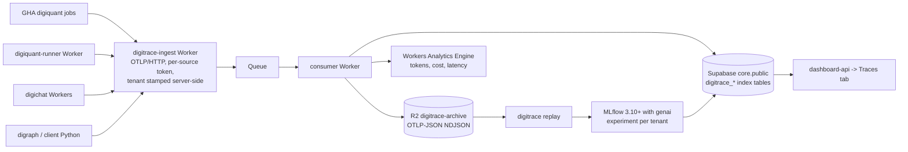

# ADR-0036 — digitrace tracing: Cloudflare-native ingest and store, with on-demand MLflow analysis

**Status:** Accepted (2026-10-09).
**Date:** 2026-10-09 (decision). Recorded in the repository on 2026-10-22.
**Author:** CTO (board seat).
**Raised by:** DIG-2655 (child of DIG-2643).
**Amends:** ADR-0021 — one narrow, machine-owned exception, recorded in §4. digitrace's own tables conform to ADR-0021.
**Supersedes:** the hosting-target and platform-scope statements in [`digitrace/ARCHITECTURE.md`](../../digitrace/ARCHITECTURE.md); the zero-dependency platform principle in [`docs/vision/digitrace.md`](../vision/digitrace.md); the "no database, no worker, no queue" statement in `openwiki/digitrace/architecture.md`; the runbook [`docs/ops/digitrace-langfuse.md`](../ops/digitrace-langfuse.md); the plan memo [`docs/plans/digitrace-langfuse-swap-2026-10-01.md`](../plans/digitrace-langfuse-swap-2026-10-01.md).
**Does not supersede:** ADR-0021 (Supabase project topology), which this ADR conforms to.

## Context

digitrace is the observability layer of the digithings stack. Today it is a thin wrapper
around LangSmith plus a status endpoint: no database, no worker, no queue. The wrapper
ships a second, OpenTelemetry leg (Phase 2 dual-export, #4931), so the shape of an
OTel-first digitrace is already in the code — only the plumbing behind it is missing.

The plan on the table until 2026-10-09 was self-hosted Langfuse on Cloudflare
Containers with an external ClickHouse and Redis. Chris decided against it
("Tracing: Cloudflare hybrid with MLflow", 2026-10-09 21:34 CEST) because it means
**new paid services**, and the whole point of the exercise is that the marginal cost
of tracing stays at zero.

The design this ADR records was reviewed end to end by the Claude bench
([`docs/reviews/digitrace-tracing-architecture-review.md`](../reviews/digitrace-tracing-architecture-review.md),
verdict "approve with changes"; DIG-2664). Chris accepted the must-fix items on
2026-10-09 at 22:28. This ADR is the written form of that decision and of the review's
must-fix list. The scored candidate scan behind the decision is the v2.1 design
summary attached to DIG-2664 (the file `/workspace/paperclip-review/free-tracing-options.md`
is not in this repository); the hybrid scored 31.5 against a runner-up at 29.

### The cost facts that decide the shape

- **Cloudflare Containers allowance:** 25 GiB-h of memory, 375 vCPU-minutes and
  200 GB-h of disk per month. An always-on container does not fit: a 1 GiB `basic`
  instance runs to about 730 GiB-h a month, a 256 MiB `lite` instance to about
  182 GiB-h. **A container is on-demand only.**
- **Workers persisted traces are billable from 1 December 2026** (stored traces count
  towards account-level ingestion and storage). Recheck that date before DIG-2659 ships:
  it is a live pricing-policy date, not a fixed fact.
- **R2 free tier:** 10 GB of storage, 1M Class A and 10M Class B operations. The raw
  archive is the first thing that hits this ceiling, not the index.
- **Supabase `core` on the Pro plan:** 8 GB of disk for the project, shared with every
  other table in `public`. At roughly 1 GB per 1–2M spans, the 90-day index fills it at
  roughly 8–16M spans.
- **The account must be on Workers Paid.** The Containers allowance above only exists on
  that plan. Chris confirms the plan in the Cloudflare dashboard (Billing). This is a
  human step, and the plan is a premise of the cost facts above.

## Decision

**digitrace tracing is a Cloudflare-native pipeline with an on-demand MLflow analysis
surface.** Applications emit OTLP/HTTP to a Cloudflare Worker; the Worker writes a raw
archive to R2 and a queryable index to Supabase; the dashboard reads the index; an
on-demand `digitrace replay` loads a window into MLflow for deep analysis. No new paid
service, no always-on container, and the LangSmith leg is cut at the end of a parity
window.

### 1. The pipeline

### 2. Transport in: the endpoint, the headers, the destinations

- **Endpoint:** `https://<ingest-host>/v1/traces`, OTLP/HTTP. The host is published on
  DIG-2657; the deploy and the route are a human step.
- **Headers.** Two headers carry the ingest contract, and they are the same for every
  source, whether the source is a Cloudflare Worker, a GitHub Actions job or a Python
  service:
  - `x-digitrace-token` — the per-source ingest credential, a static secret. For the
    Workers it is a fixed custom header on the Cloudflare destination; for the Python
    and GHA sources it travels inside `DIGI_OTEL_HEADERS`.
  - `x-digitrace-tenant` — the tenant slug the source claims.
- **The tenant is resolved server-side.** The ingest Worker looks the token up and
  checks the claimed slug against the tenants that token may write for. A slug the token
  may not claim is rejected and the batch is dropped (fail closed). The stored row keeps
  `tenant_slug` and `tenant_slug_verified`.
- **Documented deviation from digikey.** In digikey, `tenant_slug_verified` is true only
  for a signed JWT claim and false for an unsigned header. The static per-source token
  path above is not that exchange: the flag is false unless the source presented a
  digikey-signed JWT carrying the claim, and the value is persisted on the stored
  span/trace row either way. The security consequence is recorded in §5.
- **Cloudflare destination names:** one per source Worker — `digitrace-digichat` and
  `digitrace-digiquant-runner`. Each destination carries the two fixed headers above.
- **Format.** The ingest Worker accepts **both** OTLP/HTTP encodings: **JSON** from the
  Cloudflare destinations, which never send protobuf, and **protobuf** from the Python and
  GitHub Actions sources, because `digibase.otel` exports OTLP/HTTP protobuf.
- **Contract names.** `DIGI_OTEL_ENDPOINT` and `DIGI_OTEL_HEADERS` are the names, and
  they are one plumbing: `digibase.otel` resolves the endpoint from `DIGI_OTEL_ENDPOINT`
  (fallback `OTEL_EXPORTER_OTLP_ENDPOINT`) and the headers from `DIGI_OTEL_HEADERS`
  (fallback `OTEL_EXPORTER_OTLP_HEADERS`), the header value in the OTel standard
  comma-separated `key=value` form. The GHA job sets those two names once **DIG-2660**
  lands; today it sets only `DIGI_OTEL_HEADERS`.
  `DIGITRACE_LANGFUSE_OTLP_ENDPOINT` and `LANGFUSE_OTLP_ENDPOINT` are **retired**:
  leaving them in a workflow points a live workflow at a dropped service.
- **The live digiquant-runner leg still carries the Langfuse name.** The Phase-3 sync
  workflow (`.github/workflows/sync-digiquant-runner-digikey-secret.yml`) puts
  `DIGITRACE_LANGFUSE_OTLP_ENDPOINT` and `DIGI_OTEL_HEADERS` into the digiquant-runner
  secret, and the runner forwards both into the container (`FORWARDED_ENV_NAMES` in
  `apps/digiquant-runner/src/env.ts`, the command allowlist in
  `apps/digiquant-runner/commands.json`). Nothing under
  `apps/digiquant-runner/container` reads an OTLP endpoint today, so this is a name to
  repoint, not a running export to migrate.
- **The header name stays; the header value changes.** `DIGI_OTEL_HEADERS` stays and
  `digibase.otel` already reads it, but the value it carries today is the Langfuse
  Basic auth pair. It must carry `x-digitrace-token=<per-source token>` and
  `x-digitrace-tenant=<tenant slug>` instead, and the endpoint name becomes
  `DIGI_OTEL_ENDPOINT`.
- **Two tickets touch the same files.** The endpoint name and the header value live in
  the workflow, in `apps/digiquant-runner/src/env.ts` (`FORWARDED_ENV_NAMES`), in
  `apps/digiquant-runner/commands.json`, in the `apps/digiquant-runner/wrangler.toml`
  comment, in `docs/ops/digiquant-runner.md` and in the tests that assert the forwarded
  names: `apps/digiquant-runner/src/env.test.ts`,
  `apps/digiquant-runner/src/runner.test.ts`,
  `apps/digiquant-runner/container/exec_job_test.py` and
  `tests/scripts/test_sync_digiquant_runner_digikey_secret_workflow.py`, which asserts
  the old name and so breaks on the rename. **DIG-5136** removes the Langfuse-named
  entries in those files; **DIG-2660** writes the new endpoint name and the new header
  value in their place and turns the emitter on. Neither ticket does the other's half.
- **`persist = false`** on `[observability.traces]`. Consequence, decided on purpose: the
  Cloudflare dashboard keeps no traces of its own, so the stored-trace billing that
  starts on 1 December 2026 does not apply to us.
- **Sampling:** `head_sampling_rate = 1` (100%), set explicitly on every source at
  launch. Per-workflow rates come later, after the parity window in DIG-2663 (digichat
  is about 4.6k requests a week, so full sampling is cheap).
- **Not every source emits yet.** The sources *can* speak OTel over HTTP through
  `digibase.otel`; turning the emitters on is DIG-2659 (Workers) and DIG-2660 (GHA).

### 3. The stores

| Store | Holds | Written by | Read by |
|---|---|---|---|
| R2 bucket `digitrace-archive` | raw OTLP-JSON NDJSON, one object per batch | consumer Worker | `digitrace replay` |
| Supabase `core`.`public` | the queryable index (`digitrace_traces`, `digitrace_spans_index`, `digitrace_scores`, `digitrace_sessions`) | consumer Worker | dashboard-api, MCP server, replay |
| Workers Analytics Engine | per-tenant and per-model token, cost and latency aggregates | consumer Worker | dashboard cost views |
| MLflow backend store | analysis sessions: experiments, runs, params, metrics, scores | replay, analysis container | the MLflow UI |

- **The archive is the system of record.** The index is a queryable window over it.
- **Archive key layout:** `tenant=<slug>/date=<YYYY-MM-DD>/<source>/<uuid>.ndjson`.
  Replay enumerates a window by prefix, so a window older than the index is still
  replayable (§11, retention).
- **Archive retention:** 180 days by R2 lifecycle rule. **Index retention:** 90 days.
  **Scores:** 180 days, so a replay of an old window still has somewhere to write them.
- **Analytics Engine is fire-and-forget.** It has no read-after-write guarantee, and
  Cloudflare samples it under high write volume, so the aggregates are an estimate and
  not an exact source of truth. The AI Gateway logs are the fallback cross-check, and
  DIG-2661 runs the spike before the cost view depends on those numbers.
- **The consumer reaches Supabase over PostgREST/REST**, the only precedented
  Worker-to-Supabase path in this repository. A raw Postgres driver is only in scope if
  Hyperdrive is adopted; DIG-2658 decides and bounds the connection count.

### 4. The Supabase shape and ADR-0021

ADR-0021 consolidated our databases into the Supabase `core` project and rejected a
second schema inside it: "`public` + per-table RLS already gives the isolation, and a
second schema complicates PostgREST exposure and the accessor for no gain at this
scale". This ADR **conforms to ADR-0021** for digitrace's own tables:

- **Schema `public`, in the `core` project.** No `digitrace` schema.
- **Prefixed table names**, the house convention in `public`:
  `digitrace_traces`, `digitrace_spans_index`, `digitrace_scores`, `digitrace_sessions`.
- **Tenancy column `workspace_id`** (uuid, `public.workspaces`), with per-table RLS
  policies keyed on `auth.uid()` through `public.workspace_members` — the house pattern,
  not a new one. The ingest path resolves a tenant slug to a `workspaces` row by slug,
  server-side, and stores the resolved `workspace_id`.
- **Additive migrations only**: `CREATE TABLE IF NOT EXISTS` plus `CREATE POLICY`. No
  DROP, ALTER or TRUNCATE, the house idiom.

**One machine-owned exception.** The MLflow backend store needs its own tables, and MLflow
creates them itself from the backend-store URI. Those tables live in a dedicated
`mlflow` schema in the same instance:

- The mechanism is a **dedicated Postgres role** with `search_path=mlflow`, carried on the
  backend-store URI (`?options=-csearch_path%3Dmlflow`). The role gets `USAGE` on that
  schema and nothing else.
- `anon`, `authenticated` and `PUBLIC` are revoked on that schema, and PostgREST's
  `db_schemas` stays at `public`, so those tables are never exposed through PostgREST.
  ADR-0021's actual objection — a second schema complicating PostgREST exposure — is
  therefore answered, not argued away.
- MLflow's own DDL runs only inside the `mlflow` schema, on the analysis container's
  start-up, never against `public`. `mlflow db upgrade` is on the human checklist.
- A Supabase service-role key is a PostgREST credential, not a database role, so it is
  not what the container uses.

This is an exception, not a precedent: one schema for our own tables, RLS per table,
`public` only for PostgREST.

### 5. The tenant boundary

**RLS is not the tenant boundary on the service-role paths.** The consumer Worker and
dashboard-api use the service role, and service-role access bypasses RLS. On those paths
the boundary is the **application-layer tenant filter**, and DIG-2661 must test that
filter rather than assume RLS covers it. RLS protects the paths where a user token
reaches PostgREST directly.

The ingest path adds one more boundary: the token decides which tenants a source may
write for, the worker checks the claimed slug against that list, and a rejected batch is
dropped rather than repaired.

### 6. The library's role

`digitrace.trace.traceable` **survives** as the emit wrapper. After this ADR:

- It emits **OTel only**. The LangSmith leg is removed from the code at the cut
  (DIG-2663) — not merely disabled by unsetting `LANGSMITH_API_KEY`.
- It gains the `gen_ai` and OpenInference span attributes, the tenant, run and session
  ids, and the redaction of §7 (DIG-2656).
- The library keeps its dependency contract: no mandatory dependency beyond what a
  digithings service already has. What changes is the platform behind it, not the
  library's shape.
- `digitrace.config` loses the `langsmith` and `langfuse-otlp` backend modes, the
  `digitrace[langsmith]` and `digitrace[tracing]` extras (both pull in the LangSmith SDK)
  and its own `_OTLP_ENDPOINT_ENVS` duplicate of `digibase.otel`. The endpoint plumbing is
  `digibase.otel` only: one copy.

### 7. What a span may carry

- **No raw prompt or completion text, not even redacted.** A span carries a **hash and a
  length**. A truncated preview is possible only behind an explicit opt-in flag, off by
  default.
- **Attribute keys come from an explicit allowlist.** No arbitrary keyword arguments on a
  span.
- **Redaction happens at the instrumentation layer**, reusing `PiiRedactor.process_inputs`
  and `process_outputs`. The redaction helper's missing pieces (key-name allowlist,
  length-based document summarisation) are filled in under DIG-2656.
- **Forbidden, as before:** raw prompts and completions, API keys, file paths, full
  document bodies.

### 8. The analysis surface

- **MLflow floors:** 3.6.0 or later for OTLP ingest at `/v1/traces`, and **3.10.0 or
  later with the `mlflow[genai]` extra plus LiteLLM** for the token and cost columns.
  3.6 alone gives traces, not cost.
- **One MLflow experiment per tenant**, selected by the `x-mlflow-experiment-id` header.
- **Backend store:** the `mlflow` schema in `core` through the dedicated role of §4, or a
  local Postgres or SQLite in Mac mode. Artifacts go to R2.
- **Scores** written in MLflow are written back to the `digitrace_scores` table in
  `public`.
- **On demand only.** The Cloudflare Container sleeps after about ten minutes of quiet.
  The ingest path must never wake it: ingest writes R2 and the index, replay reads R2.
  A 20 GiB-h usage alarm is part of DIG-2662's definition of done.
- **Local mode:** `wrangler dev`/Miniflare plus MLflow in Docker. Docker is a
  prerequisite of the local path, and that is a real cost of it.
- **Replay of an old window:** replay enumerates the archive by prefix
  `tenant=<slug>/date=<YYYY-MM-DD>/`, so a window past the 90-day index is still
  replayable from the archive. The dashboard's search does not cover it — the index row
  is gone — and that is the honest limit of the 90-day window.

### 9. The dashboard Traces tab

`dashboard-api` gains a tenant-scoped **Traces** tab: list, search, span tree, tokens and
cost. The tab reads the index of §3 through the application-layer tenant filter of §5.
The cost numbers come from the Analytics Engine aggregates, cross-checked against the
AI Gateway logs.

### 10. The read-only MCP server

ADR-0036 puts a **read-only** `digitrace.mcp_server` in the digitrace scope:
`get_trace`, `search_traces`, `get_cost_summary`, following the digiquant, digigraph and
digivault MCP precedent. It is **not built yet**; the owning leaf is **DIG-5141** (lane M,
R&D Engineer). The tools are read-only and tenant-scoped, and no tool response carries a
secret.

### 11. What "$0" means, and where it ends

The marginal cost of tracing is zero **by construction**, not by luck, and only up to these
ceilings:

| Ceiling | When it binds | What happens then |
|---|---|---|
| Supabase `core` disk, 8 GB | ~8–16M spans indexed over 90 days | the index window shortens (older rows pruned); the archive stays the record |
| R2 storage, 10 GB | 180 days of raw OTLP-JSON | the archive lifecycle shortens first; the index is not shortened before the archive |
| R2 operations, 1M Class A / 10M Class B | sustained ingest volume | operation classes are watched; a change of write pattern is a design change |
| Cloudflare Containers allowance | an always-on container | the container stays on demand; the ingest path never wakes it |
| Workers stored traces | billing from 1 December 2026 | `persist = false` keeps us out of it |
| MLflow container memory | 25 GiB-h/month | the container sleeps; the 20 GiB-h alarm fires |

Past a ceiling the system **degrades to archive-only or shortens a window**. It does not
buy capacity silently: anything that would turn into spend is a human step.

### 12. The alternatives, and the trade-off against Langfuse

| Option | Why it lost |
|---|---|
| Self-hosted Langfuse (Web + Worker) | needs external ClickHouse and Redis: two new paid services, which Chris ruled out |
| Cloudflare native traces alone | no query layer, no tenant index, and stored traces bill from 1 December 2026 |
| MLflow alone as the store | scores well on cost fit, but it cannot run on Workers (CF fit 1) and its everyday-UI story is a Mac-only process |
| Phoenix | it stores in Postgres or SQLite, so there is no ClickHouse problem, but the Elastic 2.0 licence is source-available rather than OSI, and that is a commercial decision we do not need to make |
| Opik, SigNoz, HyperDX, Helicone, OpenLIT, Laminar | each needs ClickHouse |

**The trade-off, stated plainly.** Langfuse gives a polished trace UI, sessions and
evaluations out of the box, and costs two always-on services to run. This design keeps
the bill at zero and costs us the polish: the everyday UI is ours to build (the Traces
tab), and deep analysis takes one extra step — `digitrace replay` — plus a local setup
(Docker, or a sleeping container). We buy "cheap, and eventually credible through MLflow"
at the price of one-command setup and everyday UI polish. That is the trade Chris made
when he dropped Langfuse.

### 13. Acceptance criteria for this ADR

This ADR is done when all of the following hold. Each item names its owner.

| # | Acceptance criterion | Owner | State |
|---|---|---|---|
| AC1 | ADR-0036 lands in `develop` | CTO | this PR (#6260) |
| AC2 | `apps/digitrace-langfuse/` and its two Dockerfiles are deleted, with the CI, contract, secret and runner surface cleaned in the same change | Repo, CI & Release Engineer | **DIG-5136** |
| AC3 | `docs/ops/digitrace-langfuse.md` is a tombstone pointing at this ADR, not a runbook | Repo, CI & Release Engineer | **DIG-5136** |
| AC4 | the 2026-10-01 plan memo carries a superseding banner | CTO | this PR |
| AC5 | the architecture document and the vision document no longer state that digitrace has no database, no worker and no queue | CTO | this PR, for those two documents. The openwiki page repeats the same sentence; it is listed as superseded in this ADR and is corrected in the next openwiki run, because editing a page with claim sidecars is not safe here |
| AC6 | a read-only `digitrace.mcp_server` exists with `get_trace`, `search_traces`, `get_cost_summary` | R&D Engineer | **DIG-5141** |
| AC7 | the index tables live in `public` with per-table RLS, named `digitrace_*` | Backend Engineer, Core Services | **DIG-2658** |
| AC8 | the LangSmith leg is removed from the code and `LANGSMITH_API_KEY` is unset | DevOps Lead, then Chris for the secret | **DIG-2663** |

AC2, AC3, AC5 (the openwiki page), AC6, AC7 and AC8 are owned by other tickets or other
runs and are **not** closed by this ADR. This ADR is accepted when AC1 lands; the rest stay
open on their tickets, and the retirement in AC2 and AC3 is the retirement of the Langfuse
app, nothing else.

### 14. The migration path

1. **DIG-2656** — enrich the OTel leg (`gen_ai` attributes, redaction, ids).
2. **DIG-2657** — deploy `apps/digitrace-ingest` (Worker, Queue, consumer, R2, index).
3. **DIG-2659 / DIG-2660** — turn the emitters on: Workers native traces (`persist = false`)
   and the digiquant GitHub Actions root span, with the digiquant-runner secret repointed
   at the new endpoint name and the new header value (DIG-2660, after DIG-5136 has
   removed the Langfuse-named entries).
4. **DIG-2658** — apply the index schema and the RLS policies.
5. **DIG-2661** — the dashboard Traces tab; **DIG-2662** — `digitrace replay` and MLflow.
6. **DIG-2663** — seven days of parity against LangSmith and the AI Gateway logs. Chris
   approves the cut. The cut unsets `LANGSMITH_API_KEY` (a production secret) and removes
   the LangSmith leg, the `digitrace[langsmith]` and `digitrace[tracing]` extras and the
   `langsmith` mode of `export_backend()`. GitHub #4932 stays closed (it was closed on
   2026-10-22 as not-planned); #4933 is reworked and epic #4928 is updated.
7. **DIG-5136** — the Langfuse app removal (AC2 and AC3), which does not wait for the
   cut because Langfuse was never live. The cut list on that leaf also takes
   `scripts/smoke_digitrace_langfuse_otlp.sh`, `scripts/deploy/langfuse.sh`, the
   `scripts/deploy/workers.tsv` entry and the `config/self-host/parity-baseline.json`
   reference to the dropped service.

### 15. What stays a human step

Prepared, not performed. Each item is a production action.

- [ ] **Confirm the Cloudflare account is on Workers Paid** (dashboard → Billing). The
      Containers allowance in §Context depends on it.
- [ ] Create the R2 bucket `digitrace-archive`, the Queue, the KV binding and the
      Analytics Engine dataset (DIG-2657).
- [ ] Put the per-source ingest tokens, the per-source tenant slugs and the Supabase
      role secret (production secrets).
- [ ] Apply the index migration in `core` and create the `mlflow` schema, its dedicated
      role and the `search_path` grant (DIG-2658).
- [ ] Run `mlflow db upgrade` against the `mlflow` schema from the analysis container
      (DIG-2662).
- [ ] Publish the ingest route and the DNS for the ingest host; the OTLP endpoint becomes
      `https://<ingest-host>/v1/traces` (DIG-2657).
- [ ] Set the 20 GiB-h container usage alarm (DIG-2662).
- [ ] Approve the LangSmith cut: unset `LANGSMITH_API_KEY` (DIG-2663).

## Consequences

**Positive:**

- The marginal cost of tracing stays at zero by construction, and the ceiling at which it
  stops being zero is written down (§11).
- The platform is decided. digitrace stops being a shim around somebody else's tracing
  product and becomes an OTel-first pipeline we own end to end.
- One endpoint plumbing (`digibase.otel`), one ingest contract (two headers), one
  tenancy pattern (`workspace_id` plus RLS), and no second schema for our own tables.
- The analysis surface is a real, familiar, well-supported tool (MLflow) instead of a
  bespoke one, and it runs only when someone asks for it.
- The raw archive keeps what the index cannot: a window that fell out of the 90-day
  index is still replayable.

**Negative / tradeoffs:**

- **We build the everyday UI.** The Traces tab, the cost view and the tenant filter are
  our work and our maintenance. Langfuse would have shipped them.
- **Setup is not free.** A developer needs Docker for the local MLflow path, or a
  container that sleeps. "One command" is a goal, not a fact today.
- **The tenant boundary is application-layer on the service-role paths.** RLS protects
  the direct-client paths only. A filter bug in dashboard-api or in the consumer is a
  cross-tenant leak, and DIG-2661 has to test that filter rather than assume it.
- **The index is a window, not a record.** Search does not reach past 90 days, and a
  replay of an older window is slower and reconstructs what the index would have said.
- **Two stores to reason about.** The archive and the index can disagree for a while
  (the index lags the archive by the queue's delay), and two code paths must agree on the
  tenant filter.
- **The cost of a mistake is a bill.** The ceilings in §11 are the boundary between a
  free system and a paid one, and the guards are conventions plus one alarm rather than a
  hard limit in the platform.
- **The MLflow schema is a standing exception.** It is machine-owned and invisible
  through PostgREST today, and it is the kind of thing that grows into a second database
  if nobody watches it. The owner of the MLflow leaf (DIG-2662) owns it.

## Links

- Related issues: DIG-2643 (parent: infra stabilization), DIG-2656, DIG-2657, DIG-2658,
  DIG-2659, DIG-2660, DIG-2661, DIG-2662, DIG-2663 (the build leaves), DIG-2664 (the
  Claude review), DIG-5136 (the Langfuse app removal), DIG-5141 (the MCP server).
- **Amended by this ADR:** DIG-2657 (index rows go to `public`, not to a `digitrace`
  schema), DIG-2658 (schema `public`, tables `digitrace_*`, tenancy column `workspace_id`,
  the `mlflow` schema exception), DIG-2661 (reads the `public` index, and the tenant
  boundary is the application-layer filter, not RLS).
- Related ADRs: ADR-0021 (Supabase project topology) — conformed to, with the one
  exception in §4.
- Review: [`docs/reviews/digitrace-tracing-architecture-review.md`](../reviews/digitrace-tracing-architecture-review.md)
  (DIG-2664). The must-fix items are answered as follows: **M2** (the ADR-0021 question) in
  §4; **M4** (the architecture and vision documents must be superseded, not only the old
  tickets) in the header, the Supersedes list and AC5; **M5** (the Langfuse retirement as a
  named acceptance criterion) in §13; **M6** (RLS is not the tenant boundary on the
  service-role path) in §5; **M7** (the read-only MCP server) in §10.
