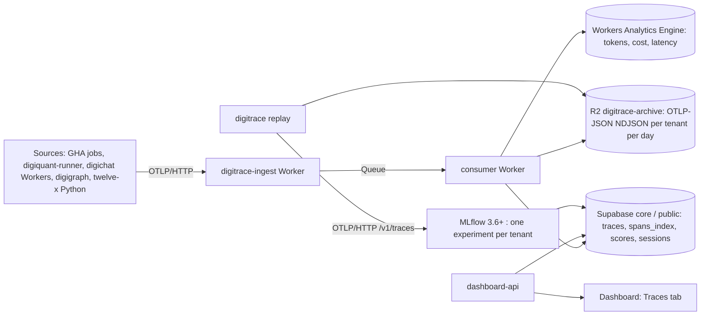

# ADR-0036 — digitrace tracing: Cloudflare-native ingest and store, with on-demand MLflow analysis

**Status:** Accepted (2026-10-09).
**Date:** 2026-10-09 (decided); recorded in the repository on 2026-10-22.
**Author:** CTO (board seat).
**Raised by:** DIG-2655 (child of DIG-2643, "Infra stabilization: Cloudflare + Langfuse").
**Amends:** ADR-0021 (one narrow, machine-owned exception for the MLflow backend store; digitrace's own tables conform to the `public` + per-table RLS pattern).
**Supersedes:** the "Phase 1 hosting target (self-hosted Langfuse)" and "Current scope vs. intended platform" sections of [`digitrace/ARCHITECTURE.md`](../../digitrace/ARCHITECTURE.md), the zero-dependency design principle in [`docs/vision/digitrace.md`](../vision/digitrace.md), the operator runbook [`docs/ops/digitrace-langfuse.md`](../ops/digitrace-langfuse.md), and the plan memo [`docs/plans/digitrace-langfuse-swap-2026-10-01.md`](../plans/digitrace-langfuse-swap-2026-10-01.md).

## Context

### What we need

digitrace is the observability layer for the digithings stack. Today it is a thin, optional
LangSmith wrapper plus a status endpoint. That wrapper is being cut, and the tracing surface has
to be replaced by something we own, on infrastructure we already pay for.

The replacement has to answer four questions that the LangSmith wrapper answered for free:

1. **Where does a span go?** Every service that emits an OTel span — GitHub Actions jobs, the
   `digiquant-runner` Worker, the digichat Workers, digigraph and the twelve-x Python services —
   must land its spans in one place, with the tenant already stamped, without the emit path
   knowing anything about storage.
2. **What is the system of record?** Something has to hold the raw span for longer than the
   queryable index, so a window can be replayed into an analysis tool months later.
3. **What does the everyday UI look like?** A list, a search, a trace tree and a cost breakdown
   per tenant and per model.
4. **What is the deep-analysis tool?** When a trace looks wrong, someone has to open it in
   something that can filter, compare and score runs.

### Why the previous plan was dropped

The plan recorded in the 2026-10-01 memo was self-hosted Langfuse on Cloudflare Containers with an
external ClickHouse and Redis. It was dropped on 2026-10-09 by Chris's decision "Tracing:
Cloudflare hybrid with MLflow", on one constraint: **no new paid services**. Langfuse is MIT and
its UI is the best in the open-source field, but it needs ClickHouse and Redis as its store, and
those are two new paid services plus two more always-on containers. That is the whole cost case
against it.

### The cost facts that shape the design

- **Cloudflare Containers allowance (per month):** 25 GiB-h memory, 375 vCPU-min, 200 GB-h disk.
  An always-on 1 GiB "basic" container burns about 730 GiB-h; a 256 MiB "lite" container about
  182 GiB-h. Both are far above the allowance. **An always-on analysis container is not $0** — it
  is a paid service by another name. The analysis container must therefore be on demand: start it
  when someone asks for a replay, let it sleep after about 10 minutes of quiet.
- **Workers native trace storage is billable from 1 December 2026.** Native traces are a transport,
  not a store: `persist: false` everywhere, no trace retention on the platform.
- **Cloudflare R2 free tier:** 10 GB, with the archive lifecycle at 180 days.
- **Supabase:** the `digithings` organisation is on the pro plan, with the `core` project
  (us-west-2, PostgreSQL 17.6) as the only database we treat as house.

### The options that were scanned

The v2.1 design scan (summary attached to DIG-2664; the working file
`/workspace/paperclip-review/free-tracing-options.md` was never committed and does not exist in
the repository) scored the candidates. The short version:

| Candidate | Why it was not chosen |
|---|---|
| Langfuse (self-hosted) | Needs ClickHouse + Redis: two new paid services, banned. |
| Phoenix | Needs Elasticsearch; the Elastic licence (2.0) is a commercial decision we do not need to make. |
| Opik, SigNoz, HyperDX, Helicone, OpenLIT, Laminar | All need ClickHouse. |
| MLflow alone as the store | Postgres-only, so no ClickHouse problem — but MLflow is an analysis tool, not a cheap always-on trace index. |
| Cloudflare native traces alone | No query layer, no per-tenant cost rollup, and persisted trace storage becomes billable on 1 December 2026. |
| **Hybrid (chosen)** | Cloudflare-native ingest and archive for $0, a thin Supabase index for the everyday queries, and MLflow on demand for the deep analysis. |

The hybrid scored highest in that scan (31.5 against the runner-up). It is also the only option
whose marginal bill stays at zero while satisfying the "no new paid services" constraint.

### What the review changed

The architecture was reviewed on 2026-10-09
([`docs/reviews/digitrace-tracing-architecture-review.md`](../reviews/digitrace-tracing-architecture-review.md),
verdict: approve with changes). Chris accepted the must-fix list on 2026-10-09 at 22:28. This ADR
carries the outcome of those items: ADR-0021 is answered explicitly, the zero-dependency
philosophy is retired, the Langfuse removal is a named acceptance criterion, and the read-only MCP
server is in scope.

## Decision

**digitrace tracing is a Cloudflare-native pipeline with three stores and one on-demand analysis
tool.**

### The pipeline

1. **Emit.** Every source already speaks OTel over HTTP. The endpoint and the headers come from
   `digibase.otel` — one copy of that plumbing, not a third.
2. **Ingest.** `apps/digitrace-ingest` is a Cloudflare Worker. It authenticates the caller with a
   per-source, per-tenant token, **stamps the tenant server-side** (the caller never names its own
   tenant), applies the redaction and size checks, applies sampling, and pushes to a Queue. It
   writes nothing else, and it never wakes the analysis container.
3. **Store.** A consumer Worker drains the Queue and writes three places: the **R2 archive**
   (the system of record, one NDJSON object per tenant per day), the **Supabase index** (the
   queryable window), and **Workers Analytics Engine** (per-tenant, per-model token, cost and
   latency aggregates, cross-checked against the AI Gateway logs).
4. **Query.** The dashboard's Traces tab reads through `dashboard-api`, never directly.
5. **Replay.** `digitrace replay` pulls a window out of the R2 archive and pushes it into MLflow
   over OTLP/HTTP `/v1/traces`, one experiment per tenant.

### The three stores, and what each one is for

- **R2 archive — the system of record.** Raw OTLP-JSON, one file per tenant per day. Nothing is
  dropped from here except by the 180-day lifecycle. Every query can be re-derived from it.
- **Supabase index — the queryable window.** `traces`, `spans_index`, `scores`, `sessions`, in the
  Supabase `core` project. Index rows only, no blobs: about 1 GB per 1–2 million spans. 90-day
  retention.
- **Workers Analytics Engine — the aggregates.** Token, cost and latency rollups per tenant and
  per model, for the cost views. It is a cheap write path for numbers we would otherwise sum in
  Postgres on every page load.

### Where the tables live: ADR-0021 is answered here

[ADR-0021](0021-digiquant-supabase-project-topology.md) consolidated the estate into the Supabase
`core` project and explicitly rejected "a separate Postgres schema inside `core`", on two grounds:
`public` plus per-table RLS already gives the isolation, and a second schema complicates
PostgREST exposure and the accessor "for no gain at this scale".

**digitrace's own index tables conform to ADR-0021.** They live in the `public` schema of `core`,
with a `tenant_id` column and per-table RLS keyed on `auth.uid()` through the existing membership
pattern, written with the additive-only migration idiom (`CREATE TABLE IF NOT EXISTS` plus
`CREATE POLICY`, no `DROP`, no `ALTER`, no `TRUNCATE`).

**One narrow, machine-owned exception is accepted: the MLflow backend store gets its own
`mlflow` schema.** The reason is specific, and it is not the reason ADR-0021 rejected `strategy.*`:

- MLflow owns its DDL and its table set — `experiments`, `runs`, `params`, `metrics`, `tags`,
  artifact rows — about twenty machine-shaped tables with their own column conventions.
- `public` is the schema PostgREST exposes. Putting MLflow's tables there would put `runs`,
  `params` and `metrics` in reach of every authenticated role in the project, in a database where
  our own tables are protected by RLS. That is a tenant-leak risk, not a tidiness question.
- The `mlflow` schema is **not** exposed through PostgREST, is reached only by the analysis
  container over a service-role connection, and is never read by a client.
- Our own tables stay in `public` with RLS, so the accessor pattern ADR-0021 established is
  unchanged.

If MLflow is ever retired, the `mlflow` schema goes with it, and no house table moves.

### The tenant boundary is the application filter, not RLS

**RLS is not the tenant boundary on the service-role path.** The ingest consumer and `dashboard-api`
read and write with the service role, which bypasses RLS by design. The boundary on those paths is
the **application-layer tenant filter**: the consumer stamps `tenant_id` from the authenticated
token, and `dashboard-api` filters every query by the tenant resolved from the caller's session.
RLS protects the direct client path (a PostgREST call with a user token), where it is the only
thing standing between a caller and another tenant's rows.

Both filters must exist, and both must be tested: DIG-2658 pins the RLS behaviour for the direct
path, DIG-2661 pins the application-layer filter for the service-role path. A test that only
covers RLS does not cover the ingest path, and a test that only covers the filter does not cover a
client that reaches Postgres directly.

### Analysis on demand: MLflow

MLflow 3.6+ is the analysis surface, reached over its OTLP/HTTP endpoint (`/v1/traces`). One
experiment per tenant, selected by the `x-mlflow-experiment-id` header. The backend store is the
Supabase `core` `mlflow` schema (or a local Postgres or SQLite in local mode); artifacts go to R2;
the `mlflow[genai]` extra provides the token and cost columns. Scores written in MLflow are written
back to `digitrace.scores`, so a score is durable even when the analysis session is not.

Two ways to run it, same code path:

- **On the Mac** — `docker compose` for MLflow, `wrangler dev`/Miniflare for the Worker. This is
  the default for development and for a one-off analysis.
- **On Cloudflare, on demand** — a Container that starts on request, serves the MLflow UI, and
  sleeps after about 10 minutes of quiet. It stays inside the 25 GiB-h allowance because it is
  rarely awake. **The ingest path must never wake it**: ingest writes to R2 and to the index, and
  replay reads from R2. A wake-up on the ingest path would turn a free pipeline into a paid one.

**Retention:** the Supabase index holds 90 days; the R2 archive holds 180. **Replay of a window
older than 90 days is supported** and reads from the archive — the index is a query window, not the
record. What is lost with age is the *search* (the Traces tab cannot find a span that is no longer
indexed), not the data or the ability to replay it.

### The everyday UI

The dashboard gets a **Traces tab**: list, search, trace tree, and cost per tenant and per model.
It reads through `dashboard-api` and is tenant-scoped by the application filter described above.
This is the part of the product we build ourselves, and it is where the trade-off below bites.

### The read-only MCP server

digitrace ships a **read-only MCP server** (`digitrace.mcp_server`) with three tools:
`get_trace`, `search_traces` and `get_cost_summary`, following the `digiquant`, `digigraph` and
`digivault` precedent. It is read-only by construction: no tool mutates a trace, and no tool
returns raw span payloads across the tenant boundary. The design review had this as new scope
(DIG-2655 / DIG-2661); it is now in the programme, tracked under DIG-2643.

### Data protection

- **No raw prompt or completion text ever reaches a span.** Even redacted text is out: what a span
  carries is a hash, a length and a short preview, under an explicit attribute-key allowlist. The
  instrumentation layer reuses `PiiRedactor.process_inputs` / `process_outputs` and adds no
  arbitrary kwargs path. DIG-2656 owns this.
- The span attribute contract in `digitrace/ARCHITECTURE.md` stays the contract: no API keys, no
  file paths, no full document bodies.
- Ingest tokens are per source and per tenant, and the tenant is resolved server-side from the
  token, using the `tenant_slug_verified` convention. A source that lies about its tenant is
  ignored, not obeyed.
- The Queue carries `max_retries` and a dead-letter queue: a poison span does not stall the
  pipeline.

### The trade-off against Langfuse, stated plainly

Langfuse gives a finished trace UI, sessions and evaluations out of the box. It also needs
ClickHouse and Redis, which are new paid services, and two always-on containers that do not fit the
Containers allowance. We buy the Langfuse experience and pay for it twice: in new services and in
our own integration work.

**This design is cheap and eventually credible, at the cost of one-command setup and everyday UI
polish.** Specifically:

- **What we get for $0:** the ingest pipeline, the archive, the index, the cost rollups, and MLflow
  for the deep analysis, on Cloudflare's free tier and Supabase pro — with no new paid service,
  provided the analysis container stays on demand and native traces stay `persist: false`.
- **What we give up:** the Langfuse UI. Our Traces tab is a build, not a configuration. Deep
  analysis needs one extra step (`digitrace replay`) and, in local mode, Docker. An engineer
  compares a trace in Langfuse with two clicks; here it is one command plus a browser tab.
- **What is deferred:** richer session grouping, built-in evaluation dashboards and the tracing
  marketplace ecosystem. None of them are on the critical path for the first ninety days.

### Migration, in order

1. Enrich the OTel leg with `gen_ai` attributes (DIG-2656).
2. Deploy the ingest Worker, Queue and consumer (DIG-2657).
3. Turn on Workers native traces with `persist: false` for digichat and `digiquant-runner`
   (DIG-2659).
4. Add GitHub Actions tracing to digiquant with the workflow root span (DIG-2660).
5. Ship the dashboard Traces tab (DIG-2661) and the `digitrace replay` CLI (DIG-2662).
6. Run both paths for seven days and compare against LangSmith and the AI Gateway logs. **Chris
   approves the cut.**
7. On approval: unset `LANGSMITH_API_KEY`, retire `apps/digitrace-langfuse`, close #4932, rework
   #4933, update the epic #4928 (DIG-2663).

### What stays a human step

None of these are performed by a seat. They are prepared as a checklist and handed to Chris:

1. **Confirm the Cloudflare account is on Workers Paid** (Billing). The design assumes it; the
   account state was not verifiable from here.
2. Create the production resources: the `digitrace-archive` R2 bucket, the Queue, the Workers
   Analytics Engine dataset, the KV namespace if used, and the Container image.
3. Put the production secrets: the ingest tokens and the Supabase service-role credential.
4. Apply the Supabase `core` migration and create the role behind it.
5. Point the DNS and the route at the ingest endpoint.
6. Approve the LangSmith cut after the seven-day parity run.

## Consequences

**Positive:**

- The marginal cost of tracing stays at zero while the pipeline is in use, and it stays at zero by
  construction rather than by discipline: the analysis container is asleep unless someone asks for
  a replay, and the platform trace storage is off.
- We own the shape of the data. The archive is raw OTLP, so a future store can be derived from it
  without re-instrumenting a single service.
- The tenant stamp is server-side and the token is per source, so a compromised or confused source
  cannot write into another tenant's rows.
- The deep-analysis tool is MLflow, which is Apache-2.0, Postgres-only, and already a known shape
  for the market. It is not a bespoke evaluation harness we would have to maintain.
- The MCP server exposes the traces to agents read-only, under the same tenant filter as the
  dashboard.

**Negative / tradeoffs:**

- The Traces tab is ours to build, and it will not match Langfuse on the first day. Search,
  grouping and the trace tree are the first surfaces where the gap is visible.
- The analysis is one step further away: `digitrace replay` before MLflow opens. A user who
  expects a hosted tracing UI has to learn the second step.
- We now run four moving parts instead of one SDK call: an ingest Worker, a Queue, a consumer and
  an archive. Each is a place a span can be lost, and each needs an alarm.
- The Supabase index is a second copy of the archive, and it needs its own retention, its own
  migration discipline and its own 90-day boundary. The archive and the index can disagree if a
  consumer fails halfway; the archive is authoritative and the index is rebuildable, but that
  reconciliation is work nobody has written yet.
- The `mlflow` schema is a deliberate exception to ADR-0021 and must be defended in review. It is
  an exception, not a precedent.
- RLS is not the tenant boundary on the service-role path, so a bug in an application-layer filter
  is a cross-tenant read. The filters are the thing to test, and they are not covered by RLS
  tests.
- An on-demand container is a cold start. The first replay after a quiet period pays the wake-up
  cost, and if the container is asleep when the replay request lands, the request waits for it.

## Links

- Related issues: DIG-2655 (this ADR), DIG-2643 (parent: infra stabilization), DIG-2664 (the
  architecture review and the v2.1 design summary), DIG-2656 (OTel attributes and redaction),
  DIG-2657 (ingest Worker, Queue, consumer, archive, aggregates), DIG-2658 (the Supabase index and
  RLS), DIG-2659 (Workers native traces, `persist: false`), DIG-2660 (GitHub Actions tracing),
  DIG-2661 (dashboard Traces tab), DIG-2662 (`digitrace replay` and MLflow), DIG-2663 (the
  dual-run parity and the LangSmith cut).
- Related ADRs: ADR-0021 (Supabase project topology — amended by the `mlflow` schema exception
  above).
- Related GitHub issues: #4928 (the digitrace tracing epic — its self-hosted-Langfuse half is
  superseded by this ADR).
- Supersedes: the "Phase 1 hosting target (self-hosted Langfuse)" and "Current scope vs. intended
  platform" sections of `digitrace/ARCHITECTURE.md`; the "Zero dependencies beyond FastAPI and
  Pydantic" design principle and the "No database, no background workers" statement in
  `docs/vision/digitrace.md`; `docs/ops/digitrace-langfuse.md`; `docs/plans/digitrace-langfuse-swap-2026-10-01.md`.
- Superseded by: nothing.
