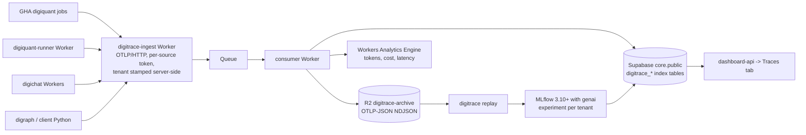

# ADR-0036 — digitrace tracing: Cloudflare-native ingest and store, with on-demand MLflow analysis

**Status:** Accepted (2026-10-09; amended 2026-10-22).
**Date:** 2026-10-09 (decision). Recorded in the repository on 2026-10-22.
**Amended:** 2026-10-22 — review round 4 on DIG-2655: the MLflow role grants, the
`search_path` and the connection mode, the tenant filter column, two stale "no
database" sentences and the AC2 cut list. See the Amendment section at the end of this
ADR.
**Author:** CTO (board seat).
**Raised by:** DIG-2655 (child of DIG-2643).
**Amends:** ADR-0021 — one narrow, machine-owned exception, recorded in §4. digitrace's own tables conform to ADR-0021.
**Supersedes:** the hosting-target and platform-scope statements in [`digitrace/ARCHITECTURE.md`](../../digitrace/ARCHITECTURE.md); the zero-dependency platform principle in [`docs/vision/digitrace.md`](../vision/digitrace.md); the "no database, no worker, no queue" statement in `openwiki/digitrace/architecture.md`; the runbook [`docs/ops/digitrace-langfuse.md`](../ops/digitrace-langfuse.md); the plan memo [`docs/plans/digitrace-langfuse-swap-2026-10-01.md`](../plans/digitrace-langfuse-swap-2026-10-01.md).
**Does not supersede:** ADR-0021 (Supabase project topology), which this ADR conforms to.

## Context

digitrace is the observability layer of the digithings stack. Today it is a thin wrapper
around LangSmith plus a status endpoint: no database, no worker, no queue. The wrapper
ships a second, OpenTelemetry leg (Phase 2 dual-export, #4931), so the shape of an
OTel-first digitrace is already in the code — only the plumbing behind it is missing.

The plan on the table until 2026-10-09 was self-hosted Langfuse on Cloudflare
Containers with an external ClickHouse and Redis. Chris decided against it
("Tracing: Cloudflare hybrid with MLflow", 2026-10-09 21:34 CEST) because it means
**new paid services**, and the whole point of the exercise is that the marginal cost
of tracing stays at zero.

The design this ADR records was reviewed end to end by the Claude bench
([`docs/reviews/digitrace-tracing-architecture-review.md`](../reviews/digitrace-tracing-architecture-review.md),
verdict "approve with changes"; DIG-2664). Chris accepted the must-fix items on
2026-10-09 at 22:28. This ADR is the written form of that decision and of the review's
must-fix list. The scored candidate scan behind the decision is the v2.1 design
summary attached to DIG-2664 (the file `/workspace/paperclip-review/free-tracing-options.md`
is not in this repository); the hybrid scored 31.5 against a runner-up at 29.

### The cost facts that decide the shape

- **Cloudflare Containers allowance:** 25 GiB-h of memory, 375 vCPU-minutes and
  200 GB-h of disk per month. An always-on container does not fit: a 1 GiB `basic`
  instance runs to about 730 GiB-h a month, a 256 MiB `lite` instance to about
  182 GiB-h. **A container is on-demand only.**
- **Workers persisted traces are billable from 1 December 2026** (stored traces count
  towards account-level ingestion and storage). Recheck that date before DIG-2659 ships:
  it is a live pricing-policy date, not a fixed fact.
- **R2 free tier:** 10 GB of storage, 1M Class A and 10M Class B operations. The raw
  archive is the first thing that hits this ceiling, not the index.
- **Supabase `core` on the Pro plan:** 8 GB of disk for the project, shared with every
  other table in `public`. At roughly 1 GB per 1–2M spans, the 90-day index fills it at
  roughly 8–16M spans.
- **The account must be on Workers Paid.** The Containers allowance above only exists on
  that plan. Chris confirms the plan in the Cloudflare dashboard (Billing). This is a
  human step, and the plan is a premise of the cost facts above.

## Decision

**digitrace tracing is a Cloudflare-native pipeline with an on-demand MLflow analysis
surface.** Applications emit OTLP/HTTP to a Cloudflare Worker; the Worker writes a raw
archive to R2 and a queryable index to Supabase; the dashboard reads the index; an
on-demand `digitrace replay` loads a window into MLflow for deep analysis. No new paid
service, no always-on container, and the LangSmith leg is cut at the end of a parity
window.

### 1. The pipeline

### 2. Transport in: the endpoint, the headers, the destinations

- **Endpoint:** `https://<ingest-host>/v1/traces`, OTLP/HTTP. The host is published on
  DIG-2657; the deploy and the route are a human step.
- **Headers.** Two headers carry the ingest contract, and they are the same for every
  source, whether the source is a Cloudflare Worker, a GitHub Actions job or a Python
  service:
  - `x-digitrace-token` — the per-source ingest credential, a static secret. For the
    Workers it is a fixed custom header on the Cloudflare destination; for the Python
    and GHA sources it travels inside `DIGI_OTEL_HEADERS`.
  - `x-digitrace-tenant` — the tenant slug the source claims.
- **The tenant is resolved server-side.** The ingest Worker looks the token up and
  checks the claimed slug against the tenants that token may write for. A slug the token
  may not claim is rejected and the batch is dropped (fail closed). The archived batch
  object keeps `tenant_slug` and `tenant_slug_verified`; they are edge values, not
  columns on the index rows (§5).
- **Documented deviation from digikey.** In digikey, `tenant_slug_verified` is true only
  for a signed JWT claim and false for an unsigned header. The static per-source token
  path above is not that exchange: the flag is false unless the source presented a
  digikey-signed JWT carrying the claim, and the value is persisted on the archived
  record either way. The source is therefore trusted only as far as its token allows,
  which is the tenant boundary of §5.
- **Cloudflare destination names:** one per source Worker — `digitrace-digichat` and
  `digitrace-digiquant-runner`. Each destination carries the two fixed headers above.
- **Format.** The ingest Worker accepts **both** OTLP/HTTP encodings: **JSON** from the
  Cloudflare destinations, which never send protobuf, and **protobuf** from the Python and
  GitHub Actions sources, because `digibase.otel` exports OTLP/HTTP protobuf.
- **Contract names.** `DIGI_OTEL_ENDPOINT` and `DIGI_OTEL_HEADERS` are the names, and
  they are one plumbing: `digibase.otel` resolves the endpoint from `DIGI_OTEL_ENDPOINT`
  (fallback `OTEL_EXPORTER_OTLP_ENDPOINT`) and the headers from `DIGI_OTEL_HEADERS`
  (fallback `OTEL_EXPORTER_OTLP_HEADERS`), the header value in the OTel standard
  comma-separated `key=value` form. The GHA job sets those two names once **DIG-2660**
  lands; today it sets only `DIGI_OTEL_HEADERS`.
  `DIGITRACE_LANGFUSE_OTLP_ENDPOINT` and `LANGFUSE_OTLP_ENDPOINT` are **retired**:
  leaving them in a workflow points a live workflow at a dropped service.
- **The live digiquant-runner leg still carries the Langfuse name.** The Phase-3 sync
  workflow (`.github/workflows/sync-digiquant-runner-digikey-secret.yml`) puts
  `DIGITRACE_LANGFUSE_OTLP_ENDPOINT` and `DIGI_OTEL_HEADERS` into the digiquant-runner
  secret, and the runner forwards both into the container (`FORWARDED_ENV_NAMES` in
  `apps/digiquant-runner/src/env.ts`, the command allowlist in
  `apps/digiquant-runner/commands.json`). Nothing under
  `apps/digiquant-runner/container` reads an OTLP endpoint today, so this is a name to
  repoint, not a running export to migrate.
- **The header name stays; the header value changes.** `DIGI_OTEL_HEADERS` stays and
  `digibase.otel` already reads it, but the value it carries today is the Langfuse
  Basic auth pair. It must carry `x-digitrace-token=<per-source token>` and
  `x-digitrace-tenant=<tenant slug>` instead, and the endpoint name becomes
  `DIGI_OTEL_ENDPOINT`.
- **Two tickets touch the same files.** The endpoint name and the header value live in
  the workflow, in `apps/digiquant-runner/src/env.ts` (`FORWARDED_ENV_NAMES`), in
  `apps/digiquant-runner/commands.json`, in the `apps/digiquant-runner/wrangler.toml`
  comment, in `docs/ops/digiquant-runner.md` and in the tests that assert the forwarded
  names: `apps/digiquant-runner/src/env.test.ts`,
  `apps/digiquant-runner/src/runner.test.ts`,
  `apps/digiquant-runner/container/exec_job_test.py` and
  `tests/scripts/test_sync_digiquant_runner_digikey_secret_workflow.py`, which asserts
  the old name and so breaks on the rename. **DIG-5136** removes the Langfuse-named
  entries in those files; **DIG-2660** writes the new endpoint name and the new header
  value in their place and turns the emitter on. Neither ticket does the other's half.
- **`persist = false`** on `[observability.traces]`. Consequence, decided on purpose: the
  Cloudflare dashboard keeps no traces of its own, so the stored-trace billing that
  starts on 1 December 2026 does not apply to us.
- **Sampling:** `head_sampling_rate = 1` (100%), set explicitly on every source at
  launch. Per-workflow rates come later, after the parity window in DIG-2663 (digichat
  is about 4.6k requests a week, so full sampling is cheap).
- **Not every source emits yet.** The sources *can* speak OTel over HTTP through
  `digibase.otel`; turning the emitters on is DIG-2659 (Workers) and DIG-2660 (GHA).

### 3. The stores

| Store | Holds | Written by | Read by |
|---|---|---|---|
| R2 bucket `digitrace-archive` | raw OTLP-JSON NDJSON, one object per batch, with the two edge values of §5 stamped alongside the spans | consumer Worker | `digitrace replay` |
| Supabase `core`.`public` | the queryable index (`digitrace_traces`, `digitrace_spans_index`, `digitrace_scores`, `digitrace_sessions`) | consumer Worker | dashboard-api, MCP server, replay |
| Workers Analytics Engine | per-tenant and per-model token, cost and latency aggregates | consumer Worker | dashboard cost views |
| MLflow backend store | analysis sessions: experiments, runs, params, metrics, scores | replay, analysis container | the MLflow UI |

- **The archive is the system of record.** The index is a queryable window over it.
- **Archive key layout:** `tenant=<slug>/date=<YYYY-MM-DD>/<source>/<uuid>.ndjson`.
  Replay enumerates a window by prefix, so a window older than the index is still
  replayable (§11, retention).
- **Archive retention:** 180 days by R2 lifecycle rule. **Index retention:** 90 days.
  **Scores:** 180 days, so a replay of an old window still has somewhere to write them.
- **Analytics Engine is fire-and-forget.** It has no read-after-write guarantee, and
  Cloudflare samples it under high write volume, so the aggregates are an estimate and
  not an exact source of truth. The AI Gateway logs are the fallback cross-check, and
  DIG-2661 runs the spike before the cost view depends on those numbers.
- **The consumer reaches Supabase over PostgREST/REST**, the only precedented
  Worker-to-Supabase path in this repository. A raw Postgres driver is only in scope if
  Hyperdrive is adopted; DIG-2658 decides and bounds the connection count.

### 4. The Supabase shape and ADR-0021

ADR-0021 consolidated our databases into the Supabase `core` project and rejected a
second schema inside it: "`public` + per-table RLS already gives the isolation, and a
second schema complicates PostgREST exposure and the accessor for no gain at this
scale". This ADR **conforms to ADR-0021** for digitrace's own tables:

- **Schema `public`, in the `core` project.** No `digitrace` schema.
- **Prefixed table names**, the house convention in `public`:
  `digitrace_traces`, `digitrace_spans_index`, `digitrace_scores`, `digitrace_sessions`.
- **Tenancy column `workspace_id`** (uuid, `public.workspaces`), with per-table RLS
  policies keyed on `auth.uid()` through `public.workspace_members` — the house pattern,
  not a new one. The consumer that writes the index rows resolves a tenant slug to a
  `workspaces` row by slug, server-side, and stores the resolved `workspace_id` (§5).
- **Additive migrations only**: `CREATE TABLE IF NOT EXISTS` plus `CREATE POLICY`. No
  DROP, ALTER or TRUNCATE, the house idiom.

**One machine-owned exception.** The MLflow backend store needs its own tables, and MLflow
creates them itself from the backend-store URI. Those tables live in a dedicated
`mlflow` schema in the same instance:

- The mechanism is **two dedicated Postgres roles** in `core`, bound to that schema and to
  nothing else:
  - `digitrace_mlflow_owner` **owns** the `mlflow` schema. Ownership is what carries
    `CREATE`: `USAGE` on a schema only allows access to the objects in it, and
    `mlflow db upgrade` is an Alembic run that issues `CREATE TABLE` for the MLflow
    tracking tables and for `alembic_version`. A role that holds `USAGE` and nothing
    else cannot create them. The owner role runs that DDL and nothing else; it never
    serves a request. The runtime role's grants are **default privileges**, and they
    cover sequences as well as tables:
    `ALTER DEFAULT PRIVILEGES FOR ROLE digitrace_mlflow_owner IN SCHEMA mlflow GRANT
    SELECT, INSERT, UPDATE, DELETE ON TABLES TO digitrace_mlflow` and
    `ALTER DEFAULT PRIVILEGES FOR ROLE digitrace_mlflow_owner IN SCHEMA mlflow GRANT
    USAGE, SELECT ON SEQUENCES TO digitrace_mlflow`. The sequence grant is not optional:
    MLflow's `experiments` table has an autoincrementing integer key, which PostgreSQL
    renders as a `SERIAL` and therefore as a sequence, so the runtime role needs `USAGE`
    on that sequence before it can insert. It is the only sequence in the tracking schema
    at MLflow 3.10.0: no tracking table declares an identity column, and
    `experiments.experiment_id` is the one autoincrementing key. A grant on `ALL TABLES
    IN SCHEMA mlflow` would be empty — the tables do
    not exist until the upgrade creates them — and the tables created later would
    belong to the owner role with no grant for the runtime role. The default-privileges
    statements run **as the owner role**: PostgreSQL lets a role change the default
    privileges of itself or of a role it is a member of, and Supabase's `postgres` role
    is not a superuser, so the migration either runs the statement as
    `digitrace_mlflow_owner` or is granted membership in it first. The schema is
    created the same way, with `CREATE SCHEMA mlflow AUTHORIZATION digitrace_mlflow_owner`.
  - `digitrace_mlflow` is the **runtime** role: `USAGE` on the `mlflow` schema and DML
    on every table in it — the MLflow tracking tables and `alembic_version`, which
    MLflow reads at start-up to check the schema version — no `CREATE`, and nothing on
    `public` beyond the default `USAGE` that every role inherits. The MLflow server and
    the backend store of `digitrace replay` connect as this role. It is **only** the
    MLflow backend-store credential: every read of the `public` index — by
    `digitrace replay`, dashboard-api or the MCP server — goes over PostgREST with the
    service role and through the application-layer tenant filter of §5. The runtime role
    holds no table-level grant on the index tables at all, so a direct read on it fails
    with `permission denied for table`; and it carries no JWT, so `auth.uid()` is
    `NULL` and no RLS policy could match it either.
- **The `search_path` is a role default, not a startup parameter.** Both roles carry
  `ALTER ROLE <role> SET search_path = mlflow`. PostgreSQL applies that at login, so
  every server connection opened as the role carries it, and the backend-store URI
  therefore carries **no** `?options=-csearch_path%3Dmlflow`: a client-issued
  `search_path` is not preserved by every pooler mode, and where a pooler does not
  track it, the setting leaks to the next client on the same server connection. Two
  consequences follow. The default is applied **at login**, so DIG-2658 must set it
  before the first connection is opened as the role; the pooler's server connections
  that were opened before the change are recycled, either by restarting the pooler or by
  terminating the backends with `pg_terminate_backend`. And `search_path = mlflow`
  **replaces** the default path: `pg_catalog` stays implicitly in it, `public` leaves
  it. The runtime role cannot resolve a `public` table unqualified even where it holds
  the privilege, which is why the index is never touched from that role, and why the
  invariant below holds.
- **The connection mode is named: the direct connection, or session mode — never
  transaction mode.** Supabase's own guidance puts migrations and long-lived backends
  on the direct connection or on session mode, and transaction mode is excluded for
  that reason: it returns the connection to the pool after each transaction, so
  session-level state, prepared statements and session advisory locks do not survive
  between transactions, and a DDL run that spans more than one transaction can be handed
  a different server connection halfway through. The `search_path` is **not** the
  reason: the role default is applied at login and a pooler's server connection keeps
  it, so the failure this ADR once described — the tables landing in `public` because
  the `search_path` did not stick — belongs to the client-issued startup parameter it
  no longer uses. What the mode decides is whether the migration has the session state
  it needs.
- **The endpoints are named, because the port alone is ambiguous.** The direct
  connection is `db.[PROJECT-REF].supabase.co:5432` (IPv6, or IPv4 with the add-on) and
  the shared pooler in session mode is `aws-[INDEX]-[REGION].pooler.supabase.com:5432`
  (IPv4). The username differs with the connection type: on a direct connection it is
  the role name, on the shared pooler it is `[ROLE].[PROJECT-REF]` — so
  `digitrace_mlflow.[PROJECT-REF]`, not `digitrace_mlflow`. Which of the two the
  analysis container can reach is the leaf's call (DIG-2662). Port 6543 is not on the
  list, and neither is the dedicated pooler at `db.[PROJECT-REF].supabase.co:6543`,
  which is transaction mode as well.
- `anon`, `authenticated` and `PUBLIC` are revoked on that schema, and PostgREST's
  `db_schemas` stays at `public`, so those tables are never exposed through PostgREST.
  ADR-0021's actual objection — a second schema complicating PostgREST exposure — is
  therefore answered, not argued away.
- MLflow's own DDL runs only inside the `mlflow` schema, never against `public`, and
  only as the owner role. `mlflow db upgrade` is on the human checklist (§15): it runs
  with the owner credentials over the direct connection or the shared pooler in session
  mode, from a host that holds them — the Mac, or any operator machine. The analysis
  container never carries the owner password: it holds the runtime role's password and
  the service-role key, nothing more, so a container that starts against an unmigrated
  schema must fail loudly, and it does. The failure arrives as one of two different
  errors, and the difference matters. MLflow's tracking store checks at start-up
  whether the tables exist; where they do not, it creates them and runs the migration
  itself, so against an unmigrated schema the container fails inside that creation
  step with `permission denied for schema mlflow` — an error that points at the grants,
  not at a missing upgrade. The version error, "Detected out-of-date database schema
  (found version None, but expected …)", is the narrower case: the tables are there
  and `alembic_version` is empty. That is why the upgrade is our step and not MLflow's
  automatic one: MLflow's start-up path can only migrate as a role that may create
  objects, which is the owner role and not the runtime one.
- A Supabase service-role key is a PostgREST credential, not a database role, so it is
  not the MLflow backend-store credential. It is the credential of the **index**: the
  consumer Worker, dashboard-api, the MCP server and the write-back to
  `public.digitrace_scores` all go over PostgREST with the service role and through the
  application-layer tenant filter of §5. The analysis container holds it for that
  write-back, and the runtime role's password for the MLflow backend store. A host that
  runs `digitrace replay` against the shared backend store holds the runtime password
  as well; replay in Mac mode against a local Postgres holds no shared credential.

This is an exception, not a precedent: one schema for our own tables, RLS per table,
`public` only for PostgREST.

### 5. The tenant boundary

**RLS is not the tenant boundary on the service-role paths.** The consumer Worker and
dashboard-api use the service role, and service-role access bypasses RLS. On those paths
the boundary is the **application-layer tenant filter**, and DIG-2661 must test that
filter rather than assume RLS covers it. RLS protects the paths where a user token
reaches PostgREST directly.

The ingest path adds one more boundary: the token decides which tenants a source may
write for, the worker checks the claimed slug against that list, and a rejected batch is
dropped rather than repaired.

**The filter has one column: `workspace_id`.** The slug is resolved to a `workspaces`
row once, on the core side, by the consumer that writes the index rows (DIG-2657); the
ingest Worker only checks the claimed slug against the tenant list the token may write
for (§2) and does not read `public.workspaces` at all. The resolved `workspace_id`
travels on the payload the consumer writes, `dashboard-api` filters on
`workspace_id`, and DIG-2661's tenant-filter test therefore has one target.
`tenant_slug` and `tenant_slug_verified` are **edge values**: they are not columns on
the index rows. The ingest Worker decides the verdict and passes it on the payload; the
consumer stamps both values into the archived batch object next to the raw spans, so
the archive carries our two edge values beside the source payload and is not
byte-for-byte what the source sent. The archive key `tenant=<slug>/…` carries the slug
as well.

### 6. The library's role

`digitrace.trace.traceable` **survives** as the emit wrapper. After this ADR:

- It emits **OTel only**. The LangSmith leg is removed from the code at the cut
  (DIG-2663) — not merely disabled by unsetting `LANGSMITH_API_KEY`.
- It gains the `gen_ai` and OpenInference span attributes, the tenant, run and session
  ids, and the redaction of §7 (DIG-2656).
- The library keeps its dependency contract: no mandatory dependency beyond what a
  digithings service already has. What changes is the platform behind it, not the
  library's shape.
- `digitrace.config` loses the `langsmith` and `langfuse-otlp` backend modes, the
  `digitrace[langsmith]` and `digitrace[tracing]` extras (both pull in the LangSmith SDK)
  and its own `_OTLP_ENDPOINT_ENVS` duplicate of `digibase.otel`. The endpoint plumbing is
  `digibase.otel` only: one copy.

### 7. What a span may carry

- **No raw prompt or completion text, not even redacted.** A span carries a **hash and a
  length**. A truncated preview is possible only behind an explicit opt-in flag, off by
  default.
- **Attribute keys come from an explicit allowlist.** No arbitrary keyword arguments on a
  span.
- **Redaction happens at the instrumentation layer**, reusing `PiiRedactor.process_inputs`
  and `process_outputs`. The redaction helper's missing pieces (key-name allowlist,
  length-based document summarisation) are filled in under DIG-2656.
- **Forbidden, as before:** raw prompts and completions, API keys, file paths, full
  document bodies.

### 8. The analysis surface

- **MLflow floors:** 3.6.0 or later for OTLP ingest at `/v1/traces`, and **3.10.0 or
  later with the `mlflow[genai]` extra plus LiteLLM** for the token and cost columns.
  3.6 alone gives traces, not cost.
- **One MLflow experiment per tenant**, selected by the `x-mlflow-experiment-id` header.
- **Backend store:** the `mlflow` schema in `core` through the two roles of §4 — the
  owner role for the DDL, the runtime role for the server — over the direct connection
  or the shared pooler in session mode, never transaction mode, with the username of §4
  (`[ROLE].[PROJECT-REF]` on the shared pooler). In Mac mode it is a local Postgres or
  SQLite. Artifacts go to R2.
- **Scores** written in MLflow are written back to the `digitrace_scores` table in
  `public`, through the service role (§5) and not through the runtime role of §4.
- **On demand only.** The Cloudflare Container sleeps after about ten minutes of quiet.
  The ingest path must never wake it: ingest writes R2 and the index, replay reads R2.
  A 20 GiB-h usage alarm is part of DIG-2662's definition of done.
- **Local mode:** `wrangler dev`/Miniflare plus MLflow in Docker. Docker is a
  prerequisite of the local path, and that is a real cost of it.
- **Replay of an old window:** replay enumerates the archive by prefix
  `tenant=<slug>/date=<YYYY-MM-DD>/`, so a window past the 90-day index is still
  replayable from the archive. The dashboard's search does not cover it — the index row
  is gone — and that is the honest limit of the 90-day window.

### 9. The dashboard Traces tab

`dashboard-api` gains a tenant-scoped **Traces** tab: list, search, span tree, tokens and
cost. The tab reads the index of §3 through the application-layer tenant filter of §5.
The cost numbers come from the Analytics Engine aggregates, cross-checked against the
AI Gateway logs.

### 10. The read-only MCP server

ADR-0036 puts a **read-only** `digitrace.mcp_server` in the digitrace scope:
`get_trace`, `search_traces`, `get_cost_summary`, following the digiquant, digigraph and
digivault MCP precedent. It is **not built yet**; the owning leaf is **DIG-5141** (lane M,
R&D Engineer). The tools are read-only and tenant-scoped, and no tool response carries a
secret.

### 11. What "$0" means, and where it ends

The marginal cost of tracing is zero **by construction**, not by luck, and only up to these
ceilings:

| Ceiling | When it binds | What happens then |
|---|---|---|
| Supabase `core` disk, 8 GB | ~8–16M spans indexed over 90 days | the index window shortens (older rows pruned); the archive stays the record |
| R2 storage, 10 GB | 180 days of raw OTLP-JSON | the archive lifecycle shortens first; the index is not shortened before the archive |
| R2 operations, 1M Class A / 10M Class B | sustained ingest volume | operation classes are watched; a change of write pattern is a design change |
| Cloudflare Containers allowance | an always-on container | the container stays on demand; the ingest path never wakes it |
| Workers stored traces | billing from 1 December 2026 | `persist = false` keeps us out of it |
| MLflow container memory | 25 GiB-h/month | the container sleeps; the 20 GiB-h alarm fires |

Past a ceiling the system **degrades to archive-only or shortens a window**. It does not
buy capacity silently: anything that would turn into spend is a human step.

### 12. The alternatives, and the trade-off against Langfuse

| Option | Why it lost |
|---|---|
| Self-hosted Langfuse (Web + Worker) | needs external ClickHouse and Redis: two new paid services, which Chris ruled out |
| Cloudflare native traces alone | no query layer, no tenant index, and stored traces bill from 1 December 2026 |
| MLflow alone as the store | scores well on cost fit, but it cannot run on Workers (CF fit 1) and its everyday-UI story is a Mac-only process |
| Phoenix | it stores in Postgres or SQLite, so there is no ClickHouse problem, but the Elastic 2.0 licence is source-available rather than OSI, and that is a commercial decision we do not need to make |
| Opik, SigNoz, HyperDX, Helicone, OpenLIT, Laminar | each needs ClickHouse |

**The trade-off, stated plainly.** Langfuse gives a polished trace UI, sessions and
evaluations out of the box, and costs two always-on services to run. This design keeps
the bill at zero and costs us the polish: the everyday UI is ours to build (the Traces
tab), and deep analysis takes one extra step — `digitrace replay` — plus a local setup
(Docker, or a sleeping container). We buy "cheap, and eventually credible through MLflow"
at the price of one-command setup and everyday UI polish. That is the trade Chris made
when he dropped Langfuse.

### 13. Acceptance criteria for this ADR

This ADR is done when all of the following hold. Each item names its owner.

| # | Acceptance criterion | Owner | State |
|---|---|---|---|
| AC1 | ADR-0036 lands in `develop` | CTO | PR #6260, merged 2026-10-22; the amendment of 2026-10-22 lands with this PR |
| AC2 | `apps/digitrace-langfuse/` and its two Dockerfiles (`infra/docker/Dockerfile.digitrace-langfuse-web`, `infra/docker/Dockerfile.digitrace-langfuse-worker`) are deleted, with the CI, contract, secret and runner surface cleaned in the same change — the sites that DIG-5136 names, which include the CI workflows, the `config/contract/` set, `.github/secret-names.json`, `docs/ops/SECRETS_INVENTORY.md`, `scripts/ci_paths.yaml` and the digiquant-runner surface — and digitrace's own `langfuse-otlp` export mode cut with it. That mode cut is what makes the generated artefact move: `docs/openapi/digitrace.json` carries `langfuse-otlp`, `langfuse_configured` and `langfuse_host` from that mode, and `make openapi-export` regenerates it in the same change. `apps/digithings-web/lib/module-counts.json` does not move with this cut — it counts endpoints, and the mode adds none — so it is regenerated by whatever change changes its input, `python3 scripts/fetch_module_counts.py`. The "Langfuse" pricing tier in `apps/digithings-web/lib/stackCatalog.ts` is a product decision raised on DIG-2663, not a mechanical cut, and is not part of this criterion | Repo, CI & Release Engineer | **DIG-5136** |
| AC3 | `docs/ops/digitrace-langfuse.md` is a tombstone pointing at this ADR, not a runbook: the banner is already in place and says every step below is void, and the runnable body under it is removed, so nothing in the file reads as something to run | Repo, CI & Release Engineer | **DIG-5136** |
| AC4 | the 2026-10-01 plan memo carries a superseding banner | CTO | PR #6260, merged 2026-10-22 |
| AC5 | the architecture document and the vision document no longer state, unqualified, that digitrace has no database, no worker and no queue: the vision document retires the claim and the architecture document scopes it to the code as shipped today | CTO | the vision document in PR #6260, the architecture document in the amendment of 2026-10-22. The openwiki page repeats the same sentence; it is listed as superseded in this ADR and is corrected in the next openwiki run, because editing a page with claim sidecars is not safe here |
| AC6 | a read-only `digitrace.mcp_server` exists with `get_trace`, `search_traces`, `get_cost_summary` | R&D Engineer | **DIG-5141** |
| AC7 | the index tables live in `public` with per-table RLS, named `digitrace_*` | Backend Engineer, Core Services | **DIG-2658** |
| AC8 | the LangSmith leg is removed from the code and `LANGSMITH_API_KEY` is unset | DevOps Lead, then Chris for the secret | **DIG-2663** |

AC2, AC3, AC5 (the openwiki page), AC6, AC7 and AC8 are owned by other tickets or other
runs and are **not** closed by this ADR. This ADR is accepted when AC1 and the amendment
of 2026-10-22 land in `develop`; the rest stay open on their tickets, and the retirement
in AC2 and AC3 is the retirement of the Langfuse app, nothing else.

### 14. The migration path

1. **DIG-2656** — enrich the OTel leg (`gen_ai` attributes, redaction, ids).
2. **DIG-2657** — deploy `apps/digitrace-ingest` (Worker, Queue, consumer, R2, index).
3. **DIG-2659 / DIG-2660** — turn the emitters on: Workers native traces (`persist = false`)
   and the digiquant GitHub Actions root span, with the digiquant-runner secret repointed
   at the new endpoint name and the new header value (DIG-2660, after DIG-5136 has
   removed the Langfuse-named entries).
4. **DIG-2658** — apply the index schema and the RLS policies.
5. **DIG-2661** — the dashboard Traces tab; **DIG-2662** — `digitrace replay` and MLflow.
6. **DIG-2663** — seven days of parity against LangSmith and the AI Gateway logs. Chris
   approves the cut. The cut unsets `LANGSMITH_API_KEY` (a production secret) and removes
   the LangSmith leg, the `digitrace[langsmith]` and `digitrace[tracing]` extras and the
   `langsmith` mode of `export_backend()`. The `langsmith` mode appears in the same
   `/v1/status` schema as the `langfuse-otlp` one, so `docs/openapi/digitrace.json`
   moves again in that change: `make openapi-export` regenerates it there as well. The
   artefact is regenerated by whichever cut changes it, and each cut regenerates it in
   its own change. GitHub #4932 stays closed (it was closed on
   2026-10-22 as not-planned); #4933 is reworked and epic #4928 is updated.
7. **DIG-5136** — the Langfuse app removal (AC2 and AC3), which does not wait for the
   cut because Langfuse was never live. The cut list on that leaf also takes
   `scripts/smoke_digitrace_langfuse_otlp.sh`, `scripts/deploy/langfuse.sh`, the
   `scripts/deploy/workers.tsv` entry and the `config/self-host/parity-baseline.json`
   reference to the dropped service. Inside the categories AC2 names, this ADR also
   names the sites a cut list has to cover: the CI workflows (`.github/workflows/ci.yml`,
   `.github/workflows/test-web.yml`, `.github/workflows/sync-digiquant-runner-digikey-secret.yml`),
   the `config/contract/` set (`contract.yaml`, `services.yaml`, `README.md`,
   `bootstrap_contract.py`, `check_contract.py`, `generate.py`, `generated/env.example`,
   `generated/wrangler.vars.digitrace-langfuse.json`), `.github/secret-names.json`,
   `docs/ops/SECRETS_INVENTORY.md`, `scripts/ci_paths.yaml` and the digiquant-runner
   surface. The `langfuse-otlp` export mode of `digitrace.config` goes with the app,
   and with it `docs/openapi/digitrace.json` moves: `make openapi-export` regenerates
   it in the same change. `apps/digithings-web/lib/module-counts.json` counts endpoints
   and does not move with this cut. **DIG-5136's body is the authoritative list**: a
   site that leaf does not name is not cut, and a site it does name is cut in that
   change. The "Langfuse" pricing tier in `apps/digithings-web/lib/stackCatalog.ts`
   (and its test) is deliberately outside the mechanical cut: it is a product decision
   raised on DIG-2663.

### 15. What stays a human step

Prepared, not performed. Each item is a production action.

- [ ] **Confirm the Cloudflare account is on Workers Paid** (dashboard → Billing). The
      Containers allowance in §Context depends on it.
- [ ] Create the R2 bucket `digitrace-archive`, the Queue, the KV binding and the
      Analytics Engine dataset (DIG-2657).
- [ ] Put the per-source ingest tokens, the per-source tenant slugs and the Supabase
      role secrets in place (production secrets): the password of `digitrace_mlflow`,
      which the analysis container uses for the MLflow backend store and which a host
      running `digitrace replay` against the shared store also holds; the password of
      `digitrace_mlflow_owner`, which the upgrade step uses and nothing else, and which
      lives with the operator rather than in the container; the backend-store URI built
      from the runtime role, the `mlflow` schema and the endpoint of §4; and the
      Supabase service-role key, which the container holds for the write-back of §8.
- [ ] Apply the index migration in `core` and create the `mlflow` schema and its two
      roles with their `search_path` defaults (DIG-2658): `CREATE SCHEMA mlflow
      AUTHORIZATION digitrace_mlflow_owner`, and `digitrace_mlflow_owner` carries
      `ALTER ROLE digitrace_mlflow_owner SET search_path = mlflow`;
      `digitrace_mlflow` holds `USAGE` on the schema and DML on the MLflow tables, and
      carries `ALTER ROLE digitrace_mlflow SET search_path = mlflow`. In the same change
      the default privileges go on — `ALTER DEFAULT PRIVILEGES FOR ROLE
      digitrace_mlflow_owner IN SCHEMA mlflow GRANT SELECT, INSERT, UPDATE, DELETE ON
      TABLES TO digitrace_mlflow` and `ALTER DEFAULT PRIVILEGES FOR ROLE
      digitrace_mlflow_owner IN SCHEMA mlflow GRANT USAGE, SELECT ON SEQUENCES TO
      digitrace_mlflow` — because a grant on `ALL TABLES IN SCHEMA mlflow`
      would be empty until the upgrade runs, and because MLflow's `experiments` table
      has an autoincrementing key that PostgreSQL renders as a sequence. Those two
      statements run **as `digitrace_mlflow_owner`**, or after `GRANT
      digitrace_mlflow_owner TO postgres`: PostgreSQL lets a role change the default
      privileges of itself or of a role it is a member of, and Supabase's `postgres`
      role is not a superuser. In the same change `anon`, `authenticated` and `PUBLIC`
      are revoked on the schema. The role default is applied at login, so it must be
      set before the first connection is opened as the role; the pooler connections
      opened before the change are recycled, by restarting the pooler or with
      `pg_terminate_backend`.
- [ ] Run `mlflow db upgrade` against the `mlflow` schema as `digitrace_mlflow_owner`,
      over the direct connection or the shared pooler in session mode and never
      transaction mode, from the Mac or from any operator machine that holds the owner
      credentials — never from the analysis container, which does not carry that
      password (DIG-2662). Two guards make the invariant of §4 real instead of
      conventional: before the upgrade, `SELECT current_schema();` must return
      `mlflow` (it returns `NULL` when the schema does not exist); after it,
      `SELECT count(*) FROM pg_tables WHERE schemaname = 'public' AND tablename IN
      ('experiments', 'runs', 'alembic_version', 'experiment_tags', 'datasets');` must
      return 0.
- [ ] Publish the ingest route and the DNS for the ingest host; the OTLP endpoint becomes
      `https://<ingest-host>/v1/traces` (DIG-2657).
- [ ] Set the 20 GiB-h container usage alarm (DIG-2662).
- [ ] Approve the LangSmith cut: unset `LANGSMITH_API_KEY` (DIG-2663).

## Consequences

**Positive:**

- The marginal cost of tracing stays at zero by construction, and the ceiling at which it
  stops being zero is written down (§11).
- The platform is decided. digitrace stops being a shim around somebody else's tracing
  product and becomes an OTel-first pipeline we own end to end.
- One endpoint plumbing (`digibase.otel`), one ingest contract (two headers), one
  tenancy pattern (`workspace_id` plus RLS), and no second schema for our own tables.
- The analysis surface is a real, familiar, well-supported tool (MLflow) instead of a
  bespoke one, and it runs only when someone asks for it.
- The raw archive keeps what the index cannot: a window that fell out of the 90-day
  index is still replayable.

**Negative / tradeoffs:**

- **We build the everyday UI.** The Traces tab, the cost view and the tenant filter are
  our work and our maintenance. Langfuse would have shipped them.
- **Setup is not free.** A developer needs Docker for the local MLflow path, or a
  container that sleeps. "One command" is a goal, not a fact today.
- **The tenant boundary is application-layer on the service-role paths.** RLS protects
  the direct-client paths only. A filter bug in dashboard-api or in the consumer is a
  cross-tenant leak, and DIG-2661 has to test that filter rather than assume it.
- **The index is a window, not a record.** Search does not reach past 90 days, and a
  replay of an older window is slower and reconstructs what the index would have said.
- **Two stores to reason about.** The archive and the index can disagree for a while
  (the index lags the archive by the queue's delay), and two code paths must agree on the
  tenant filter.
- **The cost of a mistake is a bill.** The ceilings in §11 are the boundary between a
  free system and a paid one, and the guards are conventions plus one alarm rather than a
  hard limit in the platform.
- **The MLflow schema is a standing exception.** It is machine-owned and invisible
  through PostgREST today, and it is the kind of thing that grows into a second database
  if nobody watches it. The owner of the MLflow leaf (DIG-2662) owns it.

## Links

- Related issues: DIG-2643 (parent: infra stabilization), DIG-2655 (this ADR), DIG-2656,
  DIG-2657, DIG-2658, DIG-2659, DIG-2660, DIG-2661, DIG-2662, DIG-2663 (the build
  leaves), DIG-2664 (the Claude review), DIG-5136 (the Langfuse app removal), DIG-5141
  (the MCP server).
- **Amended by this ADR:** DIG-2657 (index rows go to `public`, not to a `digitrace`
  schema), DIG-2658 (schema `public`, tables `digitrace_*`, tenancy column `workspace_id`,
  the `mlflow` schema exception), DIG-2661 (reads the `public` index, and the tenant
  boundary is the application-layer filter, not RLS).
- Related ADRs: ADR-0021 (Supabase project topology) — conformed to, with the one
  exception in §4.
- Review: [`docs/reviews/digitrace-tracing-architecture-review.md`](../reviews/digitrace-tracing-architecture-review.md)
  (DIG-2664). The must-fix items are answered as follows: **M2** (the ADR-0021 question) in
  §4; **M4** (the architecture and vision documents must be superseded, not only the old
  tickets) in the header, the Supersedes list and AC5; **M5** (the Langfuse retirement as a
  named acceptance criterion) in §13; **M6** (RLS is not the tenant boundary on the
  service-role path) in §5; **M7** (the read-only MCP server) in §10.
- Review round 4 (the Code Reviewer seat, on the merged text of PR #6260) is recorded in
  the amendment below; it lives on DIG-2655, not in this repository.

## Amendment (2026-10-22)

Review round 4 on DIG-2655 (the Code Reviewer seat, on the merged text of PR #6260)
returned two defects and three suggestions. All five are corrected here and in the two
documents named, because the ten leaves that build this design read those sections as a
contract and none of them has started: no migration has been applied, no role exists and
no consumer has been written.

1. **The role's grants (was §4).** "USAGE on that schema and nothing else" could not run
   the DDL this ADR schedules: `mlflow db upgrade` issues `CREATE TABLE`, and `CREATE` on
   a schema is a separate privilege from `USAGE`. §4 now states the ladder — an owner
   role that holds `CREATE` implicitly and runs the DDL, a runtime role that holds
   `USAGE` and DML — and names who runs the upgrade and over which connection. The
   runtime role's grants are default privileges, because a grant on `ALL TABLES` would
   be empty until the upgrade creates the tables, and they cover the sequences as well as
   the tables, because MLflow's own keys are sequences. The score write-back to
   `public.digitrace_scores` is named as a service-role write, and so is every read of
   the index: the runtime role holds no table-level grant on `public`, so a direct read
   is refused outright, and it carries no JWT, so `auth.uid()` is `NULL` and no RLS
   policy could match it either.
2. **The connection mode (was §4, §8 and §15).** `?options=-csearch_path%3Dmlflow` is a
   startup parameter, and the rationale this ADR used to give for excluding transaction
   mode — that the `search_path` would not be applied and MLflow's tables would land in
   `public` — **is retired**: the role default is applied at login, and a pooler's server
   connection keeps it, so that failure belonged to the startup parameter this ADR no
   longer uses. Whether a pooler refuses an untracked startup parameter or drops it is
   pooler-specific and not something this ADR relies on either way. The `search_path` is
   now a role default (`ALTER ROLE ... SET search_path`), the backend-store URI carries
   no `options` parameter, and §4, §8 and §15 name the connection mode for the container
   and for the upgrade step: the direct connection or the shared pooler in session mode,
   never transaction mode. The reason transaction mode is excluded now is the one
   Supabase gives for migrations — a DDL run that spans more than one transaction can be
   handed a different server connection halfway through — and the session state and
   prepared statements a migration needs. §4 also names the endpoints and the username
   rule, because the port alone is ambiguous.
3. **The tenant filter column (was §5).** §5 now names `workspace_id` as the one column
   the application-layer filter runs on, so DIG-2661 has one target instead of three
   candidates. It also names who resolves the slug to a `workspaces` row — the consumer,
   on the core side — and says that `tenant_slug` and `tenant_slug_verified` are edge
   values kept on the archived batch object, not columns on the index rows. §2 says the
   same thing about the stored record.
4. **Two stale sentences (was AC5).** The architecture document's "There is no database,
   no background worker, no queue …" is now scoped to the code as shipped today, and the
   ops runbook's tombstone paragraph no longer splices a clause into the sentence it
   annotates. The AC5 row says what the change actually does.
5. **The AC2 cut list (was AC2 and §14).** AC2 names the sites that DIG-5136 names, §14
   enumerates the files, and DIG-5136's body is named as the authoritative list. The two
   Dockerfiles are named by path, and the generated artefact is handled honestly:
   `docs/openapi/digitrace.json` moves because digitrace's own
   `langfuse-otlp` mode is cut with the app, and the artefact that does not move with
   this cut is named too.

A second review, of this amendment rather than of the original text, ran in-session with
two fresh-context reviewers and found further defects in the amended words. They are
corrected here: the reason for excluding transaction mode, the read path of
`digitrace replay` (it reads the index over PostgREST with the service role, not over
the runtime role), the default privileges, the named endpoints and the pooler username
rule, the claim about the generated artefacts, the paths of the two Dockerfiles, and the
sites the cut list had not named.

A third review ran in-session with one fresh-context reviewer, against the MLflow source
and the PostgreSQL documentation. It found two more defects in the amended words, and
they are corrected here: the default privileges covered tables but not sequences, so a
runtime-role insert into MLflow's `experiments` table would have been refused on the
sequence behind its autoincrementing key; and the claim that MLflow never migrates by
itself was wrong — MLflow's tracking store creates and migrates the tables itself where
they are missing, so an unmigrated schema fails inside that creation step, and the
upgrade is our step because that path can only run as a role that may create objects.
The same review corrected the order in which the two failure modes are described, the
executor of the default-privileges statements, the holder of the owner password, and
the wording of the retired rationale in item 2 above.

No decision changes: the design, the cost ceiling and the tenant model of this ADR are
as accepted on 2026-10-09. What changes is the mechanism text the implementation leaves
would otherwise have built from and gotten wrong. The mechanism text is amended in place
for that reason, the way ADR-0018 amends its own decision body with a dated note; the
amendment is recorded here so the change is visible in the record rather than silent.
Round 4 of the review lives on DIG-2655.
